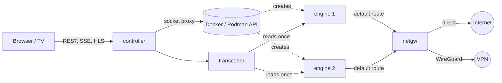

# Ace Swarm

Ace Swarm collects your Acestream streams in one place. You watch them in a browser that works with a TV remote. It keeps them playing and shows how healthy each one is.

- **A grid of live previews.** Select a tile to watch the stream full screen. Hover or focus a tile to see:
  - how fresh the picture is ("Now" while new frames arrive),
  - how many peers are actually sending data,
  - where the top peers are, with flags.
- **Paste anything.** Content IDs, infohashes, `acestream://` links and magnet links all work. You don't have to say which kind it is: Ace Swarm works it out.
- **Built for remotes.** Arrow keys and Back move around the UI, so it works on Android TV and other TV browsers.
- **Self-healing.** Each stream runs in its own engine container. A stalled stream is recovered step by step, without touching the other streams:
  1. restart the stream,
  2. restart its engine,
  3. move it to another network path.
- **Hot standby.** With more than one network path, every playing stream also runs on each other path. When its engine or path fails, it fails over to a standby that already has the stream, within seconds instead of the minute or so a new engine needs to find peers.
- **One engine per path.** One switch lets every stream on the same network path share one engine, which needs much less memory. A shared engine only restarts when the stream you are watching fails or several of its streams fail at once, and its streams keep their picture while it does.
- **WireGuard paths.** Upload a provider's `.conf` profile and streams can move to it when the direct connection struggles. Each stream can use a different path.
- **WireGuard only.** One switch keeps every stream off the direct connection. If no VPN is up, streams wait instead of going direct.
- **History.** Optional Prometheus, Loki and Grafana keep long-term records of stream health, peers, network paths, engine memory and who watched what. A ready-made dashboard and alerts are included.
- Runs on x86_64 and arm64 (including the Raspberry Pi 5), with Docker or Podman, rootful or rootless.

## Quick start

You need Docker with the Compose plugin, or Podman 5 with Docker Compose (see [Podman](#podman)).

```sh
git clone https://github.com/sergimn/AceSwarm.git
cd AceSwarm
cp .env.example .env    # then review it
docker compose --profile build build
docker compose up -d
```

Open `http://<host>:8080`. Choose **Add**, paste an Acestream ID and give the engine 10–30 seconds to find peers.

The build step makes every image locally. Once images are published, `docker compose pull` replaces it.

Ace Swarm has no login. Keep port 8080 on your local network and don't expose it to the internet.

## Configuration

All settings live in `.env`. `.env.example` explains each one. The most important are:

| Setting                     | Default                | What it does                                                                                                     |
| --------------------------- | ---------------------- | ---------------------------------------------------------------------------------------------------------------- |
| `COMPOSE_PROFILES`          | `metrics,logs,grafana` | Optional monitoring. Remove any you don't want; the app works without them.                                      |
| `DOCKER_SOCKET`             | `/var/run/docker.sock` | Docker or Podman API socket that engines are created through.                                                    |
| `ENGINE_MEMORY_CACHE_MB`    | `128`                  | Stream data each engine keeps in memory. An engine uses about this plus 150 MB.                                  |
| `ENGINE_MEMORY_MB`          | `512`                  | Memory limit per engine. The controller refuses one too small for the cache and names the minimum.               |
| `PREVIEW_MODE`              | `video`                | `keyframes` makes previews much cheaper. Use it on a Raspberry Pi.                                               |
| `PATH_STRATEGY`             | `sticky-best`          | `sticky-best` moves a stream only when its path fails. `round-robin` spreads streams over the paths that are up. |
| `ACESWARM_ENGINES_INTERNAL` | `false`                | Set to `true` on Podman.                                                                                         |

### Raspberry Pi 5

- The arm64 engine is the Android build of Acestream. It needs a kernel with 4 KB memory pages. Add `kernel=kernel8.img` to `/boot/firmware/config.txt` and reboot. `getconf PAGESIZE` should then print `4096`.
- The Pi has no hardware H.264 decoder for previews, so set `PREVIEW_MODE=keyframes`.
- Turn on **One engine per path** (under **Streams**) when you run several streams: they then share one engine instead of each starting its own.
- With WireGuard profiles, [hot standby](#hot-standby) gives each stream an engine on every other path too, so streams × paths engines without **One engine per path**. On a Pi, turn that on, or set `STANDBY_MAX_PATHS=1`, or turn hot standby off.
- An engine levels off at about its cache plus 150 MB, about 275 MB with the default settings. The Pi's arm64 engine behaved like the x86 one in testing, so an 8 GB Pi has room for several streams with their own engines. The dashboard shows how much each engine really uses.

### Podman

Podman works through its Docker-compatible API:

```sh
systemctl --user enable --now podman.socket
```

Then set these in `.env`:

```sh
DOCKER_SOCKET=/run/user/<uid>/podman/podman.sock
ACESWARM_ENGINES_INTERNAL=true
```

Rootless Podman and rootless Docker can't load kernel modules. Load `wireguard` on the host (for example in `/etc/modules-load.d/`), or the gateway falls back to the slower `wireguard-go`.

Rootless Podman sends the gateway's ping probes out through unprivileged ICMP sockets, which the host only allows for the groups in `net.ipv4.ping_group_range`. If `sysctl net.ipv4.ping_group_range` prints `1 0` (no group), every path stays down and streams wait with "no network path is up". Allow your group, for example every group:

```sh
echo 'net.ipv4.ping_group_range = 0 2147483647' | sudo tee /etc/sysctl.d/90-ping-group.conf
sudo sysctl --system
```

On Ubuntu 26.04, `docker compose down` may end with `rootless netns: kill network process: permission denied`: the AppArmor profile Ubuntu ships for `pasta` doesn't let Podman stop it. The containers are gone anyway.

## WireGuard

Open **Network** and upload a WireGuard `.conf` file, or paste its contents.

- The gateway brings the tunnel up itself.
- Only the interface and peer keys are used. Hooks such as `PostUp` are rejected, because they would run commands.
- Profiles are stored in a volume that only Ace Swarm can read.

The gateway pings through every path and scores it. With `sticky-best`, a stream stays on its path until recovery needs to move it. It then moves to the best path, starting a new engine before stopping the old one so the picture isn't interrupted.

The gateway fails closed: an engine without an assigned path can't reach the internet at all, so a stream on a VPN never leaks out the direct connection. Engines also can't reach the host, its published ports or the LAN; set `ENGINE_ALLOWED_PRIVATE` (for example `192.168.1.0/24`) to let them reach LAN peers.

### WireGuard only

Turn on **WireGuard only** under **Network** to stop using the direct connection altogether.

- It needs at least one profile. The switch stays greyed out until you add one, and the last profile can't be removed while it is on.
- Streams on the direct path move to a WireGuard path right away. New streams only start on WireGuard.
- If every WireGuard path is down, new streams wait and say so, and streams already on WireGuard keep recovering there. None fall back to the direct connection.
- The gateway enforces it too: it refuses to route any engine through the direct connection.
- Engines on a WireGuard path reach everything through the tunnel, including the networks in `ENGINE_ALLOWED_PRIVATE`, and a VPN provider can't reach your LAN. Keep `ENGINE_DNS` on public resolvers: with a LAN DNS server, engines can't resolve anything and no stream starts.
- Turning it off allows the direct connection again. Streams stay on their current path until they have a reason to move.

## One engine per path

Every stream normally gets an engine of its own. Turn on **One engine per path** under **Streams** and the streams on each network path share one engine instead: one for the direct connection, one for each WireGuard profile in use. Turning it on or off moves every stream to the other kind of engine without interrupting its picture.

- **One stream failing leaves the engine alone.** Restarting a shared engine would interrupt every stream on it, so a failing stream only restarts its own session, and moves to another path if that doesn't help.
- **The engine is replaced when:**
  - the stream someone is watching full screen fails,
  - more than `SHARED_ENGINE_MAX_FAILURES` (2) of its streams fail within `SHARED_ENGINE_FAILURE_WINDOW_SECONDS` (60),
  - every stream on it is failing, or
  - it stopped answering.

  Only streams that had played from the engine count, since a broadcast that is down fails on any engine. Apart from **Restart**, it is replaced at most once per failure window.

- **Replacing is make-before-break.** A new engine starts on the same path, and each stream moves over once the new engine delivers its video. The old engine goes once its last stream left.
- **It needs about the same memory as one stream's engine.** The `ENGINE_MEMORY_CACHE_MB` cap is per engine, not per stream: in testing with a 512 MB cache, an engine playing two streams levelled off at 674 MB, against 662 MB for one. It fills its cache sooner, though. Watch the "Engines" dashboard row. After changing `ENGINE_MEMORY_CACHE_MB` or `ENGINE_MEMORY_MB`, run `docker compose up -d`, then press **Restart** on one stream of each path to replace its engine with one that uses them.
- **Peer counts are shared too.** The engine reports connected peers per stream, but the peers sending data and their countries come from the engine's connections, so every stream on it shows the same ones.

### Who is watching

The player tells Ace Swarm which stream it shows full screen, right away and then every `VIEWER_PING_SECONDS` (60). That is how shared engines know which stream someone is watching. Each page load makes up a random viewer id and keeps it only in memory: there are no cookies and nothing is stored in the browser, so every visit is a new viewer. The "Viewers" dashboard row shows who watches what, with a rough guess of the device (such as "Chrome on TV").

## Hot standby

With more than one network path (add a WireGuard profile), every stream that played keeps a standby on each other path it may use: an engine of its own there, or with **One engine per path** on, a session on that path's shared engine. The transcoder reads each standby and throws the data away, so the engine keeps downloading the stream from its peers as if someone watched it. A standby is _hot_ while data keeps coming.

- **Failing over takes seconds.** When no new video came for `STANDBY_FAILOVER_SECONDS` (8) and a standby is hot, the stream moves to it make-before-break, before it even counts as stalled. A stalled stream also tries a hot standby before the recovery steps above. The path it left gets a standby again: the engine it played from, when it was one of its own.
- **A standby also helps without a failover.** Engines on the host can swap pieces over the engines' network, so a stream whose path loses its peers may go on playing, fed by its standby on another path.
- **Path moves use the standbys too.** When recovery moves a stream to another path, it moves to the standby there, even one that is still warming up.
- **A healthy stream never moves.** Standbys only take over when the stream's own engine or path fails, and they keep their paths when path scores change, since a standby that moves starts again from no peers.
- **Standbys that bring no data start again**, and go after three tries; their path gets a new one later, but not after three rounds of that, until the path goes down or the stream moves. A standby whose path is down stays two minutes in case the path comes back.
- **Only for streams that play.** A stream that hasn't had video for ten minutes (a broadcast that is off) keeps no standbys; they start again once it plays.
- **It costs resources.** Each standby is one more engine (or one more session on a shared engine), downloading the stream all the time. Turn **Hot standby on other paths** off under **Streams**, or set `STANDBY_MAX_PATHS` to keep standbys only on each stream's best few other paths. With **One engine per path** on, standbys only add sessions to the engines that are running anyway, which costs much less memory.

The stream's tile and the Streams list show its standbys and whether they are hot.

## Monitoring

| Profile   | Service                                     | Port |
| --------- | ------------------------------------------- | ---- |
| `metrics` | Prometheus, with recording rules and alerts | 9090 |
| `logs`    | Alloy collecting container logs into Loki   | 3100 |
| `grafana` | Grafana with the Ace Swarm dashboard        | 3000 |

To use an existing Grafana instead:

1. Import [`monitoring/grafana/dashboards/aceswarm.json`](monitoring/grafana/dashboards/aceswarm.json).
2. Choose your Prometheus and Loki data sources in its variables.

## How it works



- **controller:** the web UI and API. It runs one supervisor per stream, which creates the stream's engine, watches its health and recovers it.
- **transcoder:** reads each stream once with ffmpeg. It produces a full-quality HLS stream (copied when it is already H.264), a small preview and thumbnails.
- **netgw:** the network gateway. Every engine routes through it. It owns the WireGuard tunnels, routes each engine through its path, probes the paths, and counts each engine's peers from connection tracking.
- **engine:** the Acestream engine. It starts as root only to point its default route at the gateway, then drops to an unprivileged user with no capabilities.

[docs/architecture.md](docs/architecture.md) has the details.

## Security notes

- **Docker access.** Engines are created through [docker-socket-proxy](https://github.com/Tecnativa/docker-socket-proxy), which only exposes the container and image API. That API can still create containers, so treat the controller as privileged.
  - Rootless Docker or rootless Podman limits what that could reach.
  - A proxy that filters container settings is a possible follow-up.
- **Container privileges.** The controller and transcoder run read-only, as non-root, with no capabilities. The gateway keeps only `NET_ADMIN`, `NET_RAW` and `DAC_READ_SEARCH`.
- **Engines are untrusted.** They can't change their routes, and they can't reach the gateway, controller or transcoder directly.
  - Like any device on your network, an engine can still reach the host's published ports (the UI and, when enabled, the monitoring ports), which have no login.
  - Blocking engine-to-host traffic with a host firewall rule is a possible follow-up.
- **No authentication.** Keep the UI on a trusted network. The same goes for the monitoring ports: Prometheus, Loki and Grafana are published on every interface, and Grafana's admin password comes from `GRAFANA_ADMIN_PASSWORD`.

## Development

You need Node.js 26.13 or later and Docker.

```sh
npm ci
npm run check            # typecheck, lint, format check, unit tests
pipx install pre-commit && pre-commit install
```

- **End-to-end tests use real engines, no mocks.** They run on three GitHub runners: AceSwarm with real Acestream engines, real broadcasts of dummy streams, and a real WireGuard server. They run on every pull request, and on any branch with "Run workflow" in the E2E workflow. They don't run on one machine. See [e2e/README.md](e2e/README.md), which also has diagrams.
- **Unit tests use small fakes** (Docker client, iptables, clock) to test logic without Docker.
- **Dependencies.** Renovate keeps dependencies current and waits until a release is 30 days old. TypeScript stays on 6.0 until typescript-eslint supports newer versions.

## Credits

- Peer locations use the free [DB-IP](https://db-ip.com) IP to Country Lite database ([CC BY 4.0](https://creativecommons.org/licenses/by/4.0/)).
- The engine images build on [martinbjeldbak/acestream-http-proxy](https://github.com/martinbjeldbak/acestream-http-proxy) (x86_64) and [jopsis/acestream](https://hub.docker.com/r/jopsis/acestream) (arm64).
