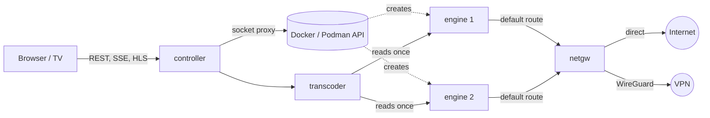

# Ace Swarm

Ace Swarm collects your Acestream streams in one place. You watch them in a browser that works with a TV remote. It keeps them playing and shows how healthy each one is.

- **A grid of live previews.** Select a tile to watch the stream full screen. Point at a tile with the mouse, or move to it with the remote, to see:
  - how fresh the picture is ("Now" while new frames arrive),
  - how many peers are actually sending data (and how many the engine says are connected),
  - where the peers sending data are from, as flags.
- **Paste anything.** Content IDs, infohashes, `acestream://` links and magnet links all work. You don't have to say which kind it is: Ace Swarm works it out.
- **Add a whole list.** Turn on **Add several at once** and paste a list with one stream per line. It can be untidy, like a list copied from a page or an M3U playlist: Ace Swarm takes the ID from each line and ignores the rest. Lines without an ID don't stop the others: they stay in the box for you to correct. The streams of a list start right away, each downloading its broadcast: for a long list, turn off **Start them right away** to add them disabled, and enable the ones you want under **Streams**.
- **Built for remotes.** Arrow keys and Back move around the UI, so it works on Android TV and other TV browsers.
- **Self-healing.** Each stream runs in its own engine container. A stalled stream is recovered step by step, without touching the other streams:
  1. restart the stream,
  2. restart its engine,
  3. move it to another network path.
- **Only new video.** When a broadcast stops, its engine and its peers keep serving the minutes of it they already have. Ace Swarm follows each engine's live edge, the newest data of the broadcast it knows of, and only publishes video while that edge moves. A stream whose broadcast stopped shows "Waiting for source" instead of old video. It replaces that engine with a new one every so often and plays again once the broadcast is back.
- **Hot standby.** With more than one network path, every playing stream also runs on each other path. When its engine or path fails, it fails over to a standby that already has the stream, within seconds instead of the minute or so a new engine needs to find peers.
- **One engine per path.** One switch lets every stream on the same network path share one engine, which needs much less memory. A shared engine is only replaced when the stream you are watching fails, several of its streams fail at once, all of them fail, it stops answering, or you press **Restart**, and its streams keep their picture while it is replaced.
- **WireGuard paths.** Upload a provider's `.conf` profile and streams can move to it when the direct connection struggles. Each stream can use a different path.
- **WireGuard only.** One switch keeps every stream off the direct connection. If no VPN is up, streams wait instead of going direct.
- **Updates without a gap.** Restarting or updating the controller doesn't interrupt the streams: the new one takes over the engines and video that kept running, and players play on from their buffer meanwhile.
- **History.** Optional Prometheus, Loki and Grafana keep long-term records of stream health, peers and uploads, network paths, engine memory and cache, and who watched what. A ready-made dashboard and alerts are included.
- Runs on x86_64 and arm64 (including the Raspberry Pi 5), with Docker or Podman, rootful or rootless.

## Quick start

You need Docker with the Compose plugin, or Podman 5 with Docker Compose (see [Podman](#podman)).

```sh
git clone https://github.com/sergimn/AceSwarm.git
cd AceSwarm
cp .env.example .env    # then review it
docker compose --profile build build
docker compose up -d
```

Open `http://<host>:8080`. Choose **Add**, paste an Acestream ID and give the engine 10–30 seconds to find peers.

The build step makes every image locally. Once images are published, `docker compose pull` replaces it.

Ace Swarm has no login. Keep port 8080 on your local network and don't expose it to the internet.

## Configuration

All settings live in `.env`. `.env.example` explains each one. The most important are:

| Setting                     | Default                | What it does                                                                                                     |
| --------------------------- | ---------------------- | ---------------------------------------------------------------------------------------------------------------- |
| `COMPOSE_PROFILES`          | `metrics,logs,grafana` | Optional monitoring. Remove any you don't want; the app works without them.                                      |
| `DOCKER_SOCKET`             | `/var/run/docker.sock` | Docker or Podman API socket that engines are created through.                                                    |
| `ENGINE_MEMORY_CACHE_MB`    | `128`                  | Stream data each engine keeps in memory. An engine uses about this plus 150 MB.                                  |
| `ENGINE_MEMORY_MB`          | `512`                  | Memory limit per engine. The controller refuses one too small for the cache and names the minimum.               |
| `ENGINE_CACHE_DIR`          | empty                  | x86_64 only. A folder for the engines' cache, on an SSD and never an SD card: [Cache on disk](#cache-on-disk).   |
| `PREVIEW_MODE`              | `video`                | `keyframes` makes previews much cheaper. Use it on a Raspberry Pi.                                               |
| `LOW_CPU_PREVIEWS`          | `false`                | `true` shows thumbnails only in the tiles, on every screen: the cheapest previews, whatever `PREVIEW_MODE` says. |
| `PATH_STRATEGY`             | `sticky-best`          | `sticky-best` moves a stream only when its path fails. `round-robin` spreads streams over the paths that are up. |
| `STALE_SOURCE_SECONDS`      | `60`                   | A broadcast whose live edge doesn't move for this long counts as stopped: its stream waits for it.               |
| `ACESWARM_ENGINES_INTERNAL` | `false`                | Set to `true` on Podman.                                                                                         |

### Raspberry Pi 5

- The arm64 engine is the Android build of Acestream. It needs a kernel with 4 KB memory pages. Add `kernel=kernel8.img` to `/boot/firmware/config.txt` and reboot. `getconf PAGESIZE` should then print `4096`.
- The Pi has no hardware H.264 decoder for previews, so set `PREVIEW_MODE=keyframes`. To save the most, set `LOW_CPU_PREVIEWS=true`: the tiles then only show thumbnails, and **Live video** is greyed out under **Settings**. Both decode only the key frames of an H.264 broadcast (one that is re-encoded is decoded in full). A broadcast whose key frames ffmpeg can't use (no IDR frames and no recovery points, as with some open GOPs and intra refresh) gives them nothing to decode: after about 45 seconds of data without a picture, the transcoder decodes every frame of that stream, which costs more CPU (and with `LOW_CPU_PREVIEWS` still makes no live preview), and logs `key frames only decoding gave no frame`. The dashboard's **Key frames only or every frame** timeline shows which streams decode key frames only and which switched.
- Turn on **One engine per path** (under **Settings**) when you run several streams: they then share one engine instead of each starting its own.
- With WireGuard profiles, [hot standby](#hot-standby) gives each stream an engine on every other path too, so streams × paths engines without **One engine per path**. On a Pi, turn that on, or set `STANDBY_MAX_PATHS=1`, or turn hot standby off.
- An engine levels off at about its cache plus 150 MB, about 275 MB with the default settings. The Pi's arm64 engine behaved like the x86 one in testing, so an 8 GB Pi has room for several streams with their own engines. The dashboard shows how much each engine really uses.
- To use less memory, lower `ENGINE_MEMORY_CACHE_MB`: with 50, the arm64 engine stayed at about 175 MB in testing. [Cache on disk](#cache-on-disk) is not for a Pi: in testing the arm64 engine kept its cache in memory when told to use a folder.

### Cache on disk

By default an engine keeps the last minutes of its stream in memory, and grows to 250 to 275 MB with the default settings. On x86_64, `ENGINE_CACHE_DIR` moves that cache to a folder on disk, which leaves an engine at about 140 MB:

```sh
mkdir -p /mnt/ssd/aceswarm-cache
```

```sh
ENGINE_CACHE_DIR=/mnt/ssd/aceswarm-cache
```

- **x86_64 only.** In testing, the arm64 engine (the Android build, which a Raspberry Pi runs) set its cache to memory when it started and wrote no stream data to the folder. So that the setting never does nothing in silence, Ace Swarm refuses to start with `ENGINE_CACHE_DIR` set on arm64. There, lower `ENGINE_MEMORY_CACHE_MB` to use less memory.
- **Do not use an SD card location.** Every stream is written to the folder for as long as it runs, at the stream's bitrate: an 8 Mbit/s stream writes 1 MB a second, about 86 GB a day. That wears out SD cards and USB sticks. Use an SSD or a hard disk. A folder that lives in memory (tmpfs) saves nothing.
- **Make the folder yourself, for this alone.** Ace Swarm does not make it: a disk that is not mounted then gives an error instead of streams filling the disk underneath. The user Docker or Podman runs as has to be able to write to it, and the folder has to let other users in, because engines run as a user of their own: mode 755, which `mkdir` gives it on most systems (`chmod 755 <folder>`). Its filesystem has to keep Linux owners and permissions (not FAT or exFAT). With SELinux, label it for containers (`chcon -t container_file_t <folder>`).
- **Each engine keeps at most `ENGINE_DISK_CACHE_MB` (256).** It makes a folder of its own, and once that is full it writes over its oldest data. Count the size for every engine: one per stream and one per hot standby, or with **One engine per path** one per network path, which keeps at least 50 MB for each of its streams. The folder of an engine that is gone is removed when the next engine starts.
- **It applies to engines started after the change.** Run `docker compose up -d`, then Disable and Enable a stream (or with **One engine per path**, press **Restart** on one stream of each path).
- With the cache on disk, `ENGINE_MEMORY_CACHE_MB` no longer matters and `ENGINE_MEMORY_MB` may go down to 256.

`.env.example` has the details, and [docs/architecture.md](docs/architecture.md#engine-image) says how it works.

### Podman

Podman works through its Docker-compatible API:

```sh
systemctl --user enable --now podman.socket
```

Then set these in `.env`:

```sh
DOCKER_SOCKET=/run/user/<uid>/podman/podman.sock
ACESWARM_ENGINES_INTERNAL=true
```

Rootless Podman and rootless Docker can't load kernel modules. Load `wireguard` on the host (for example in `/etc/modules-load.d/`), or the gateway falls back to the slower `wireguard-go`.

Rootless Podman sends the gateway's ping probes out through unprivileged ICMP sockets, which the host only allows for the groups in `net.ipv4.ping_group_range`. If `sysctl net.ipv4.ping_group_range` prints `1 0` (no group), every path stays down and streams wait with "no network path is up". Allow your group, for example every group:

```sh
echo 'net.ipv4.ping_group_range = 0 2147483647' | sudo tee /etc/sysctl.d/90-ping-group.conf
sudo sysctl --system
```

On Ubuntu 26.04, `docker compose down` may end with `rootless netns: kill network process: permission denied`: the AppArmor profile Ubuntu ships for `pasta` doesn't let Podman stop it ([Ubuntu bug 2154379](https://bugs.launchpad.net/ubuntu/+source/passt/+bug/2154379)). Compose then quits early: the last container stays behind (stopped), and so do the stack's networks and, with `-v`, its volumes. The next `docker compose up` still starts the stack.

## WireGuard

Open **Network** and upload a WireGuard `.conf` file, or paste its contents.

- The gateway brings the tunnel up itself.
- Only the interface and peer keys are used. Hooks such as `PostUp` are rejected, because they would run commands.
- Profiles are stored in a volume that only Ace Swarm can read.

The gateway pings through every path and scores it. With `sticky-best`, a stream stays on its path until recovery needs to move it. It then moves to the best path, starting a new engine before stopping the old one so the picture isn't interrupted.

The gateway fails closed: an engine without an assigned path can't reach the internet at all, so a stream on a VPN never leaks out the direct connection. Engines also can't reach the host, its published ports or the LAN; set `ENGINE_ALLOWED_PRIVATE` (for example `192.168.1.0/24`) to let them reach LAN peers.

### WireGuard only

Turn on **WireGuard only** under **Network** to stop using the direct connection altogether.

- It needs at least one profile. The switch stays greyed out until you add one, and the last profile can't be removed while it is on.
- Streams on the direct path move to a WireGuard path right away. New streams only start on WireGuard.
- If every WireGuard path is down, new streams wait and say so, and streams already on WireGuard keep recovering there. None fall back to the direct connection.
- The gateway enforces it too: it refuses to route any engine through the direct connection.
- While it is on, the top bar counts only the WireGuard paths, since streams may not use the direct one, and **Network** shows the direct path as Off.
- Engines on a WireGuard path reach everything through the tunnel, including the networks in `ENGINE_ALLOWED_PRIVATE`, and a VPN provider can't reach your LAN. Keep `ENGINE_DNS` on public resolvers: with a LAN DNS server, engines can't resolve anything and no stream starts.
- Turning it off allows the direct connection again. Streams stay on their current path until they have a reason to move.

## One engine per path

Every stream normally gets an engine of its own. Turn on **One engine per path** under **Settings** and the streams on each network path share one engine instead: one for the direct connection, one for each WireGuard profile in use. Turning it on or off moves every stream to the other kind of engine without interrupting its picture.

- **One stream failing leaves the engine alone.** Restarting a shared engine would interrupt every stream on it, so a failing stream only restarts its own session, and moves to another path if that doesn't help.
- **The engine is replaced when:**
  - the stream someone is watching full screen fails,
  - more than `SHARED_ENGINE_MAX_FAILURES` (2) of its streams fail within `SHARED_ENGINE_FAILURE_WINDOW_SECONDS` (60),
  - every stream on it is failing, or
  - it stopped answering.

  Only streams that had played from the engine count, since a broadcast that is down fails on any engine. Apart from **Restart**, it is replaced at most once per failure window.

- **Replacing is make-before-break.** A new engine starts on the same path, and each stream moves over once the new engine delivers its video. The old engine goes once its last stream left.
- **It needs about the same memory as one stream's engine.** The `ENGINE_MEMORY_CACHE_MB` cap is per engine, not per stream: in testing with a 512 MB cache, an engine playing two streams levelled off at 674 MB, against 662 MB for one. It fills its cache sooner, though. Watch the "Engines" dashboard row. After changing `ENGINE_MEMORY_CACHE_MB` or `ENGINE_MEMORY_MB`, run `docker compose up -d`, then press **Restart** on one stream of each path to replace its engine with one that uses them.
- **Peer counts are shared too.** The engine reports connected peers per stream, but the peers sending data and their countries come from the engine's connections, so every stream on it shows the same ones. The tile says so: "8 connected · 40 sending on the shared engine".

### Who is watching

The player tells Ace Swarm which stream it shows full screen, right away and then every `VIEWER_PING_SECONDS` (60). That is how shared engines know which stream someone is watching. Each page load makes up a random viewer id and keeps it only in memory: there are no cookies and nothing is stored in the browser, so every visit is a new viewer. The "Viewers" dashboard row shows who watches what, with a rough guess of the device (such as "Chrome on TV").

## Hot standby

With more than one network path (add a WireGuard profile), every stream that played keeps a standby on each other path it may use: an engine of its own there, or with **One engine per path** on, a session on that path's shared engine. The transcoder reads each standby and throws the data away, so the engine keeps downloading the stream from its peers as if someone watched it. A standby is _hot_ while video keeps coming: the transcoder checks that the data is MPEG-TS, and about once a minute that ffmpeg decodes its video.

- **Failing over takes seconds.** When no new video came for `STANDBY_FAILOVER_SECONDS` (8) and a standby is hot, the stream moves to it make-before-break, before it even counts as stalled. A stalled stream also tries a hot standby before the recovery steps above. The path it left gets a standby again: the engine it played from, when it was one of its own.
- **A standby also helps without a failover.** Engines on the host can swap pieces over the engines' network, so a stream whose path loses its peers may go on playing, fed by its standby on another path.
- **Path moves use the standbys too.** When recovery moves a stream to another path, it moves to the standby there, even one that is still warming up.
- **A healthy stream never moves.** Standbys only take over when the stream's own engine or path fails, and they keep their paths when path scores change, since a standby that moves starts again from no peers.
- **Standbys that bring no video start again**, and go after three tries; their path gets a new one later, but not after three rounds of that, until the path goes down or the stream moves. A standby whose path is down stays two minutes in case the path comes back. The stream's **Standby** figure (the player's overlay, and its tile when it has one standby) says why one is not hot when the controller knows, such as "mullvad-de (warming up: ffmpeg decoded no video from it)", and keeps a path that lost its standbys as "failed" (within `STANDBY_MAX_PATHS`, while standbys are wanted), with "gave up" once it gets no more.
- **Only for streams that play.** A stream that hasn't had video for ten minutes (a broadcast that is off) keeps no standbys; they start again once it plays.
- **It costs resources.** Each standby is one more engine (or one more session on a shared engine), downloading the stream all the time. Turn **Hot standby on other paths** off under **Settings**, or set `STANDBY_MAX_PATHS` to keep standbys only on each stream's best few other paths. With **One engine per path** on, standbys only add sessions to the engines that are running anyway, which costs much less memory.

The stream's tile and the player's overlay show its standbys and whether they are hot. **Network** counts the standbys that pull through each path next to its streams.

## Monitoring

| Profile   | Service                                     | Port |
| --------- | ------------------------------------------- | ---- |
| `metrics` | Prometheus, with recording rules and alerts | 9090 |
| `logs`    | Alloy collecting container logs into Loki   | 3100 |
| `grafana` | Grafana with the Ace Swarm dashboards       | 3000 |

Grafana has two dashboards, each with a link to the other at the top:

- **Ace Swarm** shows every stream on one page: stability, viewers, peers, engines, network paths and logs.
- **Ace Swarm streams** has one row for each stream: whether it delivers, its network paths, its peers, its engines' memory, the recovery steps taken and the engines it lost. A stream you add gets its row by itself, and a deleted one keeps it while the time range covers its life. A stream that was disabled for the whole range has none.

Engine containers get a new name with every new engine, so both dashboards draw engines by what they are for (the one a stream plays from, a standby, a path's shared engine) and their network path. A line goes on when an engine replaces another.

Both dashboards also list every engine that was removed, restarted or that exited: when, why, what it was for and how long it had run. The list comes from the controller's log, so it needs the `logs` profile. The overview counts these by reason and shows how long engines last, which needs only the `metrics` profile.

To use an existing Grafana instead:

1. Import both files in [`monitoring/grafana/dashboards`](monitoring/grafana/dashboards).
2. Choose your Prometheus and Loki data sources in their variables.
3. If your Prometheus collects less often than every 15 seconds, set its interval as the scrape interval in the settings of Grafana's Prometheus data source. The bars of "Recovery steps" count with it, and miss steps when it is shorter than the real one.

## How it works



- **controller:** the web UI and API. It runs one supervisor per stream, which creates the stream's engine, watches its health and recovers it.
- **cleanup:** removes the engines when the whole stack goes down (`docker compose down` or `stop`). A controller restart leaves them running, so the streams play on.
- **transcoder:** reads each stream once and runs it through ffmpeg. It produces a full-quality HLS stream (copied while the video is H.264, re-encoded while it is not), a small preview (none with `LOW_CPU_PREVIEWS`) and thumbnails. When a broadcast moves its video to another PID or codec mid-stream, ffmpeg starts over on the same engine session, right at the change.
- **netgw:** the network gateway. Every engine routes through it. It owns the WireGuard tunnels, routes each engine through its path, probes the paths, and counts each engine's peers from connection tracking.
- **engine:** the Acestream engine. It starts as root only to point its default route at the gateway, then drops to an unprivileged user with no capabilities.

[docs/architecture.md](docs/architecture.md) has the details.

## Security notes

- **Docker access.** Engines are created through [docker-socket-proxy](https://github.com/Tecnativa/docker-socket-proxy), which only exposes the container and image API. That API can still create and remove containers, so treat the controller and the cleanup service, its only clients, as privileged.
  - Rootless Docker or rootless Podman limits what that could reach.
  - A proxy that filters container settings is a possible follow-up.
- **Container privileges.** The controller, the cleanup service and the transcoder run read-only, as non-root, with no capabilities. The gateway keeps only `NET_ADMIN`, `NET_RAW` and `DAC_READ_SEARCH`.
- **Engines are untrusted.** They can't change their routes, and they can't reach the gateway, controller or transcoder directly.
  - Like any device on your network, an engine can still reach the host's published ports (the UI and, when enabled, the monitoring ports), which have no login.
  - Blocking engine-to-host traffic with a host firewall rule is a possible follow-up.
- **No authentication.** Keep the UI on a trusted network. The same goes for the monitoring ports: Prometheus, Loki and Grafana are published on every interface, and Grafana's admin password comes from `GRAFANA_ADMIN_PASSWORD`.

## Development

You need Node.js 26.13 or later and Docker.

```sh
npm ci
npm run check            # typecheck, lint, format check, unit tests
pipx install pre-commit && pre-commit install
```

- **End-to-end tests use real engines, no mocks.** They run on three GitHub runners: AceSwarm with real Acestream engines, real broadcasts of dummy streams, and a real WireGuard server. They run on every pull request, and on any branch with "Run workflow" in the E2E workflow. They don't run on one machine. See [e2e/README.md](e2e/README.md), which also has diagrams.
- **Unit tests use small fakes** (Docker client, iptables, clock) to test logic without Docker.
- **Dependencies.** Renovate keeps dependencies current and waits until a release is 30 days old. TypeScript stays on 6.0 until typescript-eslint supports newer versions.

## Credits

- Peer locations use the free [DB-IP](https://db-ip.com) IP to Country Lite database ([CC BY 4.0](https://creativecommons.org/licenses/by/4.0/)).
- The engine images build on [martinbjeldbak/acestream-http-proxy](https://github.com/martinbjeldbak/acestream-http-proxy) (x86_64) and [jopsis/acestream](https://hub.docker.com/r/jopsis/acestream) (arm64).
