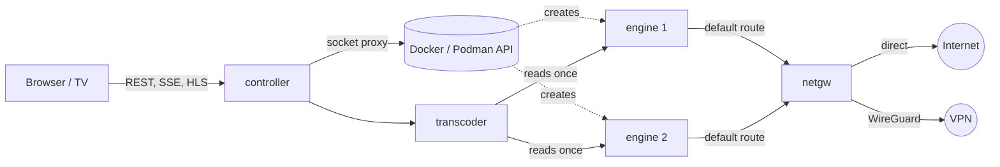

# Ace Swarm

Ace Swarm collects your Acestream streams in one place. You watch them in a browser that works with a TV remote. It keeps them playing and shows how healthy each one is.

- **A grid of live previews.** Select a tile to watch the stream full screen. Hover or focus a tile to see:
  - how fresh the picture is ("Now" while new frames arrive),
  - how many peers are actually sending data,
  - where the top peers are, with flags.
- **Paste anything.** Content IDs, infohashes, `acestream://` links and magnet links all work. You don't have to say which kind it is: Ace Swarm works it out.
- **Built for remotes.** Arrow keys and Back move around the UI, so it works on Android TV and other TV browsers.
- **Self-healing.** Each stream runs in its own engine container. A stalled stream is recovered step by step, without touching the other streams:
  1. restart the stream,
  2. restart its engine,
  3. move it to another network path.
- **WireGuard paths.** Upload a provider's `.conf` profile and streams can move to it when the direct connection struggles. Each stream can use a different path.
- **WireGuard only.** One switch keeps every stream off the direct connection. If no VPN is up, streams wait instead of going direct.
- **History.** Optional Prometheus, Loki and Grafana keep long-term records of stream health, peers, network paths and engine memory. A ready-made dashboard and alerts are included.
- Runs on x86_64 and arm64 (including the Raspberry Pi 5), with Docker or Podman, rootful or rootless.

## Quick start

You need Docker with the Compose plugin, or Podman 5 with Docker Compose (see [Podman](#podman)).

```sh
git clone https://github.com/sergimn/AceSwarm.git
cd AceSwarm
cp .env.example .env    # then review it
docker compose --profile build build
docker compose up -d
```

Open `http://<host>:8080`. Choose **Add**, paste an Acestream ID and give the engine 10–30 seconds to find peers.

The build step makes every image locally. Once images are published, `docker compose pull` replaces it.

Ace Swarm has no login. Keep port 8080 on your local network and don't expose it to the internet.

## Configuration

All settings live in `.env`. `.env.example` explains each one. The most important are:

| Setting                     | Default                | What it does                                                                                                     |
| --------------------------- | ---------------------- | ---------------------------------------------------------------------------------------------------------------- |
| `COMPOSE_PROFILES`          | `metrics,logs,grafana` | Optional monitoring. Remove any you don't want; the app works without them.                                      |
| `DOCKER_SOCKET`             | `/var/run/docker.sock` | Docker or Podman API socket that engines are created through.                                                    |
| `ENGINE_MEMORY_MB`          | `2048`                 | Memory limit per engine. Watch the "Engines" dashboard row and adjust.                                           |
| `PREVIEW_MODE`              | `video`                | `keyframes` makes previews much cheaper. Use it on a Raspberry Pi.                                               |
| `PATH_STRATEGY`             | `sticky-best`          | `sticky-best` moves a stream only when its path fails. `round-robin` spreads streams over the paths that are up. |
| `ACESWARM_ENGINES_INTERNAL` | `false`                | Set to `true` on Podman.                                                                                         |

### Raspberry Pi 5

- The arm64 engine is the Android build of Acestream. It needs a kernel with 4 KB memory pages. Add `kernel=kernel8.img` to `/boot/firmware/config.txt` and reboot. `getconf PAGESIZE` should then print `4096`.
- The Pi has no hardware H.264 decoder for previews, so set `PREVIEW_MODE=keyframes`.
- Lower `ENGINE_MEMORY_MB` (for example to 1024) when you run several streams on an 8 GB Pi. The dashboard shows how much each engine really uses.

### Podman

Podman works through its Docker-compatible API:

```sh
systemctl --user enable --now podman.socket
```

Then set these in `.env`:

```sh
DOCKER_SOCKET=/run/user/<uid>/podman/podman.sock
ACESWARM_ENGINES_INTERNAL=true
```

Rootless Podman and rootless Docker can't load kernel modules. Load `wireguard` on the host (for example in `/etc/modules-load.d/`), or the gateway falls back to the slower `wireguard-go`.

## WireGuard

Open **Network** and upload a WireGuard `.conf` file, or paste its contents.

- The gateway brings the tunnel up itself.
- Only the interface and peer keys are used. Hooks such as `PostUp` are rejected, because they would run commands.
- Profiles are stored in a volume that only Ace Swarm can read.

The gateway pings through every path and scores it. With `sticky-best`, a stream stays on its path until recovery needs to move it. It then moves to the best path, starting a new engine before stopping the old one so the picture isn't interrupted.

The gateway fails closed: an engine without an assigned path can't reach the internet at all, so a stream on a VPN never leaks out the direct connection. Engines also can't reach the host, its published ports or the LAN; set `ENGINE_ALLOWED_PRIVATE` (for example `192.168.1.0/24`) to let them reach LAN peers.

### WireGuard only

Turn on **WireGuard only** under **Network** to stop using the direct connection altogether.

- It needs at least one profile. The switch stays greyed out until you add one, and the last profile can't be removed while it is on.
- Streams on the direct path move to a WireGuard path right away. New streams only start on WireGuard.
- If every WireGuard path is down, new streams wait and say so, and streams already on WireGuard keep recovering there. None fall back to the direct connection.
- The gateway enforces it too: it refuses to route any engine through the direct connection.
- Engines on a WireGuard path reach everything through the tunnel, including the networks in `ENGINE_ALLOWED_PRIVATE`, and a VPN provider can't reach your LAN. Keep `ENGINE_DNS` on public resolvers: with a LAN DNS server, engines can't resolve anything and no stream starts.
- Turning it off allows the direct connection again. Streams stay on their current path until they have a reason to move.

## Monitoring

| Profile   | Service                                     | Port |
| --------- | ------------------------------------------- | ---- |
| `metrics` | Prometheus, with recording rules and alerts | 9090 |
| `logs`    | Alloy collecting container logs into Loki   | 3100 |
| `grafana` | Grafana with the Ace Swarm dashboard        | 3000 |

To use an existing Grafana instead:

1. Import [`monitoring/grafana/dashboards/aceswarm.json`](monitoring/grafana/dashboards/aceswarm.json).
2. Choose your Prometheus and Loki data sources in its variables.

## How it works



- **controller:** the web UI and API. It runs one supervisor per stream, which creates the stream's engine, watches its health and recovers it.
- **transcoder:** reads each stream once with ffmpeg. It produces a full-quality HLS stream (copied when it is already H.264), a small preview and thumbnails.
- **netgw:** the network gateway. Every engine routes through it. It owns the WireGuard tunnels, routes each engine through its path, probes the paths, and counts each engine's peers from connection tracking.
- **engine:** the Acestream engine. It starts as root only to point its default route at the gateway, then drops to an unprivileged user with no capabilities.

[docs/architecture.md](docs/architecture.md) has the details.

## Security notes

- **Docker access.** Engines are created through [docker-socket-proxy](https://github.com/Tecnativa/docker-socket-proxy), which only exposes the container and image API. That API can still create containers, so treat the controller as privileged.
  - Rootless Docker or rootless Podman limits what that could reach.
  - A proxy that filters container settings is a possible follow-up.
- **Container privileges.** The controller and transcoder run read-only, as non-root, with no capabilities. The gateway keeps only `NET_ADMIN`, `NET_RAW` and `DAC_READ_SEARCH`.
- **Engines are untrusted.** They can't change their routes, and they can't reach the gateway, controller or transcoder directly.
  - Like any device on your network, an engine can still reach the host's published ports (the UI and, when enabled, the monitoring ports), which have no login.
  - Blocking engine-to-host traffic with a host firewall rule is a possible follow-up.
- **No authentication.** Keep the UI on a trusted network. The same goes for the monitoring ports: Prometheus, Loki and Grafana are published on every interface, and Grafana's admin password comes from `GRAFANA_ADMIN_PASSWORD`.

## Development

You need Node.js 26.13 or later and Docker.

```sh
npm ci
npm run check            # typecheck, lint, format check, unit tests
e2e/run.sh               # end-to-end tests: builds the images and starts a mock stack
pipx install pre-commit && pre-commit install
```

- **E2E tests don't need Acestream or internet peers.** The stack runs a mock engine instead, which:
  - streams a generated test video,
  - accepts content IDs or infohashes the way the real engine does,
  - can stall on purpose,
  - talks to fake peers on a fake internet and through a throwaway WireGuard server.
- **Real engines in CI.** A second suite runs on three GitHub runners: AceSwarm with real Acestream engines, a real broadcast of a dummy stream, and a WireGuard server. See [e2e/README.md](e2e/README.md), which also has diagrams of both suites.
- **Mock behaviours by ID.** Mock stream IDs choose their behaviour by prefix (`0bad` stalls, `beef` only works through the VPN, `ec0d` is MPEG-2, `dead` never loads). The last hex digit decides whether the mock treats the ID as a content ID (`0`–`7`) or an infohash (`8`–`f`).
- **Dependencies.** Renovate keeps dependencies current and waits until a release is 30 days old. TypeScript stays on 6.0 until typescript-eslint supports newer versions.

## Credits

- Peer locations use the free [DB-IP](https://db-ip.com) IP to Country Lite database ([CC BY 4.0](https://creativecommons.org/licenses/by/4.0/)).
- The engine images build on [martinbjeldbak/acestream-http-proxy](https://github.com/martinbjeldbak/acestream-http-proxy) (x86_64) and [jopsis/acestream](https://hub.docker.com/r/jopsis/acestream) (arm64).
