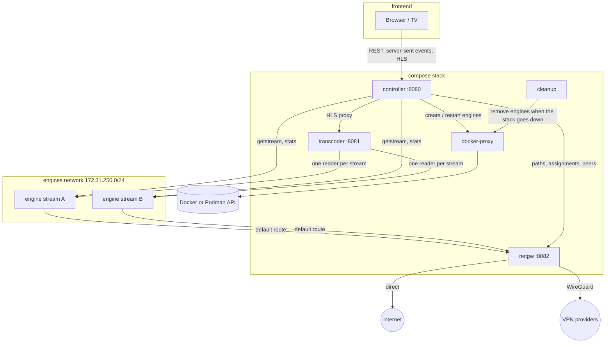
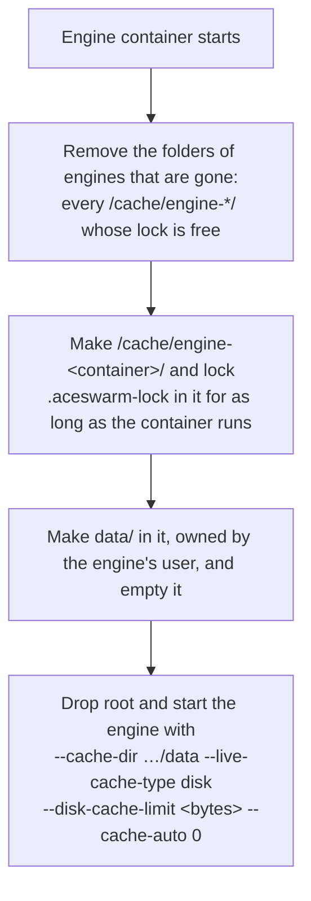

# Architecture

Ace Swarm is a small set of Node.js services written in TypeScript and run by Node's built-in type stripping, so there is no build step. The UI is the only part that is bundled (with Vite). Engines are created on demand: one container per stream, or, with [shared engines](#shared-engines), one per network path that every stream on it uses. With more than one path, each stream also keeps a [hot standby](#hot-standby) on the other paths.

## Services

| Service      | Privileges                                          | Role                                                                                                                                       |
| ------------ | --------------------------------------------------- | ------------------------------------------------------------------------------------------------------------------------------------------ |
| controller   | non-root, read-only, no capabilities                | UI, REST API, one supervisor per stream, persistence in `/data`                                                                            |
| transcoder   | non-root, read-only, no capabilities                | one ffmpeg per stream: full HLS, preview HLS (none with `LOW_CPU_PREVIEWS`) and thumbnails; it also reads each [hot standby](#hot-standby) |
| netgw        | root with `NET_ADMIN`, `NET_RAW`, `DAC_READ_SEARCH` | WireGuard, policy routing, firewall, path probes, peer stats                                                                               |
| cleanup      | non-root, read-only, no capabilities                | removes the engines when the stack goes down                                                                                               |
| docker-proxy | socket proxy, no other access                       | lets the controller and the cleanup service reach only the container and image API                                                         |
| engine       | starts as root, then uid 1000 with no capabilities  | the Acestream engine                                                                                                                       |

## Streams

The controller stores the stream list in `/data/streams.json`, written atomically: a new file is flushed to the disk and then takes the old one's place, so a crash or a power cut leaves one or the other. Additions and removals survive restarts. Each enabled stream gets a supervisor, which goes through these steps:

1. **Start or adopt the engine.** It adopts an engine left from a previous run, or creates `<stack>-engine-<stream>-<generation>`. `streams.json` remembers which of its engines the stream played from, so after a restart the controller adopts that one, not an engine a failed move kept (see [kept engines](#kept-engines)). Without that record, it adopts the newest.
2. **Pick a network path** and tell the gateway.
3. **Take over the playback** a previous run left, if there is one (see [controller restarts](#controller-restarts)). Otherwise it goes on with the next two steps.
4. **Open a session.** It calls `/ace/getstream`. A pasted value is a content ID or an infohash, and both are 40 hex characters. If the input doesn't say which (a magnet link does), the controller tries one kind, then the other, and saves the kind that worked.
5. **Start the transcoder** on the session's playback URL. It reads the URL itself, following its redirect, and passes the stream on to ffmpeg (see [layout changes](#layout-changes)).
6. **Check health every tick.** A stream is healthy only while new video frames arrive, and only frames from a source whose live edge moves count (see [stale sources](#stale-sources)). A broadcast that changes its layout mid-stream gets the same time again to show video from the new one (see [layout changes](#layout-changes)).

Streams are added one at a time (`POST /api/streams`, `{ "aceId": "…", "name": "…" }`) or as a pasted list with one stream per line (`POST /api/streams/bulk`, `{ "text": "…", "enabled": true }`; **Add several at once** in the UI). Every line is searched for an identifier: a bare one, an `acestream://` or magnet link, or an engine URL, with whatever else is on the line, which is ignored. Blank lines are skipped, and so is every line that starts with `#` in an M3U playlist (a text with an `#EXTM3U` or `#EXTINF:` line): its directives, its comments and the streams that were commented out. The answer has a result for every entry: `added`, `duplicate` (the stream was in the list already, or an earlier line has it) or `invalid` (the line has no identifier). A line that is no stream doesn't keep the others from being added. The new streams are written to `streams.json` together, and start right away unless `enabled` is `false`.

The controller keeps the time of each stream's last video: the newest frame any of its ffmpeg runs published. A new run starts without one, so this is what the UI's "Freshness" shows while a stream recovers or starts over. `streams.json` keeps it too, saved with the first video, then at most once a minute, and when the stream or the controller stops. The metric `aceswarm_stream_last_frame_age_seconds` is the age of that time while the stream is enabled and has had video since it was started. The time a stream spent disabled, or the stack spent down, is no outage, so the metric has no value from the start until the first new frame. The UI measures that age on the controller's clock: every snapshot carries the controller's time (`generatedAt`), and the page adds the time since it arrived, measured with a monotonic timer. A browser or TV whose own clock is minutes or hours off (a time zone, or a time never set) still shows true ages, and the ages go on growing every second between snapshots.

The figures a stream shows (its last video, its peers, its speed and its standbys' state) come from the checks, and a supervisor runs one step at a time. A step can take minutes: an engine starting, a session opening, a handover waiting for video from the new engine. The stream plays on from its old engine meanwhile, so while a step has run for one tick, a timer polls what the stream plays from (its pipeline, the engine's stats and peers) and the standbys' data again, every tick, until the step is done. The poll changes no decision (it only brings the figures up to date, and saves the stream's last video time now and then) and is dropped if the step moved the stream meanwhile. A stream that has no session, because a restart step stopped it, has nothing to poll: only its standbys' data is refreshed, its peers and speed show as unknown instead of the last values the old session had, and its pipeline keeps what the last poll saw. The same goes for a stream whose move just finished: its peers and speed are unknown until the next check polls the new engine. Each check of a stream without a session still drops its standbys when hot standby is off or the stream has not played lately, and learns which of them are hot.

A disabled stream has no supervisor, so no engine and no network path. The UI shows it as "Disabled", with the time of its last video, and offers to enable it instead of restarting it. The top bar counts them ("1 disabled"). It is no outage in the metrics either: `aceswarm_stream_up` has no value for it (it is 1 while a stream plays and 0 while an enabled one does not), so the alert, the availability and its recording rule leave the time it was off out, and the dashboard's "Delivering new frames" timeline shows it as grey "Disabled". `aceswarm_stream_last_frame_age_seconds` has none either.

Disabling (or removing) a stream stops its supervisor in the background: once the step in progress is done (starting an engine takes up to 90 seconds, a handover 120), it removes the stream's pipeline, session and every engine labelled with the stream. A stream enabled again before that ended is "Starting", with the message "waiting for the previous run to stop", and its new supervisor starts when the old one is gone, because it would otherwise take over the engine, session and pipeline that the teardown is about to remove. Engines of disabled streams that a teardown left (it failed, or the controller stopped in the middle of it) are removed when the controller starts, like the ones of deleted streams.

### Controller restarts

Engines, the transcoder and its ffmpeg runs keep going while the controller restarts (after an update, say), so streams don't stop:

- **The playback is taken over.** `streams.json` also keeps the engine session the transcoder reads. A restarted controller takes over the stream's engine, then that session, as long as the engine still knows it and the transcoder's ffmpeg still reads it. Nothing restarts, so there is no new ffmpeg run and no discontinuity. Otherwise (the engine or the transcoder restarted too) the stream starts as usual, and the saved session is stopped, so no engine pulls it for nobody. A stream whose previous run stopped in the middle of a move or a failover also starts as usual: the transcoder may still cut over to the other engine, which the new run doesn't know. While the transcoder can't be reached, the stream neither starts nor stops anything, and tries again.
- **After a move or a failover,** the saved session is the one on the engine the stream moved to, so that is what a restarted controller takes over. [Hot standbys](#hot-standby) aren't taken over: their engines are removed, and new ones start once the stream plays, which it does at once.
- **Shutting down is quick.** On SIGTERM, the controller waits at most 2 seconds for steps in progress (opening a session or a handover can take minutes) and for streams being disabled or removed to finish their teardown and ends the UI's event streams, which closing the server would otherwise wait for. Every service exits after 5 seconds whatever happens, before Docker or Podman kill it at 10. The cleanup service (below) has 25 seconds, of the 30 that compose gives it.
- **Stopping the stack removes the engines.** The controller leaves its engines running when it stops, and it can't tell a restart from `docker compose down`, so the `cleanup` service removes them. The controller depends on it, so `docker compose down` and `docker compose stop` stop the controller, wait until it exited, and then stop the cleanup service. On SIGTERM, the cleanup service removes every engine of the stack (streams' own engines, shared engines and hot standbys, by their labels) and then exits, unless a controller of the stack still runs: its container carries the `aceswarm.controller` label. When `docker compose up -d` recreates the cleanup service after an update, compose does that before it recreates the controller, so a controller still runs and the engines stay for the new one. `docker compose restart` of the whole stack stops every service at once, so the engines may stay or go; the streams start again either way, since the transcoder restarted too. Engines are still left behind when the cleanup service gets no chance to run: after `docker compose kill`, or `down` or `stop` with `-t 0`, when the cleanup service was already stopped on its own, or when the stack stops before the service has started. The controller takes them over, or removes them, the next time it starts. `docker rm -f $(docker ps -aq --filter label=aceswarm.stack=aceswarm)` removes them by hand (for the default `ACESWARM_STACK_NAME`).
- **The proxy comes back first.** The controller serves the HLS proxy as soon as it listens; the API waits until the stream list is loaded.
- **Players ride out the gap.** The controller is unreachable for a moment, and refused connections have no HTTP status, which hls.js doesn't retry by default. The UI's players retry them for about 10 seconds and play on from their buffer meanwhile.
- **The page says when it hears nothing.** The controller sends a snapshot every 2 seconds. When none has arrived for 6 seconds, the page dims the contents of its tiles and its summary (not the tile, so a focused tile keeps its ring), stops saying "Now" (a stream that was playing counts its seconds), and says "Reconnecting… last update 12s ago" in the top bar. The player and the dialogs cover the top bar, so the player shows the same line above its stats and brings its overlay up and keeps it up (it normally fades after 4 seconds, which would leave a frozen picture with no cue), and each dialog's header says "Not updating". The browser reconnects an event stream by itself after a dropped connection, but not after an HTTP error answer (a reverse proxy's 502 or 503 while the controller restarts): the stream is then closed for good. So the page opens a new one 3 seconds after the browser gave up, and replaces one that delivers nothing for 10 seconds although it reported no error (a lost Wi-Fi can look like an open connection for minutes).

### Recovery ladder

When a stream stalls and has a [hot standby](#hot-standby) ready, it fails over to it first. Otherwise recovery climbs a ladder, and the delay between steps grows exponentially:

| Failures | Action                                 |
| -------- | -------------------------------------- |
| 0–1      | restart the session and pipeline       |
| 2        | restart the engine container           |
| 3, 5, …  | move to the best other path that is up |
| 4, 6, …  | restart the engine                     |

A path that is down, or whose WireGuard profile was removed, is left right away. Each stream's recovery is independent, so restarting one engine never touches the others. The E2E suite checks this. On a [shared engine](#shared-engines), the engine restart steps only restart the stream's session.

Every step counts as an attempt. A recovery counts as one that worked once the stream plays again, under the step that brought the video back (see [Monitoring](#monitoring)).

**Restart stream** in the UI acts on the next check, whatever the stream is doing. A stream that has a session restarts its engine, and the ladder's delays start over. On a [shared engine](#shared-engines), its session restarts now and the path's engine is replaced in the background, for every stream on it. A stream that has no session yet, because it is still starting or its last start failed, starts at once instead of waiting out the delay after that failure, and the delays start over from there. That start takes over or starts the engine but doesn't restart it, and it doesn't ask for a shared engine's replacement the way Restart on a stream with a session does. Like any start, it still replaces a shared engine it finds gone or not answering. While no network path is up, or a shared engine waits for the gateway, there is nothing to start: the request only resets the delays, and the stream starts as soon as a path or the gateway is there. A restart asked for while such a start is in progress is dropped once the start works, so it never restarts what it just started. If the start fails, the request is kept and the next check acts on it again: it starts the stream again at once, or restarts it as above if the failed start got as far as a session.

### Stale sources

A broadcast that stops doesn't look like a stall to the engine. The engine keeps its peers, keeps answering, and keeps serving the window it already has, and so do peers that have the same window. A new session gets that old window too: it plays for a few seconds, then stops. Restarting on every stall therefore loops forever and shows old video each time. Only the engine's **live edge** tells: `livepos.last` in the session's stats, the newest data of the broadcast the engine knows of.

- **The transcoder follows each source's live edge.** The controller sends the session's stat URL with its playback URL (and with each standby's). The transcoder polls it every second. Times are its own: `livepos` is stamped by the broadcaster's clock, which can be off by minutes, so its values are only compared with each other.
- **A new source is published once its edge moves.** Its segments wait until the session downloaded and its own live edge kept moving past the newest edge the stream's previous session saw, at about the broadcast's pace: two rises at least 1.5 s apart by our clock, by no more than that time plus 3 s. Only segments written after that are published. Moving once is not enough: for a broadcast that stopped, a peer can know of a slightly later end of the old window. Moving fast is not enough either: an engine catching up on an old window sees its edge rise faster than time passes, then stop. Its frames don't count as video (`lastFrameAt`) before that, so the stream still starts, and a handover doesn't take over. For every source, with a live position or not, frames only count once a segment of it is in the playlist, so "playing" always means players can get video. A source without a live position (stats that show none, or don't answer, for 10 polls) is published as before.
- **A source whose edge stops is stale.** Once the edge didn't move for `STALE_SOURCE_SECONDS` (60), or the engine serves the stream that far behind it, the transcoder stops its ffmpeg and publishes nothing more from it. Stats that stop answering for that long count the same way. A new session of the same stream starts from what the previous one saw: one that only has the same old window is stale at once. Published segments older than the threshold leave the playlist, and the thumbnail goes too, so a player that opens the stream never starts on old video. A standby only counts as hot while its own live edge moves.
- **The stream waits for its source.** The controller shows `stale-source` ("Waiting for source" in the UI, which hides the last picture), and how long the broadcast sent nothing new, counted from the last time a live session's edge moved (`quietSince`), which a retry on a slightly newer window doesn't start over. The ladder goes on with longer waits: `STALE_SOURCE_RETRY_SECONDS` (30), doubling up to `RECOVERY_MAX_DELAY_SECONDS` (300). Every step replaces the engine, so the one whose edge stopped can't keep serving its old window, and every second step does that on another path when there is one. On a [shared engine](#shared-engines), other streams play from it, so only the stream's session starts again. It never gives up. Restart stream in the UI acts at once and starts the waits over, here and on the usual ladder. The stale session's live edge is still followed: when it moves before the next step, the next step comes at once. While it waits, the stream's standbys go, the shared engine isn't blamed, and the path's health record is left alone.
- **An engine that only lags is replaced at once.** A session can also be stale while its broadcast goes on: the engine serves the stream more than the threshold behind an edge that moves, because the session started too far back. The transcoder tells the two apart (`staleBecause` in the live edge: `quiet` or `behind`). It says `behind` only while a session of the stream saw new data within the threshold, so a new engine that starts far back on the old window of a broadcast that stopped still counts as quiet. For `behind` the stream does not wait for its source: it shows as stalled and recovering, and a wait that was on ends. The ladder goes on from where it was when the wait began, since the wait's tries were for a broadcast that sent nothing: for a stream that played until then, the engine is replaced at once rather than when the wait's next try was due. If the next engines lag too, the ladder's usual waits apply (`RECOVERY_BASE_DELAY_SECONDS`, doubling up to `RECOVERY_MAX_DELAY_SECONDS`), so engines are not replaced back to back. The transcoder only says `behind` once an engine saw the broadcast move, and an engine that is replaced as soon as it shows how far behind it serves never does. So when no engine saw new data for the threshold (after a row of such engines, or at every engine when engines need longer than the threshold to show a live position), it says `quiet` until the next engine sees some, a few seconds after it shows up. The stream shows "Waiting for source" until then, with the wait's tries, and then the ladder goes on from where it was: it doesn't start over. A restart by hand does start it over, also for a wait that goes on. As while it waits for its source, every step replaces the engine, and every second one does it on another path when there is one. The lag is not held against the path.
- **Metrics.** `aceswarm_stream_source_quiet_seconds` (how long the broadcast sent nothing new, from `quietSince`: "Broadcast quiet for") and `aceswarm_stream_live_edge_age_seconds` (`livepos.last` against our clock) are on the dashboard's "Stream stability" row. Its "Delivering new frames" timeline shows a stopped broadcast as one outage: red ("Not delivering"), then dark red ("Waiting for source") while the stream is `stale-source`. Old video never counts as delivering, so there are no green gaps in it. `aceswarm_stream_live_edge_unchanged_seconds` has no panel: it is the current session's (since its edge last moved or was first seen), so it starts over when a retry opens a session on another window, and only says why that session is or isn't stale yet.

### Path selection

- `sticky-best` combines the gateway's probe score with the stream's own history on each path.
  - A stream only moves when recovery asks for it: its path is down, or restarting the pipeline and the engine didn't bring video back.
  - It then moves to the best other path that is up, even one whose probes score lower. A path can answer pings and still fail a stream, for example when the connection blocks the stream's peers.
  - After moving, it stays for at least `PATH_MIN_DWELL_SECONDS`, unless its path goes down.
- `round-robin` spreads new streams over the paths that are up.
- A new stream whose paths are all down waits with a message instead of starting its engine. Its startup grace counts from when it gets a path.

Moves are make-before-break, so the picture doesn't go blank:

1. A second engine starts on the new path.
2. The transcoder swaps sources only once the new engine delivers video. It waits up to `HANDOVER_TIMEOUT_SECONDS` (120) for that. The input timeout for the new engine (how long the transcoder waits for its data) is at least that long, rather than the usual `INPUT_TIMEOUT_SECONDS` (60), because on a slow swarm a new engine can take over a minute to deliver. The timeout applies to every read for the whole ffmpeg run, but that doesn't delay stall detection, which watches for new frames (`STALL_SECONDS`).
3. The old engine is removed.

#### Kept engines

A new engine that doesn't deliver in time may still be about to: it may have found some peers, and a new one would start from none. So when a move to a new engine of the stream's own fails once the engine answers, the stream keeps that engine and tries again on it:

- **It stays ready.** It keeps its gateway path, and the session the move opened stays open, so it keeps its peers. The next try reuses that session while the engine still knows it, and opens a new one otherwise.
- **The next move to the same path uses it**: a recovery path switch, a move off the direct path once WireGuard only is on, or a move to an engine of its own once sharing is off. Each try comes when that move would come anyway, on a later check. A failed WireGuard-only move waits before the next; recovery and sharing moves count their waits from when the move started, so after a two-minute handover the next try is often on the next check.
- **Late video still counts.** When there was no picture to keep (the old ffmpeg had already exited, for example a minute after the old engine stopped delivering), the new engine became the transcoder's only source, and the transcoder goes on reading it after the move gave up. Once video arrives from it, the move finishes as if it had been in time. A retry on that engine then waits for that same reader rather than opening a second one, and starts a reader of its own if that one gives up. Recovery's next step after a failed path switch restarts the engine, which replaces that reader, so there late video only counts until then.
- **It goes** after its third failed try (a failed move, or a Docker error while taking it over), when it stops answering, when the stream moves to another path or to a shared engine instead, when the stream plays again without it (unless it plays from a shared engine while sharing is off, so it still wants an engine of its own), or when no move tried it again for twice `RECOVERY_MAX_DELAY_SECONDS`. The next try then starts a new engine.
- **At most `MAX_KEPT_ENGINES` (2) at once.** Each kept engine is an engine more, and it keeps downloading, so only that many streams keep one at a time. A failed move with none free removes its engine, as before. 0 turns kept engines off.
- Moves to a [shared engine](#shared-engines) don't need this: a path's engine already stays two minutes after its last stream left.

### WireGuard only

The network policy can turn the direct path off, so streams only use WireGuard. It is a switch in the UI and `PATCH /api/network` (`{ "wireguardOnly": true }`).

- **It needs a profile.** The controller refuses to turn it on without one, and refuses to remove the last profile while it is on. The UI greys the switch out until a profile exists, but keeps it focusable so a remote can reach it and read why.
- **One policy, enforced twice.** The controller writes the policy to `policy.json` in the WireGuard profile directory. The gateway reads it from there at start, on every reload and once a minute, so it knows the policy before the controller sends any engine paths.
  - The controller leaves the direct path out of every path choice.
  - The gateway refuses direct assignments (409), cuts off engines that were on the direct path, and stops translating engine traffic for the direct interface. Engine traffic never leaves through it. The gateway's own traffic still does: the tunnels' encrypted packets, its probes of the direct path, its own DNS lookups and the GeoIP download.
  - A policy file that can't be read or understood keeps the direct path off.
- **Turning it on moves streams right away.** The gateway has already cut the engine off, so a stream on the direct path moves to the best WireGuard path on its next check, make-before-break, without waiting to stall. This isn't counted as a recovery. A failed move waits before trying again, with the recovery ladder's delays. At most two streams move at once, so their new engines don't all start together; the others wait their turn.
- **No WireGuard path up means waiting.** A stream that has no engine yet waits with a message, and its engine only starts once a WireGuard path is up. A stream whose WireGuard path goes down recovers as usual: in place, or on another WireGuard path that is up. Neither ever falls back to the direct path.
- **Private networks go through the tunnel too.** A WireGuard path's routing table sends all engine traffic into the tunnel, including to the networks in `ENGINE_ALLOWED_PRIVATE`, and the private-address drop applies on every path. A VPN provider can't usually reach the LAN, so with WireGuard only on, LAN peers are out of reach, and a LAN resolver in `ENGINE_DNS` means engines can't resolve anything and no stream starts. `ENGINE_DNS` should stay on public resolvers.
- **Turning it off changes nothing right away.** Paths stay sticky: streams stay on their WireGuard path until recovery has a reason to move them.

### Shared engines

With **One engine per path** on (`PATCH /api/settings`, `{ "sharedEngines": true }`, stored in `/data/settings.json`), every stream on a network path plays from that path's engine, `<stack>-engine-shared-<path>-<generation>`. An engine plays several streams at once, one session each, so this saves an engine's memory for every stream but one.

- **Taking and leaving.** A stream takes its path's engine when it starts or moves there, and leaves it when it moves away or is removed. The first stream on a path starts the engine (or takes over the one a previous run left). Once the last one left, the engine stays for two minutes before it is removed: a stream whose move to it failed tries again on a warm engine, rather than on a new one that may take minutes to find peers. The two minutes count from when the last stream that played from it left, so an engine that never delivered video goes even while moves to it keep failing, and the next try gets a new one. A stream that takes an engine nobody uses first checks that it still answers (it may have stopped or hung unnoticed), and gets a new one if it doesn't. While sharing is off, nothing comes back to an unused engine, so it goes at once. The gateway routes the engine's address through its path, like any engine's.
- **Turning it on or off** moves every stream to the other kind of engine on its own path, make-before-break: a stream that plays keeps its picture until the new engine delivers video. Turning it off starts an engine per stream, so at most two streams move at once.
- **Recovery.** The ladder is the same, except that its engine restart steps only restart the stream's session: restarting the engine would interrupt every other stream on it. Path moves take the stream to the other path's shared engine.
- **Replacing the engine.** Every recovery step reports a failure to the shared engines, except on a path that is down: the stream leaves the path instead. A failure counts against the engine only if the stream had played from it: a broadcast that is down fails on any engine. They replace the engine when:
  - the failing stream is being watched (see [Viewers](#viewers)),
  - more than `SHARED_ENGINE_MAX_FAILURES` (2) different streams on it failed within `SHARED_ENGINE_FAILURE_WINDOW_SECONDS` (60),
  - a stream reached the ladder's engine restart step and every other stream on it failed within that window too (whether or not they had played from it), which also covers a stream alone on its engine,
  - a stream starting again on it finds it gone or not answering (`unresponsive`), or
  - someone pressed **Restart** on one of its streams that has a session.

  Apart from **Restart**, a path's engine is replaced at most once per failure window. When the new engine doesn't help either, the streams' own recovery goes on.

- **Make-before-break.**
  1. A new engine starts on the same path. The old one keeps playing meanwhile.
  2. Once it answers, new sessions go to it, and each stream on the old engine moves on its next check: one that plays keeps its picture until the new engine delivers video, one that is failing just starts there.
  3. The old engine is removed once its last stream left, or after twice `HANDOVER_TIMEOUT_SECONDS` plus a minute (enough for a second handover attempt).

  The gateway routes the new engine from the moment it has an address, like any engine's. A stream that starts on the path while the new engine starts, and the old one is already gone, waits for the new one. A replacement that doesn't start leaves the old engine in place.

- **Leftovers.** The controller removes a path's engine that nobody used for two minutes (see above) once no stream is still moving to it. Once every stream tried to start an engine (a stream waiting for the gateway, or for a WireGuard path it may use, hasn't yet), it also removes the shared engines a previous run left that no stream took over.
- **Peers.** The engine reports connected peers per session. Connection tracking only sees the engine, so the "sending" peers and their countries are the engine's, the same for each of its streams. The UI marks them as the shared engine's ("8 connected · 40 sending on the shared engine"). A stream's connected count is the engine's own and nothing else: while the engine's stats request fails, the tile shows no connected figure rather than the gateway's count of connections, which is another measure.

### Hot standby

With **Hot standby on other paths** on (the default; `PATCH /api/settings`, `{ "hotStandby": true }`, stored in `/data/settings.json`), every stream that played since the controller started keeps a standby on each other path it may use: on the best `STANDBY_MAX_PATHS` of them, or on all of them with 0 (the default). A standby is an engine of the stream's own on that path (`<stack>-engine-<stream>-<generation>`, routed through the path like the stream's own engine), or with [shared engines](#shared-engines) on, a session on that path's shared engine, which the shared engines count apart from the streams that play from it.

- **The transcoder keeps it hot.** An engine only keeps downloading a stream that someone reads, so the transcoder reads each standby session and throws the data away (`PUT /standbys/<stream>` with `{ "sources": [...] }`, sent on every check; readers it no longer lists stop). The engine allows one reader per session, so a standby's reader stops when the stream's pipeline takes its source: the pipeline's own reader connects half a second after the standby reader's connection closed, and a new ffmpeg run opens the source again (up to five times, a second apart) when the run fails before any video, since the engine may still refuse a new reader for a moment. While the transcoder reads a standby's session itself (after a failover that gave up, it may still take it), the standby isn't started again for bringing no data. A standby is _hot_ while its last data is at most 10 seconds old.
- **Only video counts as data.** An engine can send bytes that aren't video, such as zeros, and a standby that only has those can't take over. So the reader only counts MPEG-TS packets that carry stream data: it locks on once five sync bytes line up 188 bytes apart, and leaves out padding, the tables on PIDs below 0x20 (PAT, SDT, EIT and the like), packets without a payload and packets flagged with a transport error. It doesn't look for which PID holds the video, so audio alone, or the PMT, still counts there. It only reads 188-byte packets (what engines serve), not the 192- or 204-byte kind. That costs a few byte reads per packet. MPEG-TS is the container, so the check doesn't depend on the codec. On top of that, ffmpeg checks that the video decodes, fed by the reader, since the engine allows one reader per session: when data starts to come, then about every minute, when a check is free. A check passes once ffmpeg decoded five video frames within 20 seconds. One that fails comes again after 10 seconds, and the wait doubles up to 5 minutes while they keep failing. A check whose data stopped coming, or that ffmpeg couldn't run, says nothing: the next one comes 10 seconds later, doubling while they keep saying nothing, up to a minute for a standby whose video decodes, and never sooner than the failures before it allow for one whose video didn't. A check that is running when the broadcast changes its layout says nothing either, and the next one starts at once, or later when the layout keeps changing (see [layout changes](#layout-changes)). ffmpeg that can't start gets a warning in the log, once. At most two run at a time across all streams. A standby whose last check failed goes first, since its data doesn't count meanwhile, then standbys never checked, then the routine re-checks; among the same kind, who waited longest goes first. A standby's data counts until a check fails, and then not until one passes. A connection that brought 1 MB without MPEG-TS video gets a warning in the log.
- **Failing over.** A stream fails over to its best hot standby (by the order of path selection) when no new video came for `STANDBY_FAILOVER_SECONDS` (8), before it counts as stalled, and before any ladder step once it stalled. The move is make-before-break, with a shorter handover (30 seconds at most), and counts as a recovery (`action="failover"`). The stream's own engine on the path it left becomes the standby there, with a new session; on a shared engine, the stream's session goes, and the path gets a new standby session. A failover that brings no video leaves the stream where it was, and that standby isn't tried again for a while (the ladder's delays), so the ladder can go on. A standby only counts for a failover when the transcoder answered on this check and its data is newer than the stream's last video by half the failover delay (at most 4 seconds): when the transcoder restarts, or the broadcast pauses on every path, the standbys stopped with the stream, and moving would not help. Nor does a stream fail over early while the transcoder starts its ffmpeg again by itself: it counts as starting then (see [A full output that stops](#a-full-output-that-stops)).
- **Path moves use standbys.** A recovery path switch, or a move off the direct path once WireGuard only is on, moves to a hot standby first, or to the standby on the target path, hot or not, before it starts a new engine.
- **Standbys are sticky.** A healthy stream never moves to a standby, and standbys keep their paths when path scores change: one that moves starts again from no peers. A standby goes when its path may no longer be used (WireGuard only, a removed profile), the stream moves onto its path, sharing is turned on or off (the standby of the other kind goes, and one of the right kind starts), its shared engine is replaced, its path is down for two minutes, or there are more than `STANDBY_MAX_PATHS`.
- **Failing standbys.** A standby whose session brings no data within `STARTUP_GRACE_SECONDS` starts again: its own engine restarts, or on a shared engine only its session does. After three failed tries it goes, and its path gets a new standby later, with the ladder's growing delays. After three such rounds the path gets none until it goes down or the stream moves to another path. Nothing happens to a standby while its path is down. The snapshot's standby has a `reason` while it is warming up or has failed, when the controller knows why: what the transcoder's reader of its session reports (its `error`, without the engine's address that a failed connection names, or a stale live edge), or why its last try failed (a standby that brings no data gives what its reader reports, if anything, and otherwise how long it brought none; one whose engine or session could not start gives a short phrase for that, and the error stays in the controller's log). The controller cuts a reason to 60 characters. The UI shows the reason after the state in the player's overlay, and on the stream's tile when it has one standby (with several, the reasons are in the tile's tooltip). A path that lost its standbys stays in the list as a failed one without an engine, with that reason (and "gave up" once it gets none), for as long as it gets no new standby, and only while standbys are wanted, the path is still one of the candidates and there is room within `STANDBY_MAX_PATHS`.
- **Only while the stream plays.** A stream that had no video for ten minutes keeps no standbys, so a broadcast that is off for hours doesn't keep engines starting; they come back once it plays.
- **Background work.** Standbys start, open their sessions, start again and go in the background, so the stream's own checks never wait for them. At most two standby engines start (or start again) at once, across all streams.
- **Shared engines** count a stream's standby session and its play role on an engine separately, so a failed move to the engine of a path where the stream also has a standby leaves that standby counted.
- **After a controller restart,** standbys aren't taken over: the stream's own engine is, and the others are removed. New standbys start once the stream plays.
- **Metrics.** `aceswarm_stream_standby{stream, path, state}` (`starting`, `warming`, `hot`, `failed`, which also counts a path waiting for a new standby) and `aceswarm_shared_engine_standbys{path, engine}`. The dashboard's "Delivering new frames" timeline shows a stream that plays with at least one hot standby in blue ("High availability"), and one that plays without in green ("Delivering").

### Viewers

The player reports the stream it shows full screen (`POST /api/viewers/<viewer>` with `{ "stream": "<id>" }`), when it opens and every `VIEWER_PING_SECONDS` (60), and `{ "stream": null }` when it closes or the page is hidden. A viewer that misses two and a half reports no longer counts. `VIEWER_PING_SECONDS` is at least 5.

- **Viewers are throwaway.** The id is random, made up when the page loads and kept only in memory. There are no cookies and no browser storage, so every page load is a new viewer.
- **The device** is a rough guess from the User-Agent, such as "Chrome on TV".
- **Players outside the page** (see [External players](#external-players)) report nothing, so their requests count. The controller's HLS proxy counts every `GET` of `/hls/<id>/external/index.m3u8` that the transcoder answers with a playlist: a player asks for it every few seconds while it plays, and no longer counts 30 seconds after its last request, or the moment its stream is disabled or removed. The page's own playlists never count, since tests and checks by hand fetch them too.
  - **The same player** is whoever asks for the same stream from the same address with the same User-Agent. Two alike behind one address count once: two on one computer, or any two when a reverse proxy or the container runtime hides the clients' addresses.
  - **Nothing identifies it.** Address and User-Agent are kept only in memory, as a hash salted anew at every start. The viewer id is random, as a page's, and the device is the player's name, such as "VLC" or "Kodi on TV", or "External player" for one that says nothing known.
- **Metrics.** `aceswarm_viewer_watching{viewer, device, stream}` and `aceswarm_stream_viewers{stream}` feed the dashboard's "Viewers" row.

### External players

**Open in external player**, in the full screen player, hands out the address of the stream's playlist for external players, `/hls/<id>/external/index.m3u8` (`hls.external` in the API), made absolute with the page's own origin (`apps/ui/src/external-player.ts`). The transcoder answers it with a playlist of its own (`ExternalPlaylist`): the segments of the `full` playlist, and the slate while those don't come (see below). A playlist names its segments relative to the stream, so an external player fetches the same segments as the page. The address is its own so that the controller can tell who asks for it, and count them (see [Viewers](#viewers)).

- **Android** (the User-Agent says "Android"): the page follows an intent link, `intent://<host>/<path>#Intent;scheme=<http or https>;action=android.intent.action.VIEW;type=application/vnd.apple.mpegurl;end`. It names no package, so that the system can offer every installed player that takes HLS. The E2E suite checks the link the page follows in a browser that says it is Android, and no more: what a browser and Android then do with it hasn't been tried on a real device yet. Still to find out there: which players a browser offers (Chrome only hands such a link to apps that accept links from a browser), what a TV browser built on a WebView does (it may show an error page), and whether the page stays full screen while the player opens.
- **Elsewhere**: the page downloads an `.m3u` file with one entry, the playlist's address under the stream's name. The file is named after the stream, without the characters file systems refuse. The page can't tell whether the browser saved it: one that can't download leaves the message with no file to open, and the address in the message and **Watch here again** are the ways on.
- **The page then plays nothing**: it drops its hls.js player and reports `{ "stream": null }`, as a closed player does (see [Viewers](#viewers)), and says what to do next where the picture was. **Watch here again** starts it again. Disabling the stream ends the hand-off: the external player lost its playlist too, and the page plays again once the stream is enabled.
- **Copy link** uses the clipboard API, which browsers only offer on HTTPS and on localhost, and falls back to `document.execCommand("copy")` on plain HTTP. When neither works, a line under the title and the clock says so and gives the address, for two minutes (`ADDRESS_NOTE_MS`), or until the player closes, the stream is handed over, taken back or disabled, or a later copy works: long enough to write the address down. The line is part of the top bar, which the stats window stays below, so it covers neither the window nor the buttons, and the controls stay up while it shows. The button shows from the start, not only after a hand-over: a browser that can't follow the intent link may not come back to the page from trying.
- **A press counts once.** The button that hands the stream over gives its place and the focus to the one that takes it back, and Copy link moves up beside it. A held Enter (OK on a remote) repeats, so the player ignores the repeats of Enter. And for a second after the stream is handed over or taken back (`SWITCH_QUIET_MS`), the three buttons do nothing: the second click of a double click, a double tap or a second OK was meant for the button that is gone, and would undo the first or copy the link.
- **On small screens** (500 px or less either way) the player's buttons are smaller and have no icons, so that the four of them fit one row on a phone held sideways and two on one held upright.
- **The slate keeps external players going.** The page's player waits when its playlist stops growing, and tries again when a request fails. Other players give up: the ones built on ffmpeg 10 to 16 seconds after the last new segment (mpv 0.37 and ffmpeg 6.1; other versions may wait longer), and every one of them at the first playlist request that fails. So the external playlist always goes on. It lists the slate, a picture that says "Waiting for video" with silent sound, from the moment it is first asked for until the stream's first segment, and again whenever no segment came for 5 seconds (`SLATE_AFTER_MS`). A broadcast with few key frames has long segments, each of which comes about as long after the one before as that one lasts, so the slate waits 3 seconds longer than the longest of the last six segments of the stream's ffmpeg run when that is more. A segment of more than 10 seconds only counts there while it is no more than twice what those segments usually last (their median), and no more than `FULL_OUTPUT_STALL_SECONDS` (a full output that writes no segment for that long is started again, so no stream that plays has a longer one): the first segment after the stream had no data for a while says it lasts all the time that is missing, and where that is more than 10 seconds it must not make the slate late the next time, while a broadcast with key frames 12 seconds apart must not get the slate between every two segments. The slate never waits longer than a player does, though. A player goes by the segments the playlist lists, so the wait is at most 3 seconds more than the longest segment the playlist lists at that moment. After an outage those are the slate's, and the stream's first segment can be the short end of a long one: a player then waits as for a stream of short segments, while the stream's next segment takes as long as its segments usually do (ffmpeg 6.1 and mpv 0.37 ended there, on a broadcast with key frames 12 seconds apart). The slate comes back after 5 seconds then, until a long segment is listed again. The `full` playlist tells the external one of each segment it takes (`PipelineEvents.fullSegment`), so both have the same video, and what `full` never publishes (the old window of a [stale source](#stale-sources)) is not here either. Segments older than `STALE_SOURCE_SECONDS` leave both: where `full` is then empty (404), the external playlist has the slate.
- **The slate is listed when a player asks.** No timer adds its entries, so a playlist nobody plays costs nothing. The slate starts with the request that finds it due, and each later request adds the segments of it that came due up to that moment, one for every two seconds. A playlist that shows the slate and that nobody asked for in a minute goes on from the request that comes.
- **The slate starts with three segments at once**, and so does one that goes on after a minute without requests. A player has little or nothing left to play by then: nothing of a playlist it just opened, and what it had of the stream's video went during the wait. With three segments it plays a few seconds behind the newest one again, as it does on a stream that plays. Given one at a time, VLC 3.0.20 ran dry at each and raised its delay (`pts_delay`), which it keeps for the video that follows, and after an outage it ran dry on the stream's video too: 10 times through four outages of 15 seconds, three of them on the stream's video, with pictures shown late. With three it ran dry once per outage, on the slate's first segment, since it has less than the 5 seconds of the wait to play. The price is that the slate lasts 6 seconds at least.
- **The slate is a loop of 30 seconds whose timestamps run on from one segment to the next, because one segment listed over and over stops players (mpv shows a frozen picture and plays nothing after it). They start over with each pass, so each pass is behind `#EXT-X-DISCONTINUITY`, like each change between the slate and the stream's video. With VLC 3.0.20, mpv 0.37 and ffmpeg 6.1, a player that opened the address before the stream had a pipeline played on through the stream's start, outages of 25 and 70 seconds and a restart of the stream's source.
- **ffmpeg makes the slate once, when the transcoder starts** (`apps/transcoder/src/slate.ts`), from the picture `apps/transcoder/assets/slate.png`. The words are part of the picture, since the image has no font for ffmpeg to write them with; `slate.html` next to it is what the picture was taken from. It becomes 15 segments of 2 seconds in `<HLS_DIR>/_slate` (no stream's id has an underscore): H.264 at 25 frames a second and silent AAC stereo, on the PIDs of a stream's full output, so that a player goes from one to the other as it goes from one ffmpeg run to the next. That takes a few seconds, during which the transcoder already serves its streams, and a third of a megabyte. Players fetch the segments at `/hls/<id>/slate/seg_NNN.ts`, so the playlist names them relative to the stream like every other segment. When ffmpeg can't make the slate, the transcoder logs a warning, and the external playlist has the stream's segments only: none (404) before the first one, and nothing new while the video stops.
- **Only an enabled stream has the playlist.** A player may open the address the moment a stream is enabled, before the transcoder has a pipeline for it, so the transcoder answers for every id that can be a stream's. It doesn't know which streams there are: the controller's proxy does, and answers 404 itself for a stream that is not in the list or is disabled. It does so too for a stream that was enabled again while its earlier run is still being torn down: the transcoder still has that run's playlist then, which goes with its pipeline, and a player that got it would see the next one start over. The proxy reads the address as the transcoder will (`externalPlaylistStream`): with `.` and `..` resolved, as its own request to the transcoder has them, and each part decoded once, as the transcoder's router does. So the playlist can't be asked for past it under another spelling, such as `%65xternal`. The transcoder drops a stream's external playlist with its pipeline (when the stream is disabled or removed). One without a pipeline that nobody asked for in a minute goes the next time a playlist is made.
- **How often the slate showed** is in `aceswarm_pipeline_slates_total{stream}`: one each time it takes the place of a stream's video. It counts when a player's request finds the slate due, so an outage that nobody asked through counts nothing, and neither does the slate a stream starts with. The stream's series starts at 0 with its pipeline. The dashboard's "Stream stability" row has it ("Waiting picture shown in range" and "Waiting picture shown per hour").
- **What the slate doesn't cover.** A restart of the controller or the transcoder still ends external players: their requests fail meanwhile, and the transcoder's playlists start over. And the slate shows whenever a stream's next segment is late, for 6 seconds at least, which is not always an outage: during a short pause that a player would have played through from its buffer, between two runs of a stream whose source takes more than 5 seconds to start again, where a segment takes over 3 seconds longer than the longest of the last six (key frames unevenly apart), and between the first segments of a broadcast that goes from short segments to ones of more than 10 seconds within one ffmpeg run, until most of the last six are long. Each of those counts. Some outages count twice. An ffmpeg run that ends during an outage can write one last short segment: the playlists list it, so the slate gives way to a moment of the stream's video and comes back. And after an outage on a broadcast with long segments, the slate comes back once more when the stream's first segment is the short end of a long one.

### HLS continuity

Every ffmpeg run writes its segments into a new "generation" directory, which is emptied first. The transcoder serves one playlist per stream that joins the generations with `#EXT-X-DISCONTINUITY` and keeps the media sequence counting up, so players continue across restarts and path moves. The generations come in the order the pipeline publishes them, which is not always the order of their numbers: a source that waited to take over has a lower number than a run the playing source started meanwhile (for a [layout change](#layout-changes), say). Once the playlist went on to another generation, the one before it never adds a segment again. Segments leave the playlist once they are older than `STALE_SOURCE_SECONDS`, so after a long gap the playlist is empty (404) until new video comes, and its sequence goes on from there. The page's player waits through that; players outside the page would not, so their playlist has the slate then (see [External players](#external-players)). Stopping a stream's pipeline (when the stream is disabled or removed) kills its ffmpeg runs before it removes the stream's files, so none of them writes a last segment into a directory that is going. Files that can't be removed get a warning in the log, not an error, and a start of the same stream waits for the stop to end, so a new pipeline never publishes what an old one left.

### Layout changes

The transcoder reads each session's playback URL itself and passes the stream on to ffmpeg's standard input, so it sees what the broadcast sends before ffmpeg does. In an MPEG-TS stream it follows the program tables (PAT and PMT, each section checked by its CRC). The stream's **layout** is what they list for a reader of video and audio: the programs, and the PID and format of every stream that is, or may be, video or audio. The format is the stream's type and the descriptors that name one (a registration, AC-3, DTS and the like). What tells such a reader nothing doesn't count: streams of other data that come and go (subtitles, teletext, cue messages), and descriptors that name no format, such as a language. The tables' version doesn't count either way: a broadcast that switches encoders changes its layout under the same version, and a new version of the same tables changes nothing.

- **A change mid-stream starts a new ffmpeg run on the same session**, unless the run can read on over it (see the next two points). ffmpeg stays on the streams it found when it started, so when a broadcast moves its video to another PID, or to another codec, a running ffmpeg gets no more video until the old layout comes back. The reader ends the old run's input right at the table that changed, and a new run gets the stream's tables followed by everything after the change. The engine's session and its connection stay as they are, so nothing of the stream is left out, and nothing is read twice. Packets on PIDs that only the old layout had are left out from then on.
- **A change that leaves ffmpeg's streams where they are changes nothing for the run.** ffmpeg reads the first video stream and the first audio stream of the program. While those two are on the PIDs they were on, in the format they had, the same run reads on, whatever else the tables say now: the program's table on another PID, a second audio stream that comes or goes. The run keeps the tables it started with. From the first change the run reads on over, ffmpeg gets the packets on the PIDs of its run and nothing else: not the new tables, and no stream it doesn't know (teletext or subtitles that begin, or that come back on another PID). For such a stream ffmpeg would hold everything back until it had read up to 5 MB of the broadcast (`-probesize`), with no frame for players meanwhile: 38 seconds on a test stream of 1.4 Mbit/s. That holds for a move to other PIDs too (the next point), while it is looked at and once it is on. One thing still takes a new run: a kind of stream the run has none of (sound that begins on a stream that had none). Where the tables don't tell which streams ffmpeg reads (several programs, or a stream type that may be video or audio), every stream has to be where it was, and none may be new.
- **The same streams on other PIDs are passed on under the PIDs ffmpeg knows.** A broadcast that switches encoders often comes back with what it had (the same codecs and formats, in the same order) on other PIDs. A new run is not needed for that, if the decoders can go on with what follows, and the reader checks that in the stream itself: it holds the new PIDs' packets back until the video shows a picture a decoder can start at, with decoder settings (the parameter sets of H.264 or HEVC) that are byte for byte the ones the run's decoder has, and until each audio stream's frame header (AAC, MPEG audio, AC-3) says what the old one said. From that picture on, ffmpeg gets the packets under the old PIDs, with timestamps that go on from the last ones it got, so it reads on as if nothing had happened: no new run, and no discontinuity for players. Each PID's continuity counter goes on from the last one ffmpeg got as well, and from there it steps as the stream's own does: a packet the broadcast lost on its way still shows as missing, and ffmpeg drops the frame with the hole in it, as it does on a stream that never moved. On test streams no video frame was lost and the sound paused for 0.12 to 0.17 seconds, when the full stream is copied and when it is re-encoded. If no such picture comes within 2.5 seconds or 4 MB, or the settings differ (another resolution, another sample rate), a new run starts as for any other change, and gets what was held back, so nothing is lost by the try. The 2.5 seconds count from the first look at a move that keeps coming back: tables that switch between the run's layout and the move, while the data is on the move's PIDs, end the look each time they go back, often before a picture to go on from came, and would keep the run without video for as long as they switch. So a move that comes back less than 2.5 seconds after the last look at it was given up, with video on the move's video PID, keeps the first look's start. A look that saw no video there (the video is still where the run reads it, whatever stays on its PID, such as the sound or the clock) leaves the next one its whole patience, so tables that switch while the data stays where the run reads it cost nothing, as long as they name the move for less than 2.5 seconds at a time (see the limits below). A move the run read on over, and a new run, start the count over. The same goes for tables that change again before that picture came: what was held goes on to whichever run reads the stream from there, or into the next move that is looked at (a key picture that was held is where a new run's video starts). A move always takes a new run when the video's settings are not read here (MPEG-2, say), when there is a second video stream, and when the change had to wait its turn (see the waits below) and something came on the PIDs it moves streams to meanwhile: by then the run was given the stream as it came. Where nothing came on them (tables that switch to a move to PIDs the run doesn't read, while the data stays where the run reads it), the move is looked at like one that came in its turn. A move that puts a stream on a PID the run reads (the video and the sound on each other's PIDs, say) always finds something came there, the run's own data, so it takes a new run when it had to wait.
- **Players get the old layout to its last frame, and the new one from its first key frame**, when a new run takes over. The old run writes out the frames it still has (it gets 3 seconds, and needs a fraction of one), and they are published before the new run's first segment, with an `#EXT-X-DISCONTINUITY` between the two (see [HLS continuity](#hls-continuity)). The new run begins at a key frame, like every ffmpeg run: an encoder that takes over starts with one, but when a layout changes in the middle of a group of pictures (the audio moves while the video goes on, say), the frames up to the next key frame are lost, and a copied full stream gets its first segment only at the key frame after that one (see the limits below). The new run studies its input for 1 second, not the usual 5 (`-analyzeduration`), since the tables in front of it say what there is. On a test stream its first segment came 2.4 seconds after the new video began when the full stream is copied, and 3.1 when it is re-encoded; a segment takes 2 seconds anyway.
- **Tables that don't settle start ffmpeg less and less often.** A change is followed at once. Another one within 3 seconds of that start waits until then, and is followed for the layout the stream has by then: ffmpeg starts on it, unless the run can read on over it (see above), so a flip to another layout and back within that time costs two starts, not one per table. While the tables keep changing, every start doubles that wait (6 seconds, 12, 24 and so on, up to a minute): tables that never settle get a new run once a minute in the end. Once they said the same for a minute, the next change is followed at once again.
- **The full output's mode belongs to the run, not to the stream.** The full stream is copied while the source's video is H.264 and re-encoded while it is anything else, whatever it was before. The first tables come before ffmpeg gets a byte, so a run in the wrong mode is replaced right there, on the same connection. A stream's next run starts in the mode its last video needed, since most sources stay as they are. Where the tables don't name the codec (a source that isn't MPEG-TS, or a private stream type without a registration), ffmpeg's own finding decides, in both directions, and the run in the right mode opens the source again.
- **The controller allows for the change.** A broadcast often pauses before it changes, and the run that takes over reports its first frames 2.4 seconds after the change when it copies the full stream and 3.1 when it re-encodes it (measured on a test stream; a re-encode whose previews decode key frames only took 6.3, about as long as a stream's first run, which studies its input for 5 seconds). A run that reads on over a move to other PIDs waits for a picture to go on from as well, for up to 2.5 seconds. So the time without video counts from the change (not from one that left ffmpeg's streams where they are, which costs nothing): for the stall (`STALL_SECONDS`), for the failover to a [hot standby](#hot-standby) (`STANDBY_FAILOVER_SECONDS`) and for how fresh a standby's data must be. The standbys read the same broadcast, so a move would not bring the picture back any sooner. The allowance ends when the run that took over does, and a change of a source that waits to take over (a handover) allows nothing. Only a change after a run that showed video of its own counts, and a move the same run reads on over only when that run showed new frames since its last one: tables that keep changing over a stream that has no video buy no time, and the stream is stalled like any other. Until the new run reports frames that players can get, the stream's last video is the old run's, the frames it still writes out included; a segment alone doesn't count, as sound fills one too.
- **Standby checks.** A decode check that is running when its standby's broadcast changes layout would get no more video and fail a standby that is fine, so it ends without an answer. The next check starts at once, because what the last one found may not hold for the new layout. Tables that keep changing end every check that runs, but start the next one no more often than they start a pipeline's ffmpeg: 3 seconds after the last one that followed a change, then 6, 12 and so on, up to a minute.
- **An engine that isn't ready** answers with a short text instead of video (`failed to seek`). The reader asks again every second for as long as it would wait for data (`INPUT_TIMEOUT_SECONDS`), without an ffmpeg run failing each time. So a pipeline whose engine never gets ready stays `starting` for that long per run, where ffmpeg used to fail on the text within seconds, each time it was started; the controller's own limits for a stream without video (`STARTUP_GRACE_SECONDS`, the handover timeout) are what end the wait, as before.
- **What shows it.** The pipeline's status (`GET /pipelines/<stream>` on the transcoder) has the `layout` of the source players get, such as `program 1 [256:h264 257:0x0f]`, the full output's `mode`, and `layoutChangedAt`. The transcoder logs `the broadcast changed its layout; a new ffmpeg run takes over` with the kind of change (`codec`, `pid`, or `other` when the video stayed where it was), both layouts, and `unfit`, the reason why the run could not read on, where the reader looked into that (`the video's decoder settings differ`, say). A run that reads on logs `the broadcast moved its streams to other PIDs; the same ffmpeg run reads on`, or `the broadcast changed its tables, and the streams ffmpeg reads are where they were; the same ffmpeg run reads on`; the second at most once a minute per stream (the others at `debug` level), since tables can go back and forth for as long as a broadcast lasts. `aceswarm_pipeline_starts_total{stream, reason}` counts a start with the reason `layout` for each change that took a new run, and `copy` or `transcode` for a run replaced by one in that mode.
- **How often, and what it cost.** `aceswarm_pipeline_layout_changes_total{stream, kind, run}` counts every change ffmpeg followed on the source players get: `kind` as in the log line, and `run` is `new` when a new run took over, `same` for a move the same run read on over. Changes that leave ffmpeg's streams where they are don't count (they can come every second), nor do the changes of a source that waits to take over. The histogram `aceswarm_pipeline_layout_change_gap_seconds{stream}` has how long players got no new frame at each change: from the last frame they got before it (one that the old run wrote out after the change included) to the first one after it, once that came. ffmpeg tells of its frames once a second, so a change without a pause shows about 1 second. `aceswarm_pipeline_full_mode{stream, mode}` says what the full output of the stream's run does with the video (`copy` or `transcode`), and `aceswarm_pipeline_video_codec{stream, codec}` which codec the source carries, as ffmpeg found it or else as the tables say. The dashboard's row "Full screen output and layout changes" shows them, and marks each change on "Delivering new frames".
- **Limits.**
  - The tables are trusted over the data. Tables that keep changing what they say about the streams ffmpeg reads (their PIDs or formats) while the data stays as it is get a new run as often as the waits above allow, each with a gap of a few seconds for players, where one run without the tables' say would play through. Tables that only move those streams to other PIDs and back are the exception, where such a move could be read on over, while they name the move for less than the 2.5 seconds a look waits: no video comes on the move's video PID, so each look is given up when the tables go back, no new run starts, and the run reads on, also where the sound stays on its PID. A longer stretch ends the look without a picture to go on from: a new run starts on the move's layout, where no video comes, and another one when the tables go back. So does a look that held 4 MB: one at a move that puts the run's streams on each other's PIDs holds all the run reads, so above about 13 Mbit/s even shorter stretches end it, and while it is looked at the run gets nothing until the tables go back. And while a change waits its turn (3 seconds after a start, longer while the tables keep changing; see the waits above), a move that puts a stream on a PID the run reads (such a swap, or the video alone onto the sound's PID) takes a new run if the tables name it when the wait ends, however short the stretch; a move to PIDs the run doesn't read doesn't. Tables that only change around those streams cost nothing: on a test stream whose PMT listed a second audio stream every other second, one run played through without a gap.
  - A change of the sound alone starts a new run while the video goes on: the first audio stream moves to another PID, changes its format or ends, or sound begins on a stream that had none. Holding the video back until the sound can go on would cost more than it saves. Such a change comes in the middle of a group of pictures: the new run starts at the next key frame, and a copied full stream gets its first segment at the one after that, so players wait up to two key frame intervals. On a test stream with key frames 5 seconds apart, no new frame came for 8.4 seconds after such a change. That is more than `STANDBY_FAILOVER_SECONDS` (8) allows from the change, so a hot standby may take over for it, and with key frames 10 seconds apart it would pass `STALL_SECONDS` (20) as well.
  - A move to other PIDs is read on over only where the decoders' settings can be compared: H.264 and HEVC video, with AAC, MPEG or AC-3 audio. An encoder that comes back with other settings (another resolution or profile, even another build of the same encoder that writes its parameter sets differently) gets a new run. If the old stream was cut in the middle of a picture, that one picture reaches the decoders damaged; the next one is a key frame. The picture a run goes on from is an IDR picture where the broadcast sends them. Otherwise it is, in H.264, a picture coded by itself that the broadcast marks as a point to start at (a recovery point), and in HEVC any random access picture; after one of those, the few pictures that are shown before it and sent after it may show damaged, as they refer to the old encoder's pictures.
  - A source that isn't MPEG-TS goes to ffmpeg as it comes, once its first 64 KiB showed no MPEG-TS packet, and only ffmpeg's finding sets its mode. ffmpeg reads it from a pipe, so it can't seek in it and doesn't see the engine's content type: it goes by the data alone. An MPEG-TS stream whose PAT takes more than one section (hundreds of programs) is passed on as it comes too: its layout is not followed.
  - A stream's first bytes wait for its tables, which come several times a second. A PAT that lists a program whose table never comes holds them back until the tables that did come have each come three more times (a fraction of a second), and a stream without any tables until 2 MB of it came; both then go to ffmpeg as they are.
  - ffmpeg 9 can't read AV1 or VP9 video from MPEG-TS at all, so such a broadcast doesn't play, whether it starts that way or changes to it.
  - Reading the source costs little: about 1.1 ms of CPU time per MB on a cloud machine (0.9 before the reader looked at the streams' packets for a move to come), and about 1.4 ms for a stream that is passed on under other PIDs. A 6 Mbit/s stream takes about 0.1% of a core either way.

### Preview modes

The previews and thumbnails come from the same ffmpeg run that copies the full stream. With `PREVIEW_MODE=video` it decodes every frame. With `keyframes` it decodes key frames only (`-skip_frame nokey`, an input option), which costs a fraction of the CPU. `LOW_CPU_PREVIEWS` (thumbnails mode) makes no live preview at all, and decodes key frames only too. Both decode key frames only while the full stream is copied, and the copied full stream keeps every frame. A re-encoded full stream (a source that is not H.264) needs every frame decoded: made of the key frames alone, it would show a picture every few seconds. Its previews are then made as in `video` mode. Key frames only decoding needs key frames ffmpeg takes for one: IDR frames, or frames with a recovery point, of which it shows next to nothing in an intra refresh or an open GOP with B-frames (see [A full output that stops](#a-full-output-that-stops)). A broadcast that has neither (some open GOPs whose I frames carry no recovery point, or an intra refresh that spreads the I slices over the frames) leaves the previews and thumbnail without a frame, and ffmpeg 9 prints no progress until every output has started. The full stream is still copied and served, but with no frame counted the stream never counts as playing, and the controller keeps restarting it.

So when no frame came for 45 seconds (`KEY_FRAMES_PATIENCE_MS`) of a run that decodes key frames only, the transcoder starts that run again with every frame decoded (the previews then thin them out as in video mode; in thumbnails mode only the thumbnail needs them, which still costs more CPU than key frames only), logs `key frames only decoding gave no frame`, and counts a start with the reason `all-frames`. The 45 seconds count while the data comes: ffmpeg knows the source's video, the run may publish (its live edge is verified, see [stale sources](#stale-sources)), and the source's live edge moved within the last 20 seconds, or the source has no live position (no stat URL, or stats without `livepos`). A pause starts the wait over. The stream keeps the change for as long as its pipeline lives (not across a restart of the transcoder, nor once the controller removes the pipeline, as when the stream is disabled), or until a stream re-encoded after a stall copies again after a wait with IDR pictures alone (see [A full output that stops](#a-full-output-that-stops)): later runs, on any source, decode every frame from the start, and a run that began before the change swaps at once. It is never made once a run of the stream got a frame with key frames only decoding, because then the broadcast has key frames, and a source that gives none is only slow. Before such a frame it can be made for a broadcast that has key frames, if their first frame took longer than the patience (see below), and then it lasts. A broadcast that has key frames shows its first frame after up to about 3.5 to 4 times their interval, counted from the start of the run (on a 720p test source: about 17 seconds for key frames every 5 seconds, 34 to 40 for every 10, 48 for every 12, 60 for every 15; less for a small, fast source, so it depends on bitrate and encoder), and the wait begins after ffmpeg opened and probed the source, so a broadcast whose key frames are further apart than about 12 seconds is decoded in full too (and a run that follows ones that got no frame has less time left for its first frame, as they count). The controller gives a starting stream 90 seconds for its first video, counted from when its session opens, so the swarm's prebuffering uses up part of it: when the data starts late, the controller starts the stream's pipeline again before the fallback or the first frame came. The time the data came for those runs counts for the next one (it starts over when the data stops for a while), so the fallback comes all the same.

The transcoder's `aceswarm_pipeline_decoding{stream, decoding}` says how each stream's ffmpeg run decodes (its last run's way while none runs), with 1 for that way and 0 for the others: `key-frames` (key frames only, and a frame came of them, so it stays so), `key-frames-waiting` (key frames only, no frame yet, so it can still fall back), `all-frames-fallback` (every frame, after the fallback) and `all-frames` (every frame, as `PREVIEW_MODE=video`, or a re-encoded full stream, want). A stream has none before its first run. The dashboard's "Key frames only or every frame" timeline, on the "Stream stability" row, shows them per stream.

### ffmpeg and gaps in the video's timestamps

ffmpeg 9.0.2 (the version the image ships) can stop for good in the middle of a stream when the video has a gap in its timestamps: every thread waits, it reads no more input, writes no more segments and never exits. Nothing recovers it but a restart, which the controller's stall check does after `STALL_SECONDS`. That looks like a stream that stalled, so the controller climbs the [recovery ladder](#recovery-ladder) and may fail over to another engine, although the engine was fine.

A gap of more than about 67 ms can make an `fps=15` filter repeat a frame (depending on where it falls between two slots of the filter). A P2P live stream causes such gaps when a stretch of it is missing, and `-fflags +discardcorrupt` causes one when it drops a frame after a continuity error. The filter graph then has output to send without any input, and ffmpeg's scheduler has to wake it. That is a bug of the scheduler (still in ffmpeg's master): it wakes the graphs below a demuxer stream or a decoder only through the _first_ destination of each. The first destination of the video stream is the copy of the full stream, or, with a re-encoded full stream, the full stream's graph is the decoder's first, and the preview's graph is never the one that gets woken. It waits while the decoder blocks on its full input queue, the thumbnail's graph waits for a frame from that decoder, and the thumbnail is the output the scheduler holds the others back for. Whether it happens in a given run is a race: it needs the input to come at a pace like a live engine (a file read at full speed passes), never showed in the first 10 seconds of a run, and the details of the other outputs change the odds (the thumbnail's `round=up:start_time=0` and `-threads 1` hid it for a copied full stream, but not for a re-encoded one).

So the preview does not use the `fps` filter. `select` keeps the first frame of each 1/`PREVIEW_FPS` second slot of the stream's time and drops the others before they are scaled, as `fps` did, and `-r` with `-fps_mode cfr` on the output sets the frame rate: ffmpeg repeats a frame there, after the graph, in the loop that sends it, so the graph never asks to run on its own. The preview comes out frame for frame as it did with `fps`, for the same CPU. `PREVIEW_MODE=keyframes` has no `fps` and no `-r`, so nothing changes there. The thumbnail's `fps=1/10` only repeats a frame for a gap of a whole interval, and ffmpeg closes a hole of more than 10 seconds in MPEG-TS timestamps by itself (it logs `timestamp discontinuity`).

`apps/transcoder/test/ffmpeg-gaps.test.ts` runs the real ffmpeg on a stream with a missing frame and with missing stretches, fed at five times real time, for a copied and a re-encoded full stream. It runs in the CI job "ffmpeg with timestamp gaps", with the ffmpeg binary taken out of the image that the Dockerfile names (`FFMPEG_BIN`), and is skipped without it. Its last test is the control: with the `fps` filter in the preview, ffmpeg must still freeze, which shows that the test can see it. When that test fails on a newer ffmpeg, the scheduler is fixed there, and the workaround can go.

### A full output that stops

ffmpeg's HLS muxer holds the segment it writes in memory, and writes it to its file only when it starts the next one. It can only start one at a video key frame, and a copied video's key frames are the ones ffmpeg's parser marks: for H.264, IDR frames, frames with a recovery point (SEI), and I frames with a single reference frame. A broadcast can stop sending those, for instance when it switches to a source with an open GOP whose I frames carry no recovery point. Then the full output writes no more segments, while the preview and the thumbnail, which ffmpeg encodes itself with key frames of its own, go on (with key frames only decoding, they stop too). So does ffmpeg's frame count (`frame=` of `-progress`), because it counts the frames it hands the full output's muxer, and a stream only shows as stalled when that count stops. Fullscreen players get no new video, and the published segments leave the playlist after `STALE_SOURCE_SECONDS`. Meanwhile, the segment in memory grows by the stream's bitrate, for as long as the key frames stay away. The compose file sets no memory limit on the transcoder, so nothing stops it, and when ffmpeg ends, or finds a key frame again, it writes all of it to the `/hls` tmpfs at once, which can fill it (`No space left on device`) for every stream.

So the transcoder checks each stream's running ffmpeg every second, and starts it again on the same source (killed outright, so that it doesn't write out what it holds) when:

- **its full output wrote no segment for `FULL_OUTPUT_STALL_SECONDS` (30)** while the run still made video after that long: a new frame, a preview segment or a thumbnail. It counts from the run's last full segment. A run with none yet counts from ffmpeg's first frame, or its first video while ffmpeg counts none: a copy starts at a key frame (ffmpeg counts no frame before it) and its first segment ends at the next one, while the decoder can show pictures from the I frames in between. A run that makes no video at all is left to the controller: its source stopped. When its source pauses (no video for more than its thumbnail interval and 5 seconds) and comes back, the stall time counts from then, since the full output writes its next segment at the next key frame. The setting has to be longer than the longest gap between the key frames of a copied broadcast plus a segment (`SEGMENT_SECONDS`, 2): each of its segments ends at the first key frame after its time is up. It also has to stay well under the controller's `STARTUP_GRACE_SECONDS` (90), as the controller only waits that long for the two stalls and the re-encode below. It logs `the full output wrote no segment while ffmpeg still made video`, and counts a start with the reason `full-output-stalled`.
- **its memory grew by more than `FFMPEG_MAX_MEMORY_GROWTH_MB` (512)** over what it held a minute after its first video, resident and swapped out, whatever the cause. It logs `ffmpeg's memory keeps growing`, and counts a start with the reason `memory`. How much a run needs depends on the host, so the limit is on the growth: a copied 1080p stream with a video preview settles at about 100 MB, and a re-encoded one at about 400 MB on 4 cores and about 1.1 GB on 24 or more, as x264 and the decoder start more threads. 0 turns it off.

The checks go by what changed since the last one, timed by a monotonic clock: a step of the system's clock is no stall.

The new run's full output gets no video at all until a key frame comes, as ffmpeg drops a copied video's frames before the first one (and counts none of them). So when the run that replaced a stalled one stalls too, within the stall time and 5 minutes (`STALLED_AGAIN_WITHIN_MS`) and without a full segment of its own, the broadcast has no key frames to cut a copy at, and the next run re-encodes the full stream: x264 makes key frames of its own, so it can always be cut. That costs CPU: for a 1080p25 stream, about 0.7 of a core more on a 4-core x86 machine (0.94 of a core in all, against 0.26 for the copy and its previews), and about twice that on a Raspberry Pi 5. It logs `the copied video has no key frames to cut it at; re-encoding it`. Otherwise the next run starts as a copy again: after a run that had full segments of its own before it stalled, that stalled later, or that stalled after a run since the last stall wrote a full segment.

The stream then re-encodes whatever its source carries (`SourceFeeds.copyFails`) until its broadcast sends key frames again, and the full output copies again from one of them:

- **The reader looks for them.** While the stream is re-encoded, the reader holds back the start of each picture of the source's H.264 video (when it is the source's only video stream) until its first slice shows whether ffmpeg could cut a copy there: an IDR picture, or one after a recovery point (`h264-cut-points.ts`), as ffmpeg's parser reads them. A recovery point counts only where ffmpeg reads it: not after an SEI message that ffmpeg refuses in the same SEI unit (it stops reading the unit there), nor before a data partition, which its parser takes for no slice. Where it is not sure that ffmpeg reads a message (registered user data such as captions, film grain), the reader takes it for refused. The third kind that ffmpeg's parser marks, an I frame of a stream with a single reference frame, is left out, as it would take the stream's parameter sets. So a picture taken for a cut point is one that ffmpeg cuts at, and only some that it cuts at may be missed, which makes the return later, not wrong. What comes before the first slice is a packet or a few, the packets of other PIDs in between included, so the stream keeps its order.
- **A minute of them.** Once they came close enough together (see the next point) for a minute of the stream, a run that copies the video takes over right at the one that ends the minute, on the same connection, as at a [layout change](#layout-changes): the re-encode writes out what it has, which is published first, and the copy's first segment begins at that picture. The minute goes by the pictures' time stamps, not by when they come, since an engine sends what it has buffered faster than real time. It starts over after a longer gap, a step back in the time stamps or the same one again, a picture without one, at a change of layout or a move to other PIDs (the video may come from another encoder then), or on another source of the stream (a handover). While the tables name a change that waits its turn (see [layout changes](#layout-changes)), no picture counts or is taken over at: the copy would begin with those tables while the stream still comes as the run reads it. The cut points of the wait are missing from the minute, so it starts over where that leaves a gap longer than allowed (see the next point), even after a wait shorter than that gap. The stream's later runs copy too. A source that was waiting to take over and still re-encodes when another source's run comes back to copy counts a wait of its own (a minute, or longer after a copy that failed again, see below), so that it doesn't re-encode for as long as it lives once it took over.
- **Close enough together.** Players get no new video from the switch until the copy's first segment is out: ffmpeg's HLS muxer ends it at the first cut point at least `SEGMENT_SECONDS` after the switch, and it is published a second or so later. The controller fails a stream over to a [hot standby](#hot-standby) after 8 seconds without new video (`STANDBY_FAILOVER_SECONDS`), and nothing extends that for the switch. So the copy comes back only where, from each cut point of the wait, the first segment would have been no longer than 5 seconds (or than a segment, where `SEGMENT_SECONDS` is longer), and no two cut points came more than 5 seconds apart (`FULL_OUTPUT_STALL_SECONDS` is at least 10, so that is no more than half the stall time either). Either may be 0.1 seconds longer (a few frames, far more than the 0.1 % an NTSC frame rate adds): at 29.97 frames a second, key frames every 60 frames come 2.002 seconds apart, and three of them make a first segment of 6.006 seconds where segments are 6. With segments of 2 seconds, cut points every 5 seconds pass, and so do ones 1.5 and 3.4 seconds apart in turn, but not 1.8 and 5. A broadcast whose cut points are further apart, or too unevenly spaced, keeps being re-encoded. With a lower `STANDBY_FAILOVER_SECONDS`, or with `SEGMENT_SECONDS` over 5, a switch can still look like a stall to the controller.
- **Key frames only decoding comes back with the copy when every cut point of the wait was an IDR picture**, where the settings want it. Of a broadcast whose cut points are recovery points, ffmpeg 9's decoder shows next to nothing when it decodes key frames only: a picture refreshed bit by bit (x264's intra refresh) is never whole when the others are skipped, and an open GOP with B-frames gets stuck in the decoder's reordering (3 pictures of a minute with 30 recovery points, on a test stream). So when the wait had a recovery point, the stream goes on decoding every frame.
- **A copy that fails again** is found out as before, after two stalls, and the next return waits twice as long: 2 minutes, then 4, and so on, up to half an hour. A copy that played for half an hour before it failed again worked: the next return waits a minute again.
- It logs `the broadcast's video has key frames again; copying the full stream again`, with the kind of picture it came back at (`at`: `idr` or `recovery-point`) and whether every cut point of the wait was an IDR picture (`onlyIdrs`), and counts a start with the reason `key-frames`.

A stall also means that key frames only decoding (`PREVIEW_MODE=keyframes` or `LOW_CPU_PREVIEWS`, while the full stream is copied) has nothing to decode: the new run would make no picture at all, so nothing would show that its copy gets nothing either. So after a stall the stream decodes every frame, as after the fallback for broadcasts without key frames above, until a re-encoded stream copies again after a wait with IDR pictures alone.

Until the new run has video of its own, the stream's last frame is the old run's, and the status says when the transcoder restarted it (`restartedAt`). The controller takes the stream for starting rather than stalled from then on, for its startup grace (`STARTUP_GRACE_SECONDS`, 90), when the restart came within that grace of the stream's last video: with the default settings, two stalls and a re-encode take about a minute. Otherwise it would count the stall from the old run's last frame and restart the session, or fail over to a standby, while the transcoder is still at it.

`apps/transcoder/test/ffmpeg-full-stall.test.ts` runs the real ffmpeg on a broadcast that stops sending key frames: alone, then in a pipeline that starts it again and then re-encodes it, with each preview mode, and one whose key frames come back, which the pipeline copies again. It also plays a copy whose key frames are 28 seconds apart, joined between two, which must not be taken for stalled. `apps/transcoder/test/ffmpeg-cut-points.test.ts` checks the reader's cut points against the ones ffmpeg marks, for IDR frames, recovery points and intra refresh, for recovery points that ffmpeg doesn't read (after a message it refuses, before a data partition), and what key frames only decoding shows of each. Both run in the same CI job as the gaps test.

## Network gateway (netgw)

- **Engines can't bypass it.** Engines live on their own network. The engine entrypoint replaces the default route with the gateway's address and removes any IPv6 default route, then drops every capability, so an engine can't change its routing.
- **Engines can't reach the APIs.** Engines run third-party P2P software, so nothing trusts them:
  - The gateway, controller and transcoder answer 403 to requests from engine addresses (the engines network's `ip_range`). A request from the service's own address is let through: rootless Podman forwards published ports from inside the container, sometimes from its address on the engines network.
  - The gateway's firewall also drops new connections from engines to the gateway itself.
  - It drops engine connections to private, link-local and local addresses on every path, so engines can't reach the host's published ports (rootless Podman exposes them on `169.254.1.2`) or the LAN. `ENGINE_ALLOWED_PRIVATE` lists private networks they may reach anyway, such as LAN peers or a private resolver used in `ENGINE_DNS`. That only works for engines on the direct path: on a WireGuard path, that traffic goes into the tunnel.
  - The controller calls the gateway and transcoder by names that exist only on the backend network (`netgw-api`, `transcoder-api`).
- **Paths.** The gateway has a direct path (its egress network) and one WireGuard interface per profile.
  - It uses the kernel module, falling back to `wireguard-go`.
  - Profiles are parsed and applied with `wg setconf` and `ip`. `wg-quick` and its hooks are never used.
- **Policy routing.**
  - Each tunnel has its own routing table, with a default route through the tunnel and an `unreachable` fallback.
  - An engine on a tunnel gets an `ip rule` for its address.
  - Moving an engine flushes its tracked connections, so they reconnect through the new path.
- **Fail closed.**
  - The gateway's first command, before Node.js starts, sets the `FORWARD` policy to `DROP`.
  - Each engine gets one accept rule, for the interface of its own path.
  - An engine without a path (for example right after the gateway restarted), whose tunnel was removed, or whose path the policy turned off can't reach anything.
  - The controller sends the complete list of engine paths every few seconds (`PUT /assignments`). This restores them after a gateway restart and removes the ones of engines that are gone.
  - A starting engine gets its path as soon as its container has an address, before its API answers. A real engine's API only answers after its first DNS lookups, which an engine without a path can't make.
  - A stream that starts while the gateway is unreachable gets its path as soon as the gateway answers again.
- **Probes.**
  - Every path is pinged at an interval (`PROBE_TARGETS`, by default `1.1.1.1` and `9.9.9.9`), and its loss and latency become a 0–1 score.
  - A tunnel without a WireGuard handshake in the last three minutes counts as down.
  - A tunnel's ping is bound to the tunnel's interface: it can only leave through that tunnel, and only an answer that comes back through it counts. Nothing about a tunnel is keyed by its `Address`, so profiles may share one (every ProtonVPN profile is `10.2.0.2/32`, and the profiles of one Mullvad device share an address too) and each still shows its own latency, loss and state.
- **When the gateway doesn't answer.** The controller asks it for its paths every 5 seconds. While it doesn't (a restart, or a poll that timed out), streams treat the paths as unknown: the controller doesn't move or restart a running stream because of it, and one that needs a path (to start, or to move) waits for the next answer. The snapshot keeps the paths of the last answer and says `gatewayReachable: false`, and the UI says "network gateway unreachable" in the top bar and "Unknown" on each path in **Network**: their health is unknown, not zero.
- **Peer stats.** The engine API doesn't list peers, so the gateway reads the kernel's connection tracking table.
  - Per engine, it counts peers that answered ("connected") and the connected peers that sent the engine stream data since the last sample ("sending"): at least one 16 KiB block (`PEERS_INTERVAL_SECONDS` apart) on top of 1/8 of what the engine sent that peer, the rule that "uploading" peers use the other way round (see Metrics). Handshakes, resets and the short answers of trackers and DHT nodes don't add up to a block, and the 1/8 share leaves out the acknowledgements of a peer the engine uploads to, which can: so none of them count. The engine's peers on the engines' own network, such as a hot standby that feeds it, never pass the gateway: they show in the engine's connected count and not in "sending".
  - It looks up the countries of the sending peers (of the connected ones without connection accounting) in the DB-IP Lite database, which it downloads monthly.
  - Ports 53, 80 and 443 are ignored, so DNS and trackers on them don't count as peers.

## Engine image

`engine/Dockerfile` has no `RUN` steps. It copies a static busybox and the entrypoint onto an upstream engine image:

| Architecture | Base image                            | Engine                                         |
| ------------ | ------------------------------------- | ---------------------------------------------- |
| amd64        | `martinbjeldbak/acestream-http-proxy` | official Linux build 3.2.11                    |
| arm64        | `jopsis/acestream`                    | Android build 3.2.17; needs a 4 KB page kernel |

The entrypoint runs as root only for these steps:

1. Set the default route through the gateway (`ACESWARM_GATEWAY`) and the DNS servers (`ACESWARM_DNS`).
2. With the cache on disk, make the engine's cache folder (see [cache on disk](#cache-on-disk)).
3. Drop to uid 1000 with `chpst`, which clears every capability, under `setpriv --nnp`, so nothing can regain privileges.
4. Start the engine.

By default engines keep their cache in memory, capped by `ENGINE_MEMORY_CACHE_MB` (the engine's `--memory-cache-limit`), and have a memory limit (`ENGINE_MEMORY_MB`). Without the cap an engine grows for over an hour, to about 1.7 GB. With it, an engine levels off at about the cap plus 150 MB. The controller refuses a limit that leaves less than 256 MB besides the cap, or under which a full cache plus 200 MB (some room above the measured 150 MB) would pass the 85% memory alert. It exports each engine's memory use and out-of-memory kills, and its cache cap (read from the container's environment). Engines don't report how full their cache is, so the controller estimates it as the engine's memory above its idle memory, at most the cap. The idle memory is the engine's lowest reading once it has run for 20 s (it may still be loading before that), or 145 MiB (an idle x86 engine in testing) if that is lower, as for an engine first seen with a full cache after a controller restart. In testing, an engine's memory grew from that idle size by about what it downloaded, until the cache was full.

### Cache on disk

With `ENGINE_CACHE_DIR` set, engines keep their stream cache in that host folder instead of in memory. The arm64 engine works too, through a shim (see the last point below). The controller only mounts the folder at `/cache` in every engine it creates and passes the size on (`ACESWARM_DISK_CACHE_BYTES`, from `ENGINE_DISK_CACHE_MB`). It gives the folder as a mount, not as a "bind": the container runtime then refuses a folder that does not exist, where it would make one for a bind, on whatever disk happens to be there. The rest happens in the engine's entrypoint, while it is still root:

- **One folder per engine container**, named after the container's hostname: a stream's engine, its hot standbys and a path's shared engine run side by side, and a new engine generation is a new container. A container that restarts gets the same folder back, emptied.
- **The lock says which engines are alive.** It is a kernel lock (`flock`) on a file in the engine's folder, held on a file descriptor that the engine inherits. The kernel drops it when the container's last process ends, however it ends, so nothing has to run when an engine goes. The controller cannot do this part: it has no access to the host's files, and should not need any.
- **Engines clean up after each other.** An engine that starts removes every `engine-*` folder with a lock file that it can lock, by renaming it first, so a folder never disappears halfway. Anything else in the folder is left alone. Folders of the last engines stay until the next engine starts, also when the stack goes down.
- **The engine's user can only write inside the `data` folders.** The engines' folders and their locks belong to root. Engines all run as the same user, so one engine could write to another's data, and the size cap is the engine's own: the kernel does not enforce it. Engines run third-party software, so the folder belongs on a disk where filling up does no harm.
- **The engine writes one file per stream**, `data/.acestream_cache/live.<infohash>.0`, which grows to the cap and is then written over in place. `--cache-auto 0` is what makes the cap count: without it the x86 engine ignored every limit and grew the file towards 10 GiB. With several streams on one engine, each gets an equal share of the cap, at least 50 MB. In testing on the x86 engine with an 8 Mbit/s stream and the default 256 MB cap, the file stopped at the cap, the engine's memory stayed at 138 MB (an engine with the default 128 MB memory cache next to it levelled off at 252 MB), and the disk saw the whole stream: about 1 MB written every second.
- **Memory.** The kernel keeps parts of the cache file in its page cache, which counts towards the container's memory limit but is given back under pressure: in testing an engine sat at its limit this way without being killed or stuttering. Docker reports that part separately and the controller leaves it out, like `docker stats`. Podman does not, so there the engine memory in the dashboard includes it, and a cache much bigger than the default needs a bigger `ENGINE_MEMORY_MB` to stay under the memory alert. The controller reports no memory cache for such an engine (no cap, 0 in use), and accepts an `ENGINE_MEMORY_MB` down to 256.
- **When it cannot work**, the entrypoint says why in the engine's log and exits with code 78: the container runtime cannot write to the folder (a rootless runtime writes as the user it runs as), the engine's user cannot enter the folder (it is not the folder's owner, so the folder has to let other users in: mode 755), or the folder's filesystem does not keep owners and permissions. The controller turns that exit code into the stream's error. A folder that does not exist fails earlier, when the engine is created.
- **On arm64, through a shim.** The arm64 engine is the Android build, and it needs two things its Linux wrapper lacks. Its bridge does not answer the calls the engine makes for the free space of the cache folder (`Unknown method: getAvailableBlocks`), on any machine. And when it starts it picks its stream cache type from the machine's memory: it logs `set default live cache type: type=memory`, next to the machine's amount of memory, and with the memory of a Raspberry Pi it kept the stream in memory, whatever `--live-cache-type disk` said on its command line. So `engine/arm64-shim.py` runs the engine instead of its `main.py`. It answers the three disk-space calls from the file system, and while the options ask for disk it makes `/proc/meminfo` show the engine 512 MB: the memory fields are capped and the other lines are left as they are, in every `open()` of the file by the engine's Python code (psutil reads it that way). Code that reads it another way is not covered. The controller accepts `ENGINE_CACHE_DIR` on every architecture. The memory cap (`--memory-cache-limit`, which `ENGINE_MEMORY_CACHE_MB` sets) worked on arm64 in testing: with a 50 MB cap the engine levelled off at about 175 MB.

## Monitoring

- **Metrics.** Every service exposes `/metrics`. Prometheus keeps 90 days by default. The dashboard also shows who watches which stream, how many streams each shared engine plays and why it was replaced, how full each engine's memory cache is, and how much the engines upload. The gateway counts the peers each engine sends stream data to from its connection table, next to the peers sending data to it, which count by the same rule the other way round: a peer counts when the engine sent it at least 16 KiB between two samples (`PEERS_INTERVAL_SECONDS`) on top of 1/8 of what the peer sent it. That share covers the acknowledgements and requests that every download sends back, which add up to more than 16 KiB on a fast one. A stream shows 0 while its engine reports no upload speed: the engine counts only stream data, so what the gateway saw then is other traffic to its peers. The engine reports speeds in KiB/s (1024 bytes: on a steady download its downloaded bytes grew by 1013 to 1030 per unit, 1023 on average, not 1000), which is what `aceswarm_stream_speed_kbytes` holds, and the tiles, the player and the dashboard's speed panels all show it as KiB/s and MiB/s. Recording rules compute availability, and alerts cover:
  - stream down or flapping,
  - path down,
  - engine memory near its limit, and out-of-memory kills,
  - a service being down.
- **Logs.** Alloy discovers the stack's containers through a second socket proxy that allows no changes. It labels their logs by service, role and stream, then ships them to Loki.
- **Recoveries.** The controller counts every recovery step a stream takes (`aceswarm_stream_recoveries_total`, by `action`: `restart-pipeline`, `restart-engine`, `switch-path` or `failover`), whether or not it helped. A stream that waits for a broadcast that is off keeps trying, so it adds steps for as long as that lasts. Apart from those, it counts the recoveries that brought video back (`aceswarm_stream_recoveries_succeeded_total`): one each time a stream plays again after recovery steps, under the last step that changed where it plays from. The steps tried before that one are only attempts. Three cases need a rule:
  - **A move that brought no video.** A path switch or a failover whose new engine delivers nothing in time leaves the stream on the session it had, so the step before it keeps the credit. If that engine's video [arrives late](#kept-engines) and the stream moves to it after all, the step that started that move gets the credit, even when a later step failed meanwhile. A late move that no step started (one the network policy asked for) gets no credit: the step before it keeps it. Late video that comes once the stream plays again counts nothing more.
  - **A step that failed halfway.** A restart that stopped the stream's session and then failed (the engine didn't come back, the new session didn't open) keeps the credit: the starts that follow finish what it began. One whose new session opened but whose transcoder could not start changed nothing, so the step before it keeps the credit: the picture that lasts a moment longer comes from the session it stopped.
  - **Restart stream** on a stream that has a session is a `restart-engine` step. On a stream that plays, it recovers nothing and is only an attempt. On one that has no session it takes no step at all: the stream just starts.

  Video that came back after a step says nothing about why: the swarm may have come back by itself. The count doesn't try to tell the two apart. Both counters start at 0 for every stream and step, because Prometheus sees no increase in a series that first appears with a value, and would miss each stream's first recovery. The dashboard's **Recoveries in range** and **Recoveries per hour** show the recoveries that brought video back. Every step taken is in **Recovery attempts per hour**, in the row **Recovery attempts**, which is collapsed by default. The flapping alert counts steps.

- **Dashboard.** It ships as portable JSON with data source variables, so it can be imported into an existing Grafana. Its top row shows the streams live and configured, the engines running, the paths up and the recoveries. The engine count (`aceswarm_engines{kind}`, `own` or `shared`) comes from the container runtime every `ENGINE_STATS_SECONDS` (15 s), so it includes every running engine container: the ones streams play from and their hot standbys. It also includes engines kept to retry a move, and shared engines that stay a while after their last stream left. While a stream or a replaced shared engine's streams move to a new engine, both engines count. If the engines can't be listed, the count is left out until the next sample, so the panel shows no data rather than an old number.
- **Per-stream dashboard.** A second dashboard, "Ace Swarm streams", repeats one row for each stream in its `stream` variable, so rows come and go with the streams and nothing is edited by hand. The variable lists the streams that were enabled at some time in the dashboard's range, from `aceswarm_stream_info` now and over the range: a deleted stream keeps its row while the range covers its life, and a stream that was disabled all along has none. It shows names and holds ids: `query_result` prints each series with its labels, and a pattern takes the name as the text and the id as the value. Names are not escaped there, so the pattern reads the name up to the quote that the next label follows. Both dashboards carry the tag `aceswarm` and link to every other dashboard with it, keeping the time range and the selected streams.
- **Engines by place.** A container's name says little about an engine: every new engine gets a new one (`<stack>-engine-<stream>-<generation>`, with one counter per stream for all its engines), and a failover swaps the roles of two containers, because the standby's container becomes the one the stream plays from and the engine it left becomes the standby. So the engine gauges (`aceswarm_engine_memory_bytes` and its limit, cache and cache cap) carry two more labels next to `engine`: `role` and `path`. The role is `playing` (the engine a stream plays from), `standby`, `kept` (the engine of a failed move, kept to try the move again), `starting` (a new engine of a stream that has no place yet), `shared` (a path's engine) or `other`. A shared engine is its path's from its first moment, which its container's label says. For a stream's engines the controller works the place out at every scrape and every engine sample from what it knows then (`EnginePlaces`): the engine and standbys of each stream as the UI shows them, and the kept engines. An engine of a stream that is in none of these keeps the place it last had for 5 minutes, which covers a handover (a standby taken for a failover is in no list until the stream plays from it), and is `other` after that. While a failover or a move is being saved, the stream already names its new engine and still has its old path, so a scrape at that moment labels the new engine with the old path once. The dashboards aggregate by `role` and `path` and leave `engine` out, so a line goes on when an engine replaces another on the same path. The memory alert leaves both labels out, so a failover doesn't start its 5 minutes over. A stream on a shared engine has no engine of its own: its row shows the shared engine of the path it plays on, once it has had no engine of its own for 2 minutes.
- **Why engines go.** The controller counts and logs every run of an engine that ends (`EngineRuns`). A run is the time an engine's process ran: from its container's start, or its last restart, until the engine is restarted, removed, or exits. The histogram `aceswarm_engine_lifetime_seconds` has each run's length by `kind` of engine (`own` for a stream's, `shared` for a path's) and `reason`, and not by stream: every stream would add a series for each reason and bucket. A stream's own engine is removed because the stream plays from another engine now (`moved`), it was the new engine of a move that failed (`move-failed`), it was a hot standby that failed or is no longer needed, or the engine a failover left that could not stay as the standby on its path (`standby-removed`), the stream plays from a shared engine now (`sharing`), or the stream was stopped, disabled or deleted (`stopped`). A shared engine is removed because a new one took its place (`replaced`), no stream used it any more (`idle`), or it stopped answering (`unresponsive`). Either kind can be a `leftover`, such as an engine an earlier run of the controller left behind. An engine that starts again in its container ends a run too: the controller restarted it (`restart`: a recovery step, a restart by hand, a standby that brought no data), the kernel killed it for exceeding its memory limit (`oom-killed`), or it ended by itself or was stopped from outside (`exited`); the container runtime starts an engine that exits again. Every reason counts from zero, so the first run that ends for it shows as an increase. The log line (`engine removed`, `engine restarted` or `engine exited`) has what the histogram leaves out: the stream, the container's name, the engine's `role` and `path` (see the engines' places above), the reason, what the caller adds to it (`detail`, such as `manual restart`) and `lifetimeSeconds`. Both dashboards show these lines as a table, read from Loki. The role and path are the ones the engine had when its place was last worked out, at a scrape or at an engine sample (`ENGINE_STATS_SECONDS`), so an engine that went within seconds of its start has none. They are read before the controller touches the engine, and stay known for a minute after an engine left the sample, because a stopping or restarting engine is in none. Two parts of the controller see a run end. The engine manager restarts and removes containers, is told the reason by its caller, and reads the container's start time before it acts. The engine sampler notices every container whose last exit time changed since its previous sample, which is how a kill or a crash shows. A restart or a removal by the controller looks the same to the sampler, so the engine manager claims the run before it acts, and a run counts once. When the controller's own call fails, what the sampler saw meanwhile counts: a restart that stopped the engine and could not start it again is an `exited`. An engine that exits and starts more than once between two samples counts as one run, and when the controller restarts an engine the kernel had just killed, before a sample saw the kill, that run counts as `exited`. The histogram's last step is 30 days.

## Tests

| Kind         | Where                            | What                                                                                                            |
| ------------ | -------------------------------- | --------------------------------------------------------------------------------------------------------------- |
| Unit         | `apps/*/test`, `packages/*/test` | Vitest: parsing, health, recovery, path selection, routing, playlists, UI helpers                               |
| End to end   | `e2e/`                           | Playwright on five CI runners: real engines, real dummy broadcasts and a real WireGuard server, no mocks        |
| Real streams | by hand                          | the full stack with real engines and real streams, on Docker and Podman                                         |
| Real ffmpeg  | `apps/transcoder/test`           | the image's ffmpeg on streams with gaps and on the slate, in a CI job of its own (skipped without `FFMPEG_BIN`) |

The end-to-end tests make failures for real instead of faking them:

- **A swarm that dries up, or an ISP that blocks peers.** A firewall rule on the AceSwarm runner drops engine traffic to the broadcast runner.
- **A VPN provider that went away.** A firewall rule drops the gateway's WireGuard packets to the WireGuard server.
- **Fixed countries.** `GEOIP_STATIC` places the other runners in countries.

[e2e/README.md](../e2e/README.md) describes the suite with diagrams.
