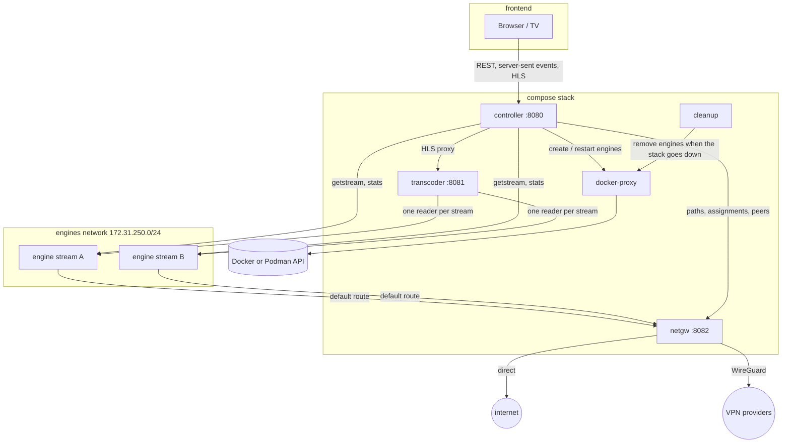

# Architecture

Ace Swarm is a small set of Node.js services written in TypeScript and run by Node's built-in type stripping, so there is no build step. The UI is the only part that is bundled (with Vite). Engines are created on demand: one container per stream, or, with [shared engines](#shared-engines), one per network path that every stream on it uses. With more than one path, each stream also keeps a [hot standby](#hot-standby) on the other paths.

## Services

| Service      | Privileges                                          | Role                                                                                                        |
| ------------ | --------------------------------------------------- | ----------------------------------------------------------------------------------------------------------- |
| controller   | non-root, read-only, no capabilities                | UI, REST API, one supervisor per stream, persistence in `/data`                                             |
| transcoder   | non-root, read-only, no capabilities                | one ffmpeg per stream: full HLS, preview HLS and thumbnails; it also reads each [hot standby](#hot-standby) |
| netgw        | root with `NET_ADMIN`, `NET_RAW`, `DAC_READ_SEARCH` | WireGuard, policy routing, firewall, path probes, peer stats                                                |
| cleanup      | non-root, read-only, no capabilities                | removes the engines when the stack goes down                                                                |
| docker-proxy | socket proxy, no other access                       | lets the controller and the cleanup service reach only the container and image API                          |
| engine       | starts as root, then uid 1000 with no capabilities  | the Acestream engine                                                                                        |

## Streams

The controller stores the stream list in `/data/streams.json`, written atomically. Additions and removals survive restarts. Each enabled stream gets a supervisor, which goes through these steps:

1. **Start or adopt the engine.** It adopts an engine left from a previous run, or creates `<stack>-engine-<stream>-<generation>`. `streams.json` remembers which of its engines the stream played from, so after a restart the controller adopts that one, not an engine a failed move kept (see [kept engines](#kept-engines)). Without that record, it adopts the newest.
2. **Pick a network path** and tell the gateway.
3. **Take over the playback** a previous run left, if there is one (see [controller restarts](#controller-restarts)). Otherwise it goes on with the next two steps.
4. **Open a session.** It calls `/ace/getstream`. A pasted value is a content ID or an infohash, and both are 40 hex characters. If the input doesn't say which (a magnet link does), the controller tries one kind, then the other, and saves the kind that worked.
5. **Start the transcoder** on the session's playback URL. ffmpeg follows the URL's redirect.
6. **Check health every tick.** A stream is healthy only while new video frames arrive, and only frames from a source whose live edge moves count (see [stale sources](#stale-sources)).

### Controller restarts

Engines, the transcoder and its ffmpeg runs keep going while the controller restarts (after an update, say), so streams don't stop:

- **The playback is taken over.** `streams.json` also keeps the engine session the transcoder reads. A restarted controller takes over the stream's engine, then that session, as long as the engine still knows it and the transcoder's ffmpeg still reads it. Nothing restarts, so there is no new ffmpeg run and no discontinuity. Otherwise (the engine or the transcoder restarted too) the stream starts as usual, and the saved session is stopped, so no engine pulls it for nobody. A stream whose previous run stopped in the middle of a move or a failover also starts as usual: the transcoder may still cut over to the other engine, which the new run doesn't know. While the transcoder can't be reached, the stream neither starts nor stops anything, and tries again.
- **After a move or a failover,** the saved session is the one on the engine the stream moved to, so that is what a restarted controller takes over. [Hot standbys](#hot-standby) aren't taken over: their engines are removed, and new ones start once the stream plays, which it does at once.
- **Shutting down is quick.** On SIGTERM, the controller waits at most 2 seconds for steps in progress (opening a session or a handover can take minutes) and ends the UI's event streams, which closing the server would otherwise wait for. Every service exits after 5 seconds whatever happens, before Docker or Podman kill it at 10. The cleanup service (below) has 25 seconds, of the 30 that compose gives it.
- **Stopping the stack removes the engines.** The controller leaves its engines running when it stops, and it can't tell a restart from `docker compose down`, so the `cleanup` service removes them. The controller depends on it, so `docker compose down` and `docker compose stop` stop the controller, wait until it exited, and then stop the cleanup service. On SIGTERM, the cleanup service removes every engine of the stack (streams' own engines, shared engines and hot standbys, by their labels) and then exits, unless a controller of the stack still runs: its container carries the `aceswarm.controller` label. When `docker compose up -d` recreates the cleanup service after an update, compose does that before it recreates the controller, so a controller still runs and the engines stay for the new one. `docker compose restart` of the whole stack stops every service at once, so the engines may stay or go; the streams start again either way, since the transcoder restarted too.
- **The proxy comes back first.** The controller serves the HLS proxy as soon as it listens; the API waits until the stream list is loaded.
- **Players ride out the gap.** The controller is unreachable for a moment, and refused connections have no HTTP status, which hls.js doesn't retry by default. The UI's players retry them for about 10 seconds and play on from their buffer meanwhile.

### Recovery ladder

When a stream stalls and has a [hot standby](#hot-standby) ready, it fails over to it first. Otherwise recovery climbs a ladder, and the delay between steps grows exponentially:

| Failures | Action                                 |
| -------- | -------------------------------------- |
| 0–1      | restart the session and pipeline       |
| 2        | restart the engine container           |
| 3, 5, …  | move to the best other path that is up |
| 4, 6, …  | restart the engine                     |

A path that is down, or whose WireGuard profile was removed, is left right away. Each stream's recovery is independent, so restarting one engine never touches the others. The E2E suite checks this. On a [shared engine](#shared-engines), the engine restart steps only restart the stream's session.

### Stale sources

A broadcast that stops doesn't look like a stall to the engine. The engine keeps its peers, keeps answering, and keeps serving the window it already has, and so do peers that have the same window. A new session gets that old window too: it plays for a few seconds, then stops. Restarting on every stall therefore loops forever and shows old video each time. Only the engine's **live edge** tells: `livepos.last` in the session's stats, the newest data of the broadcast the engine knows of.

- **The transcoder follows each source's live edge.** The controller sends the session's stat URL with its playback URL (and with each standby's). The transcoder polls it every second. Times are its own: `livepos` is stamped by the broadcaster's clock, which can be off by minutes, so its values are only compared with each other.
- **A new source is published once its edge moves.** Its segments wait until the session downloaded and its own live edge kept moving past the newest edge the stream's previous session saw, at about the broadcast's pace: two rises at least 1.5 s apart by our clock, by no more than that time plus 3 s. Only segments written after that are published. Moving once is not enough: for a broadcast that stopped, a peer can know of a slightly later end of the old window. Moving fast is not enough either: an engine catching up on an old window sees its edge rise faster than time passes, then stop. Its frames don't count as video (`lastFrameAt`) before that, so the stream still starts, and a handover doesn't take over. For every source, with a live position or not, frames only count once a segment of it is in the playlist, so "playing" always means players can get video. A source without a live position (stats that show none, or don't answer, for 10 polls) is published as before.
- **A source whose edge stops is stale.** Once the edge didn't move for `STALE_SOURCE_SECONDS` (60), or the engine serves the stream that far behind it, the transcoder stops its ffmpeg and publishes nothing more from it. Stats that stop answering for that long count the same way. A new session of the same stream starts from what the previous one saw: one that only has the same old window is stale at once. Published segments older than the threshold leave the playlist, and the thumbnail goes too, so a player that opens the stream never starts on old video. A standby only counts as hot while its own live edge moves.
- **The stream waits for its source.** The controller shows `stale-source` ("Waiting for source" in the UI, which hides the last picture). The ladder goes on with longer waits: `STALE_SOURCE_RETRY_SECONDS` (30), doubling up to `RECOVERY_MAX_DELAY_SECONDS` (300). Every step replaces the engine, so the one whose edge stopped can't keep serving its old window, and every second step does that on another path when there is one. On a [shared engine](#shared-engines), other streams play from it, so only the stream's session starts again. It never gives up. Restart stream in the UI acts at once and starts the waits over, here and on the usual ladder. The stale session's live edge is still followed: when it moves before the next step, the next step comes at once. While it waits, the stream's standbys go, the shared engine isn't blamed, and the path's health record is left alone.
- **Metrics.** `aceswarm_stream_live_edge_unchanged_seconds` (since the edge last moved) and `aceswarm_stream_live_edge_age_seconds` (`livepos.last` against our clock) are on the dashboard's "Stream stability" row. Its "Delivering new frames" timeline shows a stopped broadcast as one outage: red ("Not delivering"), then dark red ("Waiting for source") while the stream is `stale-source`. Old video never counts as delivering, so there are no green gaps in it.

### Path selection

- `sticky-best` combines the gateway's probe score with the stream's own history on each path.
  - A stream only moves when recovery asks for it: its path is down, or restarting the pipeline and the engine didn't bring video back.
  - It then moves to the best other path that is up, even one whose probes score lower. A path can answer pings and still fail a stream, for example when the connection blocks the stream's peers.
  - After moving, it stays for at least `PATH_MIN_DWELL_SECONDS`, unless its path goes down.
- `round-robin` spreads new streams over the paths that are up.
- A new stream whose paths are all down waits with a message instead of starting its engine. Its startup grace counts from when it gets a path.

Moves are make-before-break, so the picture doesn't go blank:

1. A second engine starts on the new path.
2. The transcoder swaps sources only once the new engine delivers video. It waits up to `HANDOVER_TIMEOUT_SECONDS` (120) for that. ffmpeg's input timeout for the new engine is at least that long, rather than the usual `INPUT_TIMEOUT_SECONDS` (60), because on a slow swarm a new engine can take over a minute to deliver. The timeout applies to every read for the whole ffmpeg run, but that doesn't delay stall detection, which watches for new frames (`STALL_SECONDS`).
3. The old engine is removed.

#### Kept engines

A new engine that doesn't deliver in time may still be about to: it may have found some peers, and a new one would start from none. So when a move to a new engine of the stream's own fails once the engine answers, the stream keeps that engine and tries again on it:

- **It stays ready.** It keeps its gateway path, and the session the move opened stays open, so it keeps its peers. The next try reuses that session while the engine still knows it, and opens a new one otherwise.
- **The next move to the same path uses it**: a recovery path switch, a move off the direct path once WireGuard only is on, or a move to an engine of its own once sharing is off. Each try comes when that move would come anyway, on a later check. A failed WireGuard-only move waits before the next; recovery and sharing moves count their waits from when the move started, so after a two-minute handover the next try is often on the next check.
- **Late video still counts.** When there was no picture to keep (the old ffmpeg had already exited, for example a minute after the old engine stopped delivering), the new engine became the transcoder's only source, and the transcoder goes on reading it after the move gave up. Once video arrives from it, the move finishes as if it had been in time. A retry on that engine then waits for that same reader rather than opening a second one, and starts a reader of its own if that one gives up. Recovery's next step after a failed path switch restarts the engine, which replaces that reader, so there late video only counts until then.
- **It goes** after its third failed try (a failed move, or a Docker error while taking it over), when it stops answering, when the stream moves to another path or to a shared engine instead, when the stream plays again without it (unless it plays from a shared engine while sharing is off, so it still wants an engine of its own), or when no move tried it again for twice `RECOVERY_MAX_DELAY_SECONDS`. The next try then starts a new engine.
- **At most `MAX_KEPT_ENGINES` (2) at once.** Each kept engine is an engine more, and it keeps downloading, so only that many streams keep one at a time. A failed move with none free removes its engine, as before. 0 turns kept engines off.
- Moves to a [shared engine](#shared-engines) don't need this: a path's engine already stays two minutes after its last stream left.

### WireGuard only

The network policy can turn the direct path off, so streams only use WireGuard. It is a switch in the UI and `PATCH /api/network` (`{ "wireguardOnly": true }`).

- **It needs a profile.** The controller refuses to turn it on without one, and refuses to remove the last profile while it is on. The UI greys the switch out until a profile exists, but keeps it focusable so a remote can reach it and read why.
- **One policy, enforced twice.** The controller writes the policy to `policy.json` in the WireGuard profile directory. The gateway reads it from there at start, on every reload and once a minute, so it knows the policy before the controller sends any engine paths.
  - The controller leaves the direct path out of every path choice.
  - The gateway refuses direct assignments (409), cuts off engines that were on the direct path, and stops translating engine traffic for the direct interface. Engine traffic never leaves through it. The gateway's own traffic still does: the tunnels' encrypted packets, its probes of the direct path, its own DNS lookups and the GeoIP download.
  - A policy file that can't be read or understood keeps the direct path off.
- **Turning it on moves streams right away.** The gateway has already cut the engine off, so a stream on the direct path moves to the best WireGuard path on its next check, make-before-break, without waiting to stall. This isn't counted as a recovery. A failed move waits before trying again, with the recovery ladder's delays. At most two streams move at once, so their new engines don't all start together; the others wait their turn.
- **No WireGuard path up means waiting.** A stream that has no engine yet waits with a message, and its engine only starts once a WireGuard path is up. A stream whose WireGuard path goes down recovers as usual: in place, or on another WireGuard path that is up. Neither ever falls back to the direct path.
- **Private networks go through the tunnel too.** A WireGuard path's routing table sends all engine traffic into the tunnel, including to the networks in `ENGINE_ALLOWED_PRIVATE`, and the private-address drop applies on every path. A VPN provider can't usually reach the LAN, so with WireGuard only on, LAN peers are out of reach, and a LAN resolver in `ENGINE_DNS` means engines can't resolve anything and no stream starts. `ENGINE_DNS` should stay on public resolvers.
- **Turning it off changes nothing right away.** Paths stay sticky: streams stay on their WireGuard path until recovery has a reason to move them.

### Shared engines

With **One engine per path** on (`PATCH /api/settings`, `{ "sharedEngines": true }`, stored in `/data/settings.json`), every stream on a network path plays from that path's engine, `<stack>-engine-shared-<path>-<generation>`. An engine plays several streams at once, one session each, so this saves an engine's memory for every stream but one.

- **Taking and leaving.** A stream takes its path's engine when it starts or moves there, and leaves it when it moves away or is removed. The first stream on a path starts the engine (or takes over the one a previous run left). Once the last one left, the engine stays for two minutes before it is removed: a stream whose move to it failed tries again on a warm engine, rather than on a new one that may take minutes to find peers. The two minutes count from when the last stream that played from it left, so an engine that never delivered video goes even while moves to it keep failing, and the next try gets a new one. A stream that takes an engine nobody uses first checks that it still answers (it may have stopped or hung unnoticed), and gets a new one if it doesn't. While sharing is off, nothing comes back to an unused engine, so it goes at once. The gateway routes the engine's address through its path, like any engine's.
- **Turning it on or off** moves every stream to the other kind of engine on its own path, make-before-break: a stream that plays keeps its picture until the new engine delivers video. Turning it off starts an engine per stream, so at most two streams move at once.
- **Recovery.** The ladder is the same, except that its engine restart steps only restart the stream's session: restarting the engine would interrupt every other stream on it. Path moves take the stream to the other path's shared engine.
- **Replacing the engine.** Every recovery step reports a failure to the shared engines, except on a path that is down: the stream leaves the path instead. A failure counts against the engine only if the stream had played from it: a broadcast that is down fails on any engine. They replace the engine when:
  - the failing stream is being watched (see [Viewers](#viewers)),
  - more than `SHARED_ENGINE_MAX_FAILURES` (2) different streams on it failed within `SHARED_ENGINE_FAILURE_WINDOW_SECONDS` (60),
  - a stream reached the ladder's engine restart step and every other stream on it failed within that window too (whether or not they had played from it), which also covers a stream alone on its engine,
  - a stream starting again on it finds it gone or not answering (`unresponsive`), or
  - someone pressed **Restart** on one of its streams.

  Apart from **Restart**, a path's engine is replaced at most once per failure window. When the new engine doesn't help either, the streams' own recovery goes on.

- **Make-before-break.**
  1. A new engine starts on the same path. The old one keeps playing meanwhile.
  2. Once it answers, new sessions go to it, and each stream on the old engine moves on its next check: one that plays keeps its picture until the new engine delivers video, one that is failing just starts there.
  3. The old engine is removed once its last stream left, or after twice `HANDOVER_TIMEOUT_SECONDS` plus a minute (enough for a second handover attempt).

  The gateway routes the new engine from the moment it has an address, like any engine's. A stream that starts on the path while the new engine starts, and the old one is already gone, waits for the new one. A replacement that doesn't start leaves the old engine in place.

- **Leftovers.** The controller removes a path's engine that nobody used for two minutes (see above) once no stream is still moving to it. Once every stream tried to start an engine (a stream waiting for the gateway, or for a WireGuard path it may use, hasn't yet), it also removes the shared engines a previous run left that no stream took over.
- **Peers.** The engine reports connected peers per session. Connection tracking only sees the engine, so the "sending" peers and their countries are the engine's, the same for each of its streams.

### Hot standby

With **Hot standby on other paths** on (the default; `PATCH /api/settings`, `{ "hotStandby": true }`, stored in `/data/settings.json`), every stream that played since the controller started keeps a standby on each other path it may use: on the best `STANDBY_MAX_PATHS` of them, or on all of them with 0 (the default). A standby is an engine of the stream's own on that path (`<stack>-engine-<stream>-<generation>`, routed through the path like the stream's own engine), or with [shared engines](#shared-engines) on, a session on that path's shared engine, which the shared engines count apart from the streams that play from it.

- **The transcoder keeps it hot.** An engine only keeps downloading a stream that someone reads, so the transcoder reads each standby session and throws the data away (`PUT /standbys/<stream>` with `{ "sources": [...] }`, sent on every check; readers it no longer lists stop). The engine allows one reader per session, so a reader stops when ffmpeg starts on its source: ffmpeg starts half a second after the reader's connection closed, and opens the source again (up to five times, a second apart) when it fails before any video, since the engine may still refuse a new reader for a moment. While the transcoder reads a standby's session itself (after a failover that gave up, it may still take it), the standby isn't started again for bringing no data. A standby is _hot_ while its last data is at most 10 seconds old.
- **Only video counts as data.** An engine can send bytes that aren't video, such as zeros, and a standby that only has those can't take over. So the reader only counts MPEG-TS packets that carry stream data: it locks on once five sync bytes line up 188 bytes apart, and leaves out padding, the tables on PIDs below 0x20 (PAT, SDT, EIT and the like), packets without a payload and packets flagged with a transport error. It doesn't look for which PID holds the video, so audio alone, or the PMT, still counts there. It only reads 188-byte packets (what engines serve), not the 192- or 204-byte kind. That costs a few byte reads per packet. MPEG-TS is the container, so the check doesn't depend on the codec. On top of that, ffmpeg checks that the video decodes, fed by the reader, since the engine allows one reader per session: when data starts to come, then about every minute, when a check is free. A check passes once ffmpeg decoded five video frames within 20 seconds. One that fails comes again after 10 seconds, and the wait doubles up to 5 minutes while they keep failing. A check whose data stopped coming, or that ffmpeg couldn't run, says nothing: the next one comes 10 seconds later, doubling while they keep saying nothing, up to a minute for a standby whose video decodes, and never sooner than the failures before it allow for one whose video didn't. ffmpeg that can't start gets a warning in the log, once. At most two run at a time across all streams. A standby whose last check failed goes first, since its data doesn't count meanwhile, then standbys never checked, then the routine re-checks; among the same kind, who waited longest goes first. A standby's data counts until a check fails, and then not until one passes. A connection that brought 1 MB without MPEG-TS video gets a warning in the log.
- **Failing over.** A stream fails over to its best hot standby (by the order of path selection) when no new video came for `STANDBY_FAILOVER_SECONDS` (8), before it counts as stalled, and before any ladder step once it stalled. The move is make-before-break, with a shorter handover (30 seconds at most), and counts as a recovery (`action="failover"`). The stream's own engine on the path it left becomes the standby there, with a new session; on a shared engine, the stream's session goes, and the path gets a new standby session. A failover that brings no video leaves the stream where it was, and that standby isn't tried again for a while (the ladder's delays), so the ladder can go on. A standby only counts for a failover when the transcoder answered on this check and its data is newer than the stream's last video by half the failover delay (at most 4 seconds): when the transcoder restarts, or the broadcast pauses on every path, the standbys stopped with the stream, and moving would not help.
- **Path moves use standbys.** A recovery path switch, or a move off the direct path once WireGuard only is on, moves to a hot standby first, or to the standby on the target path, hot or not, before it starts a new engine.
- **Standbys are sticky.** A healthy stream never moves to a standby, and standbys keep their paths when path scores change: one that moves starts again from no peers. A standby goes when its path may no longer be used (WireGuard only, a removed profile), the stream moves onto its path, sharing is turned on or off (the standby of the other kind goes, and one of the right kind starts), its shared engine is replaced, its path is down for two minutes, or there are more than `STANDBY_MAX_PATHS`.
- **Failing standbys.** A standby whose session brings no data within `STARTUP_GRACE_SECONDS` starts again: its own engine restarts, or on a shared engine only its session does. After three failed tries it goes, and its path gets a new standby later, with the ladder's growing delays. After three such rounds the path gets none until it goes down or the stream moves to another path. Nothing happens to a standby while its path is down.
- **Only while the stream plays.** A stream that had no video for ten minutes keeps no standbys, so a broadcast that is off for hours doesn't keep engines starting; they come back once it plays.
- **Background work.** Standbys start, open their sessions, start again and go in the background, so the stream's own checks never wait for them. At most two standby engines start (or start again) at once, across all streams.
- **Shared engines** count a stream's standby session and its play role on an engine separately, so a failed move to the engine of a path where the stream also has a standby leaves that standby counted.
- **After a controller restart,** standbys aren't taken over: the stream's own engine is, and the others are removed. New standbys start once the stream plays.
- **Metrics.** `aceswarm_stream_standby{stream, path, state}` (`starting`, `warming`, `hot`, `failed`) and `aceswarm_shared_engine_standbys{path, engine}`. The dashboard's "Delivering new frames" timeline shows a stream that plays with at least one hot standby in blue ("High availability"), and one that plays without in green ("Delivering").

### Viewers

The player reports the stream it shows full screen (`POST /api/viewers/<viewer>` with `{ "stream": "<id>" }`), when it opens and every `VIEWER_PING_SECONDS` (60), and `{ "stream": null }` when it closes or the page is hidden. A viewer that misses two and a half reports no longer counts. `VIEWER_PING_SECONDS` is at least 5.

- **Viewers are throwaway.** The id is random, made up when the page loads and kept only in memory. There are no cookies and no browser storage, so every page load is a new viewer.
- **The device** is a rough guess from the User-Agent, such as "Chrome on TV".
- **Metrics.** `aceswarm_viewer_watching{viewer, device, stream}` and `aceswarm_stream_viewers{stream}` feed the dashboard's "Viewers" row.

### HLS continuity

Every ffmpeg run writes its segments into a new "generation" directory. The transcoder serves one playlist per stream that joins the generations with `#EXT-X-DISCONTINUITY` and keeps the media sequence counting up, so players continue across restarts and path moves. Segments leave the playlist once they are older than `STALE_SOURCE_SECONDS`, so after a long gap the playlist is empty (404) until new video comes, and its sequence goes on from there.

## Network gateway (netgw)

- **Engines can't bypass it.** Engines live on their own network. The engine entrypoint replaces the default route with the gateway's address and removes any IPv6 default route, then drops every capability, so an engine can't change its routing.
- **Engines can't reach the APIs.** Engines run third-party P2P software, so nothing trusts them:
  - The gateway, controller and transcoder answer 403 to requests from engine addresses (the engines network's `ip_range`). A request from the service's own address is let through: rootless Podman forwards published ports from inside the container, sometimes from its address on the engines network.
  - The gateway's firewall also drops new connections from engines to the gateway itself.
  - It drops engine connections to private, link-local and local addresses on every path, so engines can't reach the host's published ports (rootless Podman exposes them on `169.254.1.2`) or the LAN. `ENGINE_ALLOWED_PRIVATE` lists private networks they may reach anyway, such as LAN peers or a private resolver used in `ENGINE_DNS`. That only works for engines on the direct path: on a WireGuard path, that traffic goes into the tunnel.
  - The controller calls the gateway and transcoder by names that exist only on the backend network (`netgw-api`, `transcoder-api`).
- **Paths.** The gateway has a direct path (its egress network) and one WireGuard interface per profile.
  - It uses the kernel module, falling back to `wireguard-go`.
  - Profiles are parsed and applied with `wg setconf` and `ip`. `wg-quick` and its hooks are never used.
- **Policy routing.**
  - Each tunnel has its own routing table, with a default route through the tunnel and an `unreachable` fallback.
  - An engine on a tunnel gets an `ip rule` for its address.
  - Moving an engine flushes its tracked connections, so they reconnect through the new path.
- **Fail closed.**
  - The gateway's first command, before Node.js starts, sets the `FORWARD` policy to `DROP`.
  - Each engine gets one accept rule, for the interface of its own path.
  - An engine without a path (for example right after the gateway restarted), whose tunnel was removed, or whose path the policy turned off can't reach anything.
  - The controller sends the complete list of engine paths every few seconds (`PUT /assignments`). This restores them after a gateway restart and removes the ones of engines that are gone.
  - A starting engine gets its path as soon as its container has an address, before its API answers. A real engine's API only answers after its first DNS lookups, which an engine without a path can't make.
  - A stream that starts while the gateway is unreachable gets its path as soon as the gateway answers again.
- **Probes.**
  - Every path is pinged at an interval (`PROBE_TARGETS`, by default `1.1.1.1` and `9.9.9.9`), and its loss and latency become a 0–1 score.
  - A tunnel without a WireGuard handshake in the last three minutes counts as down.
- **Peer stats.** The engine API doesn't list peers, so the gateway reads the kernel's connection tracking table.
  - Per engine, it counts peers that answered ("connected") and peers whose byte counters grew since the last sample ("sending").
  - It looks up their countries in the DB-IP Lite database, which it downloads monthly.
  - Ports 53, 80 and 443 are ignored, so DNS and trackers don't count as peers.

## Engine image

`engine/Dockerfile` has no `RUN` steps. It copies a static busybox and the entrypoint onto an upstream engine image:

| Architecture | Base image                            | Engine                                         |
| ------------ | ------------------------------------- | ---------------------------------------------- |
| amd64        | `martinbjeldbak/acestream-http-proxy` | official Linux build 3.2.11                    |
| arm64        | `jopsis/acestream`                    | Android build 3.2.17; needs a 4 KB page kernel |

The entrypoint runs as root only for these steps:

1. Set the default route through the gateway (`ACESWARM_GATEWAY`) and the DNS servers (`ACESWARM_DNS`).
2. Drop to uid 1000 with `chpst`, which clears every capability, under `setpriv --nnp`, so nothing can regain privileges.
3. Start the engine.

Engines keep their cache in memory, capped by `ENGINE_MEMORY_CACHE_MB` (the engine's `--memory-cache-limit`), and have a memory limit (`ENGINE_MEMORY_MB`). Without the cap an engine grows for over an hour, to about 1.7 GB. With it, an engine levels off at about the cap plus 150 MB. The controller refuses a limit that leaves less than 256 MB besides the cap, or under which a full cache plus 200 MB (some room above the measured 150 MB) would pass the 85% memory alert. It exports each engine's memory use and out-of-memory kills, and its cache cap (read from the container's environment). Engines don't report how full their cache is, so the controller estimates it as the engine's memory above its idle memory, at most the cap. The idle memory is the engine's lowest reading once it has run for 20 s (it may still be loading before that), or 145 MiB (an idle x86 engine in testing) if that is lower, as for an engine first seen with a full cache after a controller restart. In testing, an engine's memory grew from that idle size by about what it downloaded, until the cache was full.

## Monitoring

- **Metrics.** Every service exposes `/metrics`. Prometheus keeps 90 days by default. The dashboard also shows who watches which stream, how many streams each shared engine plays and why it was replaced, how full each engine's memory cache is, and how much the engines upload. The gateway counts the peers each engine sends stream data to from its connection table, next to the peers sending data to it: a peer counts when the engine sent it at least 16 KiB between two samples (`PEERS_INTERVAL_SECONDS`) on top of 1/8 of what the peer sent it. That share covers the acknowledgements and requests that every download sends back, which add up to more than 16 KiB on a fast one. A stream shows 0 while its engine reports no upload speed: the engine counts only stream data, so what the gateway saw then is other traffic to its peers. Recording rules compute availability, and alerts cover:
  - stream down or flapping,
  - path down,
  - engine memory near its limit, and out-of-memory kills,
  - a service being down.
- **Logs.** Alloy discovers the stack's containers through a second socket proxy that allows no changes. It labels their logs by service, role and stream, then ships them to Loki.
- **Dashboard.** It ships as portable JSON with data source variables, so it can be imported into an existing Grafana. Its top row shows the streams live and configured, the engines running, the paths up and the recoveries. The engine count (`aceswarm_engines{kind}`, `own` or `shared`) comes from the container runtime every `ENGINE_STATS_SECONDS` (15 s), so it includes every running engine container: the ones streams play from and their hot standbys. It also includes engines kept to retry a move, and shared engines that stay a while after their last stream left. While a stream or a replaced shared engine's streams move to a new engine, both engines count. If the engines can't be listed, the count is left out until the next sample, so the panel shows no data rather than an old number.

## Tests

| Kind         | Where                            | What                                                                                                      |
| ------------ | -------------------------------- | --------------------------------------------------------------------------------------------------------- |
| Unit         | `apps/*/test`, `packages/*/test` | Vitest: parsing, health, recovery, path selection, routing, playlists, UI helpers                         |
| End to end   | `e2e/`                           | Playwright on three CI runners: real engines, real dummy broadcasts and a real WireGuard server, no mocks |
| Real streams | by hand                          | the full stack with real engines and real streams, on Docker and Podman                                   |

The end-to-end tests make failures for real instead of faking them:

- **A swarm that dries up, or an ISP that blocks peers.** A firewall rule on the AceSwarm runner drops engine traffic to the broadcast runner.
- **A VPN provider that went away.** A firewall rule drops the gateway's WireGuard packets to the WireGuard server.
- **Fixed countries.** `GEOIP_STATIC` places the other runners in countries.

[e2e/README.md](../e2e/README.md) describes the suite with diagrams.
