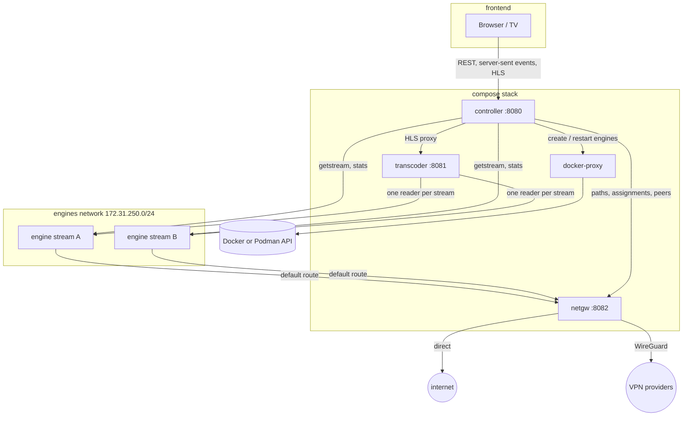

# Architecture

Ace Swarm is a small set of Node.js services written in TypeScript and run by Node's built-in type stripping, so there is no build step. The UI is the only part that is bundled (with Vite). Engines are created on demand: one container per stream, or, with [shared engines](#shared-engines), one per network path that every stream on it uses.

## Services

| Service      | Privileges                                          | Role                                                            |
| ------------ | --------------------------------------------------- | --------------------------------------------------------------- |
| controller   | non-root, read-only, no capabilities                | UI, REST API, one supervisor per stream, persistence in `/data` |
| transcoder   | non-root, read-only, no capabilities                | one ffmpeg per stream: full HLS, preview HLS and thumbnails     |
| netgw        | root with `NET_ADMIN`, `NET_RAW`, `DAC_READ_SEARCH` | WireGuard, policy routing, firewall, path probes, peer stats    |
| docker-proxy | socket proxy, no other access                       | lets the controller reach only the container and image API      |
| engine       | starts as root, then uid 1000 with no capabilities  | the Acestream engine                                            |

## Streams

The controller stores the stream list in `/data/streams.json`, written atomically. Additions and removals survive restarts. Each enabled stream gets a supervisor, which goes through these steps:

1. **Start or adopt the engine.** It adopts an engine left from a previous run, or creates `<stack>-engine-<stream>-<generation>`.
2. **Pick a network path** and tell the gateway.
3. **Open a session.** It calls `/ace/getstream`. A pasted value is a content ID or an infohash, and both are 40 hex characters. If the input doesn't say which (a magnet link does), the controller tries one kind, then the other, and saves the kind that worked.
4. **Start the transcoder** on the session's playback URL. ffmpeg follows the URL's redirect.
5. **Check health every tick.** A stream is healthy only while new video frames arrive.

### Recovery ladder

When a stream stalls, recovery climbs a ladder, and the delay between steps grows exponentially:

| Failures | Action                                 |
| -------- | -------------------------------------- |
| 0–1      | restart the session and pipeline       |
| 2        | restart the engine container           |
| 3, 5, …  | move to the best other path that is up |
| 4, 6, …  | restart the engine                     |

A path that is down, or whose WireGuard profile was removed, is left right away. Each stream's recovery is independent, so restarting one engine never touches the others. The E2E suite checks this. On a [shared engine](#shared-engines), the engine restart steps only restart the stream's session.

### Path selection

- `sticky-best` combines the gateway's probe score with the stream's own history on each path.
  - A stream only moves when recovery asks for it: its path is down, or restarting the pipeline and the engine didn't bring video back.
  - It then moves to the best other path that is up, even one whose probes score lower. A path can answer pings and still fail a stream, for example when the connection blocks the stream's peers.
  - After moving, it stays for at least `PATH_MIN_DWELL_SECONDS`, unless its path goes down.
- `round-robin` spreads new streams over the paths that are up.
- A new stream whose paths are all down waits with a message instead of starting its engine. Its startup grace counts from when it gets a path.

Moves are make-before-break, so the picture doesn't go blank:

1. A second engine starts on the new path.
2. The transcoder swaps sources only once the new engine delivers video.
3. The old engine is removed.

### WireGuard only

The network policy can turn the direct path off, so streams only use WireGuard. It is a switch in the UI and `PATCH /api/network` (`{ "wireguardOnly": true }`).

- **It needs a profile.** The controller refuses to turn it on without one, and refuses to remove the last profile while it is on. The UI greys the switch out until a profile exists, but keeps it focusable so a remote can reach it and read why.
- **One policy, enforced twice.** The controller writes the policy to `policy.json` in the WireGuard profile directory. The gateway reads it from there at start, on every reload and once a minute, so it knows the policy before the controller sends any engine paths.
  - The controller leaves the direct path out of every path choice.
  - The gateway refuses direct assignments (409), cuts off engines that were on the direct path, and stops translating engine traffic for the direct interface. Engine traffic never leaves through it. The gateway's own traffic still does: the tunnels' encrypted packets, its probes of the direct path, its own DNS lookups and the GeoIP download.
  - A policy file that can't be read or understood keeps the direct path off.
- **Turning it on moves streams right away.** The gateway has already cut the engine off, so a stream on the direct path moves to the best WireGuard path on its next check, make-before-break, without waiting to stall. This isn't counted as a recovery. A failed move waits before trying again, with the recovery ladder's delays. At most two streams move at once, so their new engines don't all start together; the others wait their turn.
- **No WireGuard path up means waiting.** A stream that has no engine yet waits with a message, and its engine only starts once a WireGuard path is up. A stream whose WireGuard path goes down recovers as usual: in place, or on another WireGuard path that is up. Neither ever falls back to the direct path.
- **Private networks go through the tunnel too.** A WireGuard path's routing table sends all engine traffic into the tunnel, including to the networks in `ENGINE_ALLOWED_PRIVATE`, and the private-address drop applies on every path. A VPN provider can't usually reach the LAN, so with WireGuard only on, LAN peers are out of reach, and a LAN resolver in `ENGINE_DNS` means engines can't resolve anything and no stream starts. `ENGINE_DNS` should stay on public resolvers.
- **Turning it off changes nothing right away.** Paths stay sticky: streams stay on their WireGuard path until recovery has a reason to move them.

### Shared engines

With **One engine per path** on (`PATCH /api/settings`, `{ "sharedEngines": true }`, stored in `/data/settings.json`), every stream on a network path plays from that path's engine, `<stack>-engine-shared-<path>-<generation>`. An engine plays several streams at once, one session each, so this saves an engine's memory for every stream but one.

- **Taking and leaving.** A stream takes its path's engine when it starts or moves there, and leaves it when it moves away or is removed. The first stream on a path starts the engine (or takes over the one a previous run left). Once the last one left, the engine stays for two minutes before it is removed: a stream whose move to it failed tries again on a warm engine, rather than on a new one that may take minutes to find peers. The two minutes count from when the last stream that played from it left, so an engine that never delivered video goes even while moves to it keep failing, and the next try gets a new one. A stream that takes an engine nobody uses first checks that it still answers (it may have stopped or hung unnoticed), and gets a new one if it doesn't. While sharing is off, nothing comes back to an unused engine, so it goes at once. The gateway routes the engine's address through its path, like any engine's.
- **Turning it on or off** moves every stream to the other kind of engine on its own path, make-before-break: a stream that plays keeps its picture until the new engine delivers video. Turning it off starts an engine per stream, so at most two streams move at once.
- **Recovery.** The ladder is the same, except that its engine restart steps only restart the stream's session: restarting the engine would interrupt every other stream on it. Path moves take the stream to the other path's shared engine.
- **Replacing the engine.** Every recovery step reports a failure to the shared engines, except on a path that is down: the stream leaves the path instead. A failure counts against the engine only if the stream had played from it: a broadcast that is down fails on any engine. They replace the engine when:
  - the failing stream is being watched (see [Viewers](#viewers)),
  - more than `SHARED_ENGINE_MAX_FAILURES` (2) different streams on it failed within `SHARED_ENGINE_FAILURE_WINDOW_SECONDS` (60),
  - a stream reached the ladder's engine restart step and every other stream on it failed within that window too (whether or not they had played from it), which also covers a stream alone on its engine,
  - a stream starting again on it finds it gone or not answering (`unresponsive`), or
  - someone pressed **Restart** on one of its streams.

  Apart from **Restart**, a path's engine is replaced at most once per failure window. When the new engine doesn't help either, the streams' own recovery goes on.

- **Make-before-break.**
  1. A new engine starts on the same path. The old one keeps playing meanwhile.
  2. Once it answers, new sessions go to it, and each stream on the old engine moves on its next check: one that plays keeps its picture until the new engine delivers video, one that is failing just starts there.
  3. The old engine is removed once its last stream left, or after twice `HANDOVER_TIMEOUT_SECONDS` plus a minute (enough for a second handover attempt).

  The gateway routes the new engine from the moment it has an address, like any engine's. A stream that starts on the path while the new engine starts, and the old one is already gone, waits for the new one. A replacement that doesn't start leaves the old engine in place.

- **Leftovers.** The controller removes a path's engine that nobody used for two minutes (see above) once no stream is still moving to it. Once every stream tried to start an engine (a stream waiting for the gateway, or for a WireGuard path it may use, hasn't yet), it also removes the shared engines a previous run left that no stream took over.
- **Peers.** The engine reports connected peers per session. Connection tracking only sees the engine, so the "sending" peers and their countries are the engine's, the same for each of its streams.

### Viewers

The player reports the stream it shows full screen (`POST /api/viewers/<viewer>` with `{ "stream": "<id>" }`), when it opens and every `VIEWER_PING_SECONDS` (60), and `{ "stream": null }` when it closes or the page is hidden. A viewer that misses two and a half reports no longer counts. `VIEWER_PING_SECONDS` is at least 5.

- **Viewers are throwaway.** The id is random, made up when the page loads and kept only in memory. There are no cookies and no browser storage, so every page load is a new viewer.
- **The device** is a rough guess from the User-Agent, such as "Chrome on TV".
- **Metrics.** `aceswarm_viewer_watching{viewer, device, stream}` and `aceswarm_stream_viewers{stream}` feed the dashboard's "Viewers" row.

### HLS continuity

Every ffmpeg run writes its segments into a new "generation" directory. The transcoder serves one playlist per stream that joins the generations with `#EXT-X-DISCONTINUITY` and keeps the media sequence counting up, so players continue across restarts and path moves.

## Network gateway (netgw)

- **Engines can't bypass it.** Engines live on their own network. The engine entrypoint replaces the default route with the gateway's address and removes any IPv6 default route, then drops every capability, so an engine can't change its routing.
- **Engines can't reach the APIs.** Engines run third-party P2P software, so nothing trusts them:
  - The gateway, controller and transcoder answer 403 to requests from engine addresses (the engines network's `ip_range`). A request from the service's own address is let through: rootless Podman forwards published ports from inside the container, sometimes from its address on the engines network.
  - The gateway's firewall also drops new connections from engines to the gateway itself.
  - It drops engine connections to private, link-local and local addresses on every path, so engines can't reach the host's published ports (rootless Podman exposes them on `169.254.1.2`) or the LAN. `ENGINE_ALLOWED_PRIVATE` lists private networks they may reach anyway, such as LAN peers or a private resolver used in `ENGINE_DNS`. That only works for engines on the direct path: on a WireGuard path, that traffic goes into the tunnel.
  - The controller calls the gateway and transcoder by names that exist only on the backend network (`netgw-api`, `transcoder-api`).
- **Paths.** The gateway has a direct path (its egress network) and one WireGuard interface per profile.
  - It uses the kernel module, falling back to `wireguard-go`.
  - Profiles are parsed and applied with `wg setconf` and `ip`. `wg-quick` and its hooks are never used.
- **Policy routing.**
  - Each tunnel has its own routing table, with a default route through the tunnel and an `unreachable` fallback.
  - An engine on a tunnel gets an `ip rule` for its address.
  - Moving an engine flushes its tracked connections, so they reconnect through the new path.
- **Fail closed.**
  - The gateway's first command, before Node.js starts, sets the `FORWARD` policy to `DROP`.
  - Each engine gets one accept rule, for the interface of its own path.
  - An engine without a path (for example right after the gateway restarted), whose tunnel was removed, or whose path the policy turned off can't reach anything.
  - The controller sends the complete list of engine paths every few seconds (`PUT /assignments`). This restores them after a gateway restart and removes the ones of engines that are gone.
  - A starting engine gets its path as soon as its container has an address, before its API answers. A real engine's API only answers after its first DNS lookups, which an engine without a path can't make.
  - A stream that starts while the gateway is unreachable gets its path as soon as the gateway answers again.
- **Probes.**
  - Every path is pinged at an interval (`PROBE_TARGETS`, by default `1.1.1.1` and `9.9.9.9`), and its loss and latency become a 0–1 score.
  - A tunnel without a WireGuard handshake in the last three minutes counts as down.
- **Peer stats.** The engine API doesn't list peers, so the gateway reads the kernel's connection tracking table.
  - Per engine, it counts peers that answered ("connected") and peers whose byte counters grew since the last sample ("sending").
  - It looks up their countries in the DB-IP Lite database, which it downloads monthly.
  - Ports 53, 80 and 443 are ignored, so DNS and trackers don't count as peers.

## Engine image

`engine/Dockerfile` has no `RUN` steps. It copies a static busybox and the entrypoint onto an upstream engine image:

| Architecture | Base image                            | Engine                                         |
| ------------ | ------------------------------------- | ---------------------------------------------- |
| amd64        | `martinbjeldbak/acestream-http-proxy` | official Linux build 3.2.11                    |
| arm64        | `jopsis/acestream`                    | Android build 3.2.17; needs a 4 KB page kernel |

The entrypoint runs as root only for these steps:

1. Set the default route through the gateway (`ACESWARM_GATEWAY`) and the DNS servers (`ACESWARM_DNS`).
2. Drop to uid 1000 with `chpst`, which clears every capability, under `setpriv --nnp`, so nothing can regain privileges.
3. Start the engine.

Engines keep their cache in memory, capped by `ENGINE_MEMORY_CACHE_MB` (the engine's `--memory-cache-limit`), and have a memory limit (`ENGINE_MEMORY_MB`). Without the cap an engine grows for over an hour, to about 1.7 GB. With it, an engine levels off at about the cap plus 150 MB. The controller refuses a limit that leaves less than 256 MB besides the cap, or under which a full cache plus 200 MB (some room above the measured 150 MB) would pass the 85% memory alert. It exports each engine's memory use and out-of-memory kills.

## Monitoring

- **Metrics.** Every service exposes `/metrics`. Prometheus keeps 90 days by default. The dashboard also shows who watches which stream, and how many streams each shared engine plays and why it was replaced. Recording rules compute availability, and alerts cover:
  - stream down or flapping,
  - path down,
  - engine memory near its limit, and out-of-memory kills,
  - a service being down.
- **Logs.** Alloy discovers the stack's containers through a second socket proxy that allows no changes. It labels their logs by service, role and stream, then ships them to Loki.
- **Dashboard.** It ships as portable JSON with data source variables, so it can be imported into an existing Grafana.

## Tests

| Kind         | Where                            | What                                                                                                      |
| ------------ | -------------------------------- | --------------------------------------------------------------------------------------------------------- |
| Unit         | `apps/*/test`, `packages/*/test` | Vitest: parsing, health, recovery, path selection, routing, playlists, UI helpers                         |
| End to end   | `e2e/`                           | Playwright on three CI runners: real engines, real dummy broadcasts and a real WireGuard server, no mocks |
| Real streams | by hand                          | the full stack with real engines and real streams, on Docker and Podman                                   |

The end-to-end tests make failures for real instead of faking them:

- **A swarm that dries up, or an ISP that blocks peers.** A firewall rule on the AceSwarm runner drops engine traffic to the broadcast runner.
- **A VPN provider that went away.** A firewall rule drops the gateway's WireGuard packets to the WireGuard server.
- **Fixed countries.** `GEOIP_STATIC` places the other runners in countries.

[e2e/README.md](../e2e/README.md) describes the suite with diagrams.
