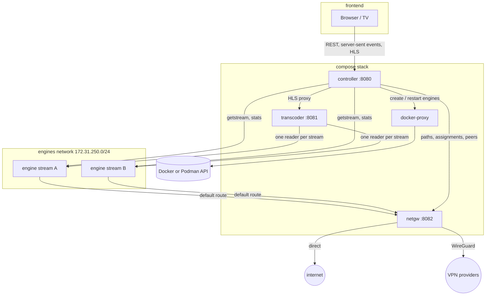

# Architecture

Ace Swarm is a small set of Node.js services written in TypeScript and run by Node's built-in type stripping, so there is no build step. The UI is the only part that is bundled (with Vite). Engines are created on demand, one container per stream.

## Services

| Service      | Privileges                                          | Role                                                            |
| ------------ | --------------------------------------------------- | --------------------------------------------------------------- |
| controller   | non-root, read-only, no capabilities                | UI, REST API, one supervisor per stream, persistence in `/data` |
| transcoder   | non-root, read-only, no capabilities                | one ffmpeg per stream: full HLS, preview HLS and thumbnails     |
| netgw        | root with `NET_ADMIN`, `NET_RAW`, `DAC_READ_SEARCH` | WireGuard, policy routing, firewall, path probes, peer stats    |
| docker-proxy | read-only socket                                    | lets the controller reach only the container and image API      |
| engine       | starts as root, then uid 1000 with no capabilities  | the Acestream engine                                            |

## Streams

The controller stores the stream list in `/data/streams.json`, written atomically. Additions and removals survive restarts. Each enabled stream gets a supervisor, which goes through these steps:

1. **Start or adopt the engine.** It adopts an engine left from a previous run, or creates `<stack>-engine-<stream>-<generation>`.
2. **Pick a network path** and tell the gateway.
3. **Open a session.** It calls `/ace/getstream`. A pasted value is a content ID or an infohash, and both are 40 hex characters. If the input doesn't say which (a magnet link does), the controller tries one kind, then the other, and saves the kind that worked.
4. **Start the transcoder** on the session's playback URL. ffmpeg follows the URL's redirect.
5. **Check health every tick.** A stream is healthy only while new video frames arrive.

### Recovery ladder

When a stream stalls, recovery climbs a ladder, and the delay between steps grows exponentially:

| Failures | Action                                       |
| -------- | -------------------------------------------- |
| 0–1      | restart the session and pipeline             |
| 2        | restart the engine container                 |
| 3, 5, …  | move to another path (if a better one is up) |
| 4, 6, …  | restart the engine                           |

A path that is down, or whose WireGuard profile was removed, is left right away. Each stream's recovery is independent, so restarting one engine never touches the others. The E2E suite checks this.

### Path selection

- `sticky-best` combines the gateway's probe score with the stream's own history on each path.
  - A stream only moves when recovery asks for it, and then only to a path that is better by a margin (hysteresis).
  - After moving, it stays for at least `PATH_MIN_DWELL_SECONDS`, unless its path goes down.
- `round-robin` spreads new streams over the paths that are up.

Moves are make-before-break, so the picture doesn't go blank:

1. A second engine starts on the new path.
2. The transcoder swaps sources only once the new engine delivers video.
3. The old engine is removed.

### HLS continuity

Every ffmpeg run writes its segments into a new "generation" directory. The transcoder serves one playlist per stream that joins the generations with `#EXT-X-DISCONTINUITY` and keeps the media sequence counting up, so players continue across restarts and path moves.

## Network gateway (netgw)

- **Engines can't bypass it.** Engines live on their own network. The engine entrypoint replaces the default route with the gateway's address, then drops every capability, so an engine can't change its routing.
- **Paths.** The gateway has a direct path (its egress network) and one WireGuard interface per profile.
  - It uses the kernel module, falling back to `wireguard-go`.
  - Profiles are parsed and applied with `wg setconf` and `ip`. `wg-quick` and its hooks are never used.
- **Policy routing.**
  - Each tunnel has its own routing table, with a default route through the tunnel and an `unreachable` fallback.
  - An engine on a tunnel gets an `ip rule` for its address.
  - Moving an engine flushes its tracked connections, so they reconnect through the new path.
- **Fail closed.**
  - The `FORWARD` policy is `DROP` from the gateway's first moment.
  - Each engine gets one accept rule, for the interface of its own path.
  - An engine without a path (for example right after the gateway restarted) or whose tunnel was removed can't reach anything.
  - The controller sends the complete list of engine paths every few seconds (`PUT /assignments`). This restores them after a gateway restart and removes the ones of engines that are gone.
- **Probes.**
  - Every path is pinged at an interval, and its loss and latency become a 0–1 score.
  - A tunnel without a WireGuard handshake in the last three minutes counts as down.
- **Peer stats.** The engine API doesn't list peers, so the gateway reads the kernel's connection tracking table.
  - Per engine, it counts peers that answered ("connected") and peers whose byte counters grew since the last sample ("sending").
  - It looks up their countries in the DB-IP Lite database, which it downloads monthly.
  - Ports 53, 80 and 443 are ignored, so DNS and trackers don't count as peers.

## Engine image

`engine/Dockerfile` has no `RUN` steps. It copies a static busybox and the entrypoint onto an upstream engine image:

| Architecture | Base image                            | Engine                                         |
| ------------ | ------------------------------------- | ---------------------------------------------- |
| amd64        | `martinbjeldbak/acestream-http-proxy` | official Linux build 3.2.11                    |
| arm64        | `jopsis/acestream`                    | Android build 3.2.17; needs a 4 KB page kernel |

The entrypoint runs as root only for these steps:

1. Set the default route through the gateway (`ACESWARM_GATEWAY`) and the DNS servers (`ACESWARM_DNS`).
2. Drop to uid 1000 with `chpst`, which clears every capability, under `setpriv --nnp`, so nothing can regain privileges.
3. Start the engine.

Engines keep their live cache in memory and have a memory limit (`ENGINE_MEMORY_MB`). The controller exports each engine's memory use and out-of-memory kills.

## Monitoring

- **Metrics.** Every service exposes `/metrics`. Prometheus keeps 90 days by default. Recording rules compute availability, and alerts cover:
  - stream down or flapping,
  - path down,
  - engine memory near its limit, and out-of-memory kills,
  - a service being down.
- **Logs.** Alloy discovers the stack's containers through a second, read-only socket proxy. It labels their logs by service, role and stream, then ships them to Loki.
- **Dashboard.** It ships as portable JSON with data source variables, so it can be imported into an existing Grafana.

## Tests

| Kind         | Where                            | What                                                                              |
| ------------ | -------------------------------- | --------------------------------------------------------------------------------- |
| Unit         | `apps/*/test`, `packages/*/test` | Vitest: parsing, health, recovery, path selection, routing, playlists, UI helpers |
| End to end   | `e2e/`                           | Playwright against the real services with a mock engine (see below)               |
| Real streams | by hand                          | the full stack with real engines, on Docker and Podman                            |

The E2E stack has no Acestream and no internet:

- **Fake peers.** The mock engine pings fake peers on a fake internet. The peers answer on addresses Docker doesn't manage, because Docker 28+ drops packets routed to another network's container addresses.
- **VPN-only peer.** A throwaway WireGuard server provides a VPN that is the only way to reach one of the peers.
- **Fixed countries.** `GEOIP_STATIC` gives the fake peers countries.
