# End-to-end tests

The end-to-end tests drive the real AceSwarm services (controller, transcoder, network gateway) through the UI and the REST API with Playwright. Nothing is mocked: real Acestream engines play real broadcasts from another machine, directly or through a real WireGuard server on a third machine.

| Runs in                    | Engines                                      | Machines                | When                                           |
| -------------------------- | -------------------------------------------- | ----------------------- | ---------------------------------------------- |
| Workflow "E2E" (`e2e.yml`) | real Acestream engines (`engine/Dockerfile`) | 4 GitHub-hosted runners | every PR and push to `main`, or "Run workflow" |

- **Docker and rootless Podman.** Two stack runners run the whole suite side by side: `stack` on Docker and `stack-podman` on rootless Podman. They share the broadcast runner and the WireGuard server. See [The Podman stack runner](#the-podman-stack-runner).

- **No single-machine run.** The broadcasts and the WireGuard server need their own hosts, joined to AceSwarm's by the mesh, so the suite runs on the CI runners only. To try a branch, push it and start the workflow with "Run workflow".
- **It needs Acestream's lookup service.** Engines resolve both content IDs and infohashes through it, so an Acestream outage fails the whole run.

## Architecture

Each runner plays one part. They reach each other over a private WireGuard network, the **mesh**, on TEST-NET-1 addresses (`192.0.2.0/24`). Nothing on the runners uses that range, and the gateway counts it as internet peers (its peer statistics skip private ranges, and its engine firewall only blocks private ranges).

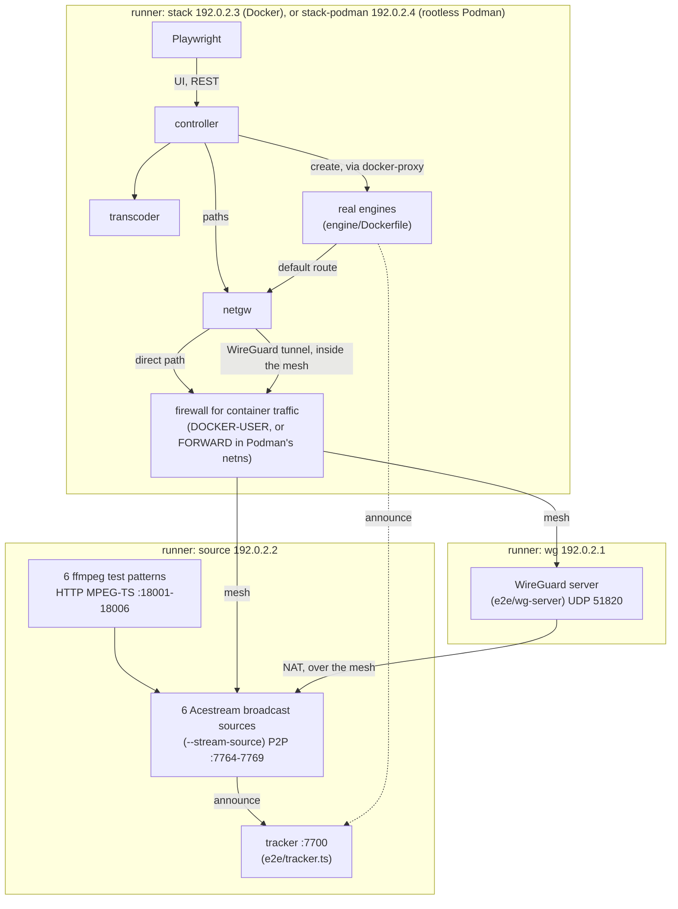

- **The broadcasts are real.** Real Acestream engines broadcast six test patterns, each with its own colours and tone: `bc1`-`bc3` for the Docker stack runner and `bc4`-`bc6` for the Podman one (`E2E_BROADCASTS`). Players on a stack runner find a broadcast by its infohash or its content ID, through Acestream's own lookup service, which returns the transport file with our tracker in it.
- **The VPN is real.** The WireGuard server writes one client profile per stack runner (`client-stack.conf`, `client-stack-podman.conf`), pointing at its mesh address, and the tests upload it through the UI like a user would. Two clients can't share one key.
- **Failures are made at the stack runner's firewall.** The tests add `DROP` rules to its `DOCKER-USER` chain (on Podman: the `FORWARD` chain of Podman's network namespace), which only sees traffic forwarded for containers. The tests' own requests to the other runners keep working, and so does the other stack runner.
- **The tracker tells the paths apart.** An engine's announces come from its stack runner's address (`192.0.2.3` or `192.0.2.4`) on the direct path and from `192.0.2.1` (the WireGuard server's runner, after NAT) on the VPN path. `GET /stats` on the tracker lists them. Both stack runners' VPN traffic leaves from `192.0.2.1`, which is why each one plays its own broadcasts.
- **Fixed countries.** `GEOIP_STATIC` places the broadcast runner in Spain (`ES`) and the WireGuard runner in Sweden (`SE`).

| Address                          | Port              | What                                       |
| -------------------------------- | ----------------- | ------------------------------------------ |
| every runner                     | UDP 51000         | mesh WireGuard (`wg-mesh`)                 |
| every runner                     | TCP 18999         | files shared on the mesh (`mesh.sh share`) |
| `192.0.2.1`                      | UDP 51820         | WireGuard server under test                |
| `192.0.2.2`                      | TCP+UDP 7764-7769 | broadcast sources (P2P)                    |
| `192.0.2.2`                      | TCP 7700          | tracker (`/announce`, `/stats`, `/inputs`) |
| `127.0.0.1` on the source runner | TCP 18001-18006   | ffmpeg's HTTP MPEG-TS inputs               |
| `127.0.0.1` on a stack runner    | TCP 18080         | AceSwarm UI and API                        |

### Real failures instead of mocks

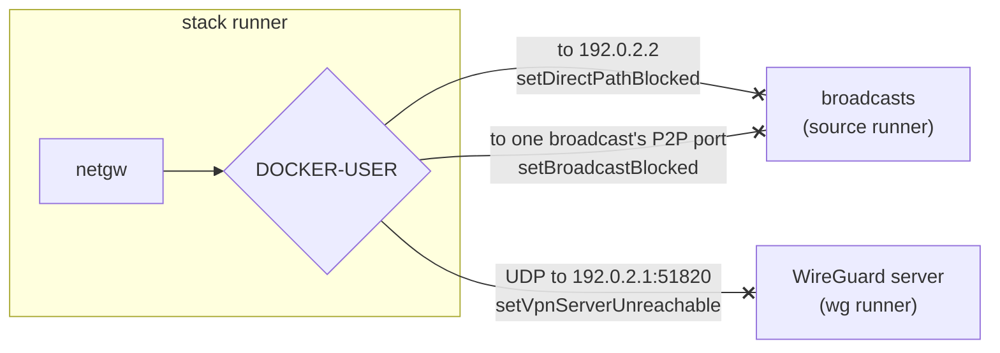

| Condition                          | How the tests make it                                                                      | Used by                                                 |
| ---------------------------------- | ------------------------------------------------------------------------------------------ | ------------------------------------------------------- |
| a swarm that dries up              | `setDirectPathBlocked(true)` while there is no WireGuard profile, so no path can help      | stall recovery                                          |
| a broadcast that stops             | `setBroadcastInput(broadcast, false)`: the tracker stops that broadcast's ffmpeg input     | waiting for the source, never publishing its old window |
| an ISP that blocks Acestream peers | `setDirectPathBlocked(true)` with a WireGuard path up                                      | moving to the VPN, fail closed after a gateway restart  |
| a VPN provider that went away      | `setVpnServerUnreachable(true)`: the tunnel stops carrying anything and its path goes down | WireGuard only: streams wait instead of going direct    |
| an engine that crashes             | `docker restart` of one engine container                                                   | the other streams are left alone                        |
| one swarm that dries up            | `setBroadcastBlocked(broadcast, true)`: only that broadcast's P2P port on `192.0.2.2`      | one engine per path: the other stream keeps playing     |

The direct-path block only drops traffic to the broadcast runner, so the direct path keeps answering the gateway's pings (they go to the WireGuard server's runner) and keeps its better probe score. That is what a connection that blocks Acestream peers looks like, and a stream still has to leave it.

## Why a mesh, and how it forms

GitHub-hosted runners can't accept connections from the internet. Each one sits behind Azure's NAT, which only lets a packet in from an address and port the runner has already sent to. The runners have no IPv6 either. The NAT keeps one public port per local port, whatever the destination (endpoint-independent mapping). So if two runners know each other's public address and port, and both send at the same time, each one's first packets open its own NAT for the other. This is UDP hole punching.

The only missing piece is the public port, which the NAT picks at random. A runner can't see it locally. It learns it by sending a packet from that exact port to a STUN server, which answers with the address and port the packet came from. `e2e/stun.ts` asks two public servers (Google and Cloudflare, no account needed). They always agreed in testing, which confirms the endpoint-independent mapping.

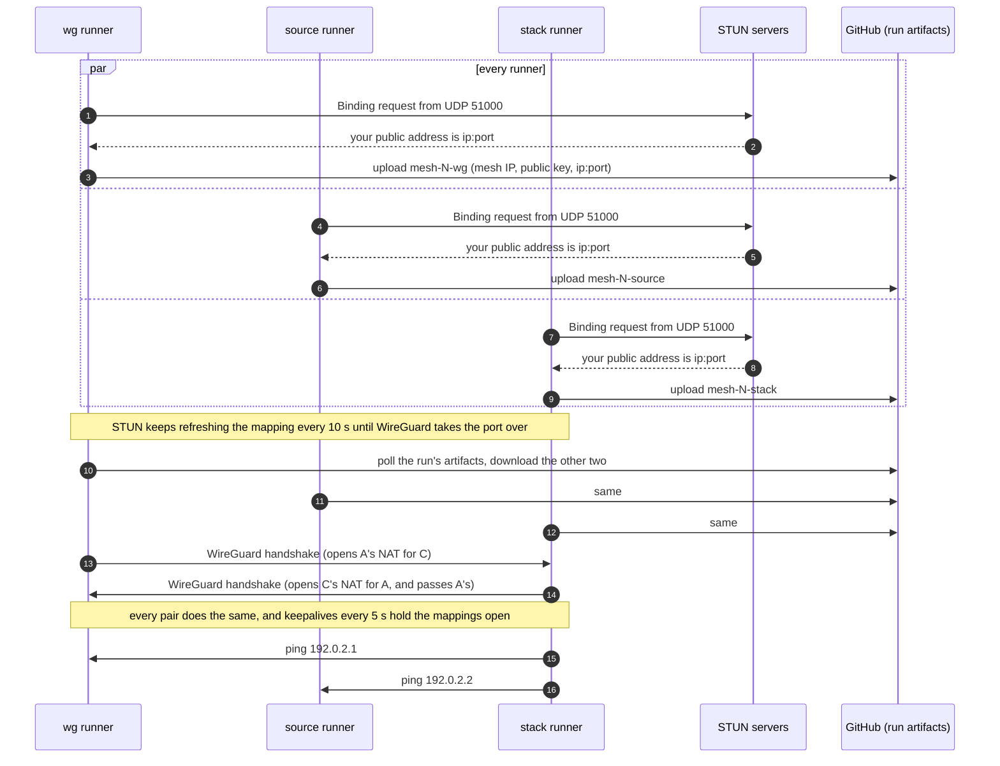

Artifact names include the run attempt (`mesh-N-…` above), so a re-run never picks up the addresses of runners from an earlier attempt.

The runners can't ping the internet either: Azure drops ICMP to and from outside addresses. The gateway's path probes ping `1.1.1.1` and `9.9.9.9` by default, so on a runner every path would stay down and, with the gateway failing closed, engines would reach nothing. `e2e/compose.e2e.yaml` points `PROBE_TARGETS` at the WireGuard server's runner (`192.0.2.1`) instead, which answers both directly over the mesh and through the tunnel.

## Workflow

The jobs start together and have no `needs`, so they run side by side. Once the mesh is up, the WireGuard server and the broadcasts start in parallel on their own runners while the stack runners build the images. The diagram shows one stack job; `stack-podman` (the same job in a matrix) does the same with its own profile, broadcasts and `done`.

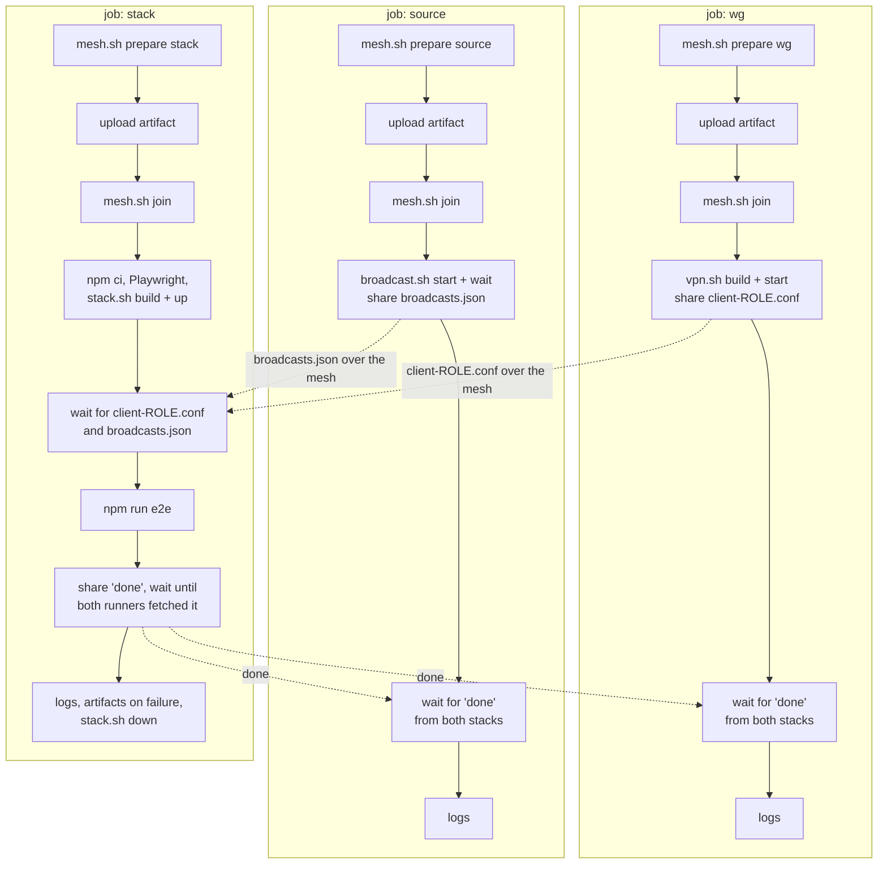

- **Sharing files.** Each runner serves `$RUNNER_TEMP/mesh/share` on its mesh address, port 18999. `mesh.sh share` publishes a file, and `mesh.sh wait-file` polls a peer for one.
- **Finishing.** Each stack job shares `done` even when it fails. The WireGuard and broadcast jobs wait for it from every stack runner that joined (`mesh.sh wait-all`), so one stack finishing early never takes the VPN or the broadcasts away from the other. A stack job keeps serving `done` until both have fetched it (`mesh.sh wait-fetched`, at most two minutes), because its file server stops with the job. If a stack runner disappears (cancelled or crashed), they stop waiting for it after it hasn't answered pings for about five minutes.
- **A stack runner that is late or never shows up** holds nobody up: the WireGuard and broadcast jobs join the stacks as optional peers (`stack?` in `mesh.sh join`) and add each one as soon as its artifact appears, while the other stack's handshakes already get answers. A stack that hasn't appeared after ten minutes, or whose job ended without publishing its address, is left out, and until then the shared runners don't start their servers, so its absence delays the other stack by up to ten minutes but doesn't fail it.
- **Time limits.** Every setup and test step has a limit of a few times its usual length, so a step that hangs fails within minutes instead of at the job's limit (50 minutes for a stack job, 60 for the two that serve them, which wait for both stacks). The tests usually take about 14 minutes; in CI Playwright stops them at 30 (`globalTimeout`), before the step's 35-minute limit, so the report still gets uploaded.
- **Slow setup.** `mesh.sh prepare` usually takes 10-15 s, but apt once hung for a whole one-hour job while installing wireguard-tools. Installing now gets three tries of at most a minute each (`MESH_TRIES`, `MESH_APT_SECONDS`), and STUN gets three tries of at most 20 s.
- **A runner that fails early.** While `mesh.sh join` waits for a peer's artifact, it also checks every 15 s or so whether that peer's job has ended. If it has, a required peer fails the join at once and an optional one is left out, instead of waiting out ten minutes for a runner that will never publish its address. A stack job that fails before joining doesn't wait for anyone to fetch its `done`.
- **Re-runs.** Use "Re-run all jobs". Re-running a single job can't work, because it would wait for runners that are gone.

## The broadcasts

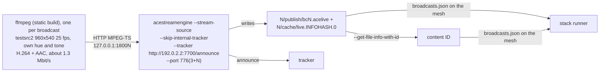

`e2e/broadcast.sh start HOST 6` runs the parts, and `broadcast.sh wait` prints `broadcasts.json`: a name, an infohash and a content ID per broadcast. The engine's cache file is named after the infohash, and `acestreamengine --get-file-info-with-id` prints the content ID of a transport file. A fresh engine resolves either one through Acestream's lookup service.

Two quirks of the 3.2.11 Linux engine shape it:

- **Its built-in tracker refuses every announce** ("Requested download is not authorized for use with this tracker"). The sources skip it and announce to `e2e/tracker.ts`, a minimal BitTorrent HTTP tracker, and players use that one too.
- **Its RSA key generation crashes with pycryptodome 4**, which the image ships: it relies on negative intermediate values. `PYCRYPTODOME_INTEGER=native` switches pycryptodome to its pure Python integers, which allow them.

The engine only reads HTTP sources (`--source -` for stdin isn't supported). ffmpeg's HTTP server serves one client and exits, so Docker restarts it for each reconnect.

## Tests

The specs share one stack, so they run one after the other, in file order. Each starts from an empty stack (`resetStack`: no streams, no WireGuard profile, WireGuard only, engine sharing and hot standby off, so each stream has one engine).

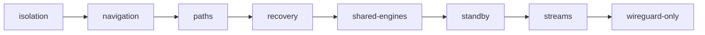

| Spec                     | Engines | Checks                                                                                                                                                                                                                                                                 |
| ------------------------ | ------- | ---------------------------------------------------------------------------------------------------------------------------------------------------------------------------------------------------------------------------------------------------------------------- |
| `isolation.spec.ts`      | 1       | engines can't reach the gateway, controller or transcoder APIs; the gateway drops engine connections to private addresses                                                                                                                                              |
| `navigation.spec.ts`     | 3       | arrow key navigation for TV remotes, the full screen player and Back, previews and thumbnails                                                                                                                                                                          |
| `paths.spec.ts`          | 1       | the direct path, profiles with hooks rejected, a profile from another machine, moving to the VPN, fail closed after a gateway restart, sticky paths, back to direct on removal                                                                                         |
| `recovery.spec.ts`       | 1, 2    | stall recovery where no path can help, an engine restart that leaves the other streams alone, a broadcast that stops and comes back: "stale-source", nothing old published, slow retries, fresh video after                                                            |
| `shared-engines.spec.ts` | 1, 2    | one engine per path: turning it on and off moves streams without a gap, one stream failing leaves the shared engine alone, the watched stream failing replaces it, throwaway viewer ids                                                                                |
| `standby.spec.ts`        | 2       | hot standby: a hot standby on the VPN, failing over within seconds when the engine hangs, without a new engine or the ladder, sticky afterwards, standby sessions on shared engines, turning it off, a broadcast that stops while both its engines hold its old window |
| `streams.spec.ts`        | 3       | adding from the UI, live stats, content ID and infohash detection, magnet links, persistence across a controller restart, removal                                                                                                                                      |
| `wireguard-only.spec.ts` | 3       | WireGuard only: greyed out without a profile, moves streams off the direct path, enforced by the gateway, streams wait while no VPN is up, the last profile stays                                                                                                      |

### Content IDs and infohashes

Both are 40 hex characters, so the controller tries a bare value as a content ID first and falls back to an infohash, then remembers what worked.

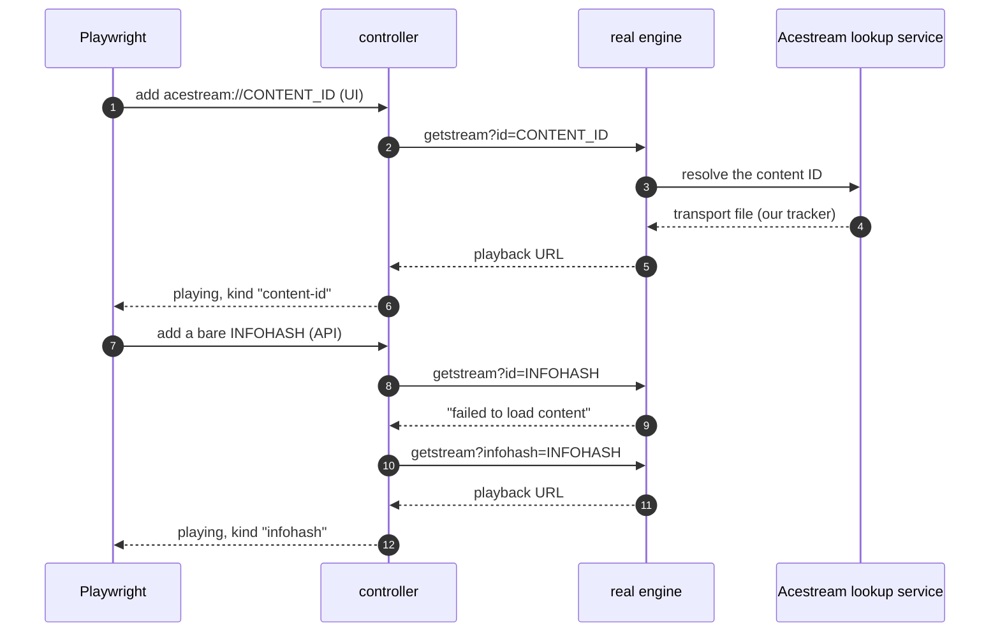

### Stall recovery

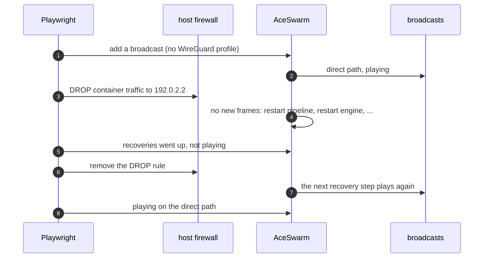

### A broadcast that stops

The tracker on the broadcast runner stops and starts a broadcast's ffmpeg input (`POST /inputs/bcN/stop|start`). Its source engine keeps running with the window it has, so the stream's engine keeps its connection and its peers, and each new session still gets that old window: data comes, but the live edge stops. That is what a broadcast that stops looks like, and what a firewall rule can't make.

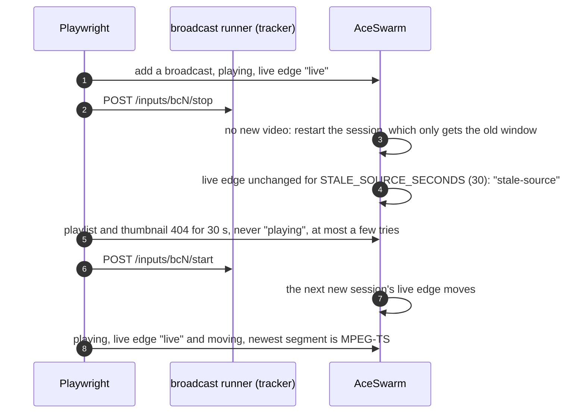

### Network paths

`paths.spec.ts` runs these in order, on one stream:

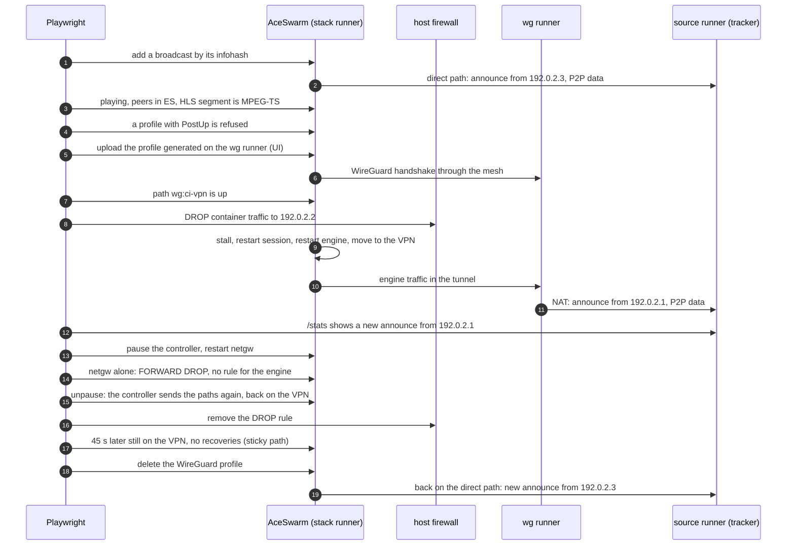

### One engine per path

`shared-engines.spec.ts` runs these in order, on two streams. All the while, the second stream (the bystander) has to keep playing, with no recovery.

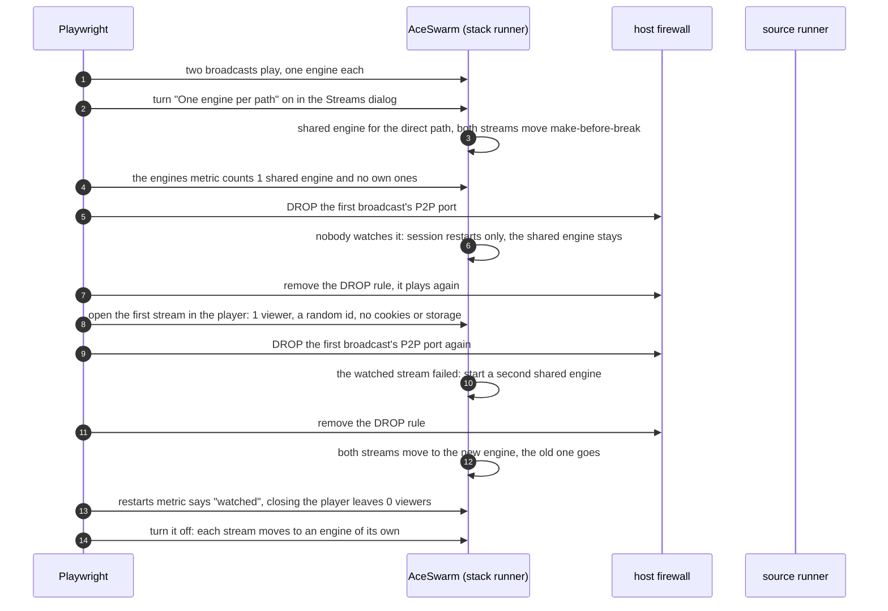

### Hot standby

`standby.spec.ts` runs these in order, on one stream, with hot standby on:

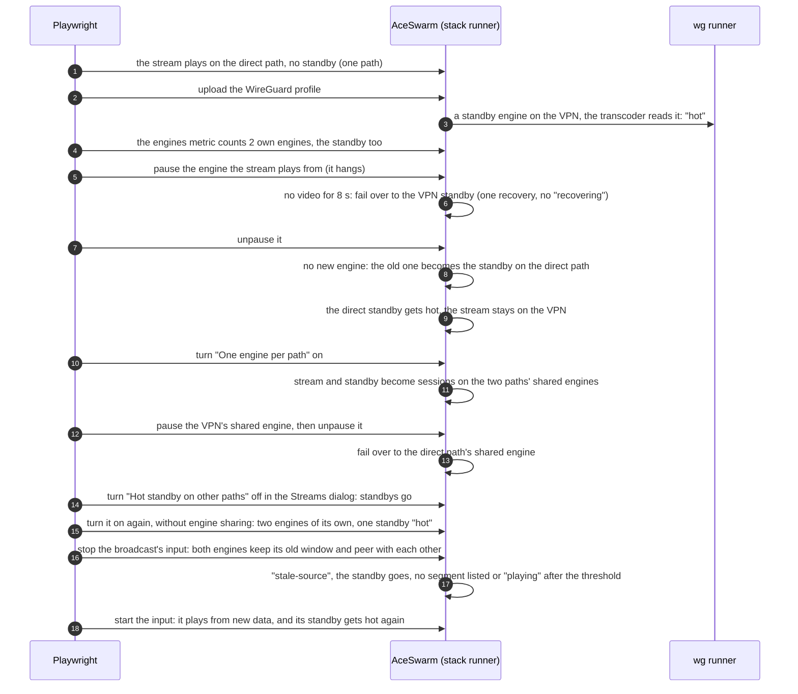

The faults are engines that hang, not paths that lose the broadcast. With a standby running, cutting the direct path off does not stall the stream: its engine keeps getting the broadcast from the standby, over the engines' network.

### WireGuard only

`wireguard-only.spec.ts` runs these in order:

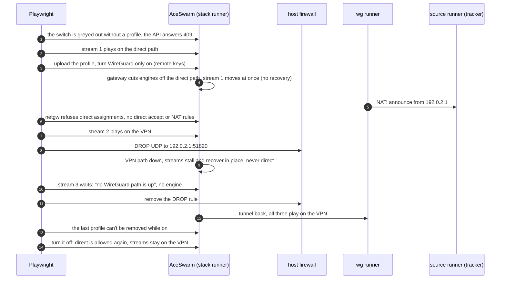

## Debugging a failed run

- **Each job's last step prints its logs:** the mesh (`wg show`), the WireGuard server, or the broadcasts (tracker, ffmpeg and engine logs).
- **Each stack job also uploads** `e2e-results-<docker|podman>-<attempt>` on failure: the Playwright report, traces, videos and `e2e-stack.log` (every service and engine).
- **"no connectivity to …" in `mesh.sh join`** means hole punching failed. Check that `endpointIndependent` was `true` in each runner's "public UDP address" line. If GitHub ever changes its NAT, this suite needs a relay instead.
- **Tests time out waiting for playback** while the mesh is fine: check the tracker log in the source job. Each engine should announce and get its source as a peer.

## Files

| File                                     | Role                                                                 |
| ---------------------------------------- | -------------------------------------------------------------------- |
| `.github/workflows/e2e.yml`              | the jobs                                                             |
| `e2e/mesh.sh`                            | STUN, artifacts, the WireGuard mesh, file sharing                    |
| `e2e/stun.ts`                            | minimal STUN client with keepalive                                   |
| `e2e/vpn.sh`, `e2e/wg-server/`           | the WireGuard server under test                                      |
| `e2e/broadcast.sh`                       | ffmpeg, the broadcast sources and the tracker                        |
| `e2e/tracker.ts`                         | minimal BitTorrent HTTP tracker with `/stats`                        |
| `e2e/stack.sh`, `e2e/compose.e2e.yaml`   | AceSwarm with real engines                                           |
| `e2e/podman.sh`                          | rootless Podman on the `stack-podman` runner                         |
| `e2e/playwright.config.ts`, `e2e/tests/` | the specs, their helpers (`helpers.ts`) and mesh helpers (`mesh.ts`) |
| `e2e/test/`                              | unit tests for the STUN client and the tracker (run by `npm test`)   |

## The Podman stack runner

The `stack-podman` runner (`ubuntu-26.04`) runs AceSwarm like a host that starts it with `docker compose up` on rootless Podman. `e2e/podman.sh setup` installs `podman`, `podman-docker` and `docker-compose-v2` from the distribution, so `docker` runs Podman and `docker compose` runs `podman compose` with Docker Compose as its provider. It starts a systemd user instance (linger) for Podman's cgroups, healthchecks and API socket, and sets `DOCKER_SOCKET` to that socket and `ACESWARM_ENGINES_INTERNAL=true`, as `.env.example` describes for Podman.

- **Faults go into Podman's network namespace.** Rootless containers reach the outside through rootless Podman's own network namespace, not the host's forwarding path, so the host's `DOCKER-USER` chain never sees their traffic. With `E2E_RUNTIME=podman`, the specs add their `DROP` rules to that namespace's `FORWARD` chain instead (`e2e/podman.sh iptables`), which also sees container traffic only.
- **AppArmor on Ubuntu 26.04.** Its AppArmor ships a profile for `/usr/bin/wg` that only lets `wg` read `/etc/wireguard`. That is why the mesh keeps its private key there. The gateway image installs `wg` as `/usr/local/sbin/wg` for the same reason: rootless containers have no AppArmor profile of their own, so the host's profile would apply to the container's `/usr/bin/wg` (see the netgw stage in `Dockerfile`).
