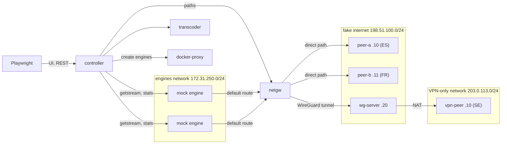
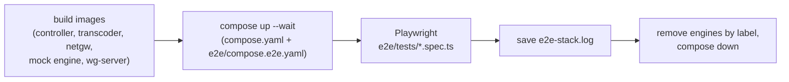
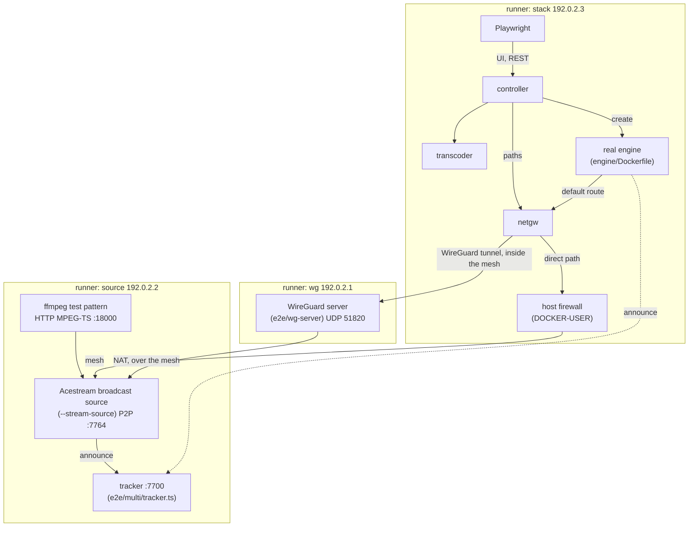
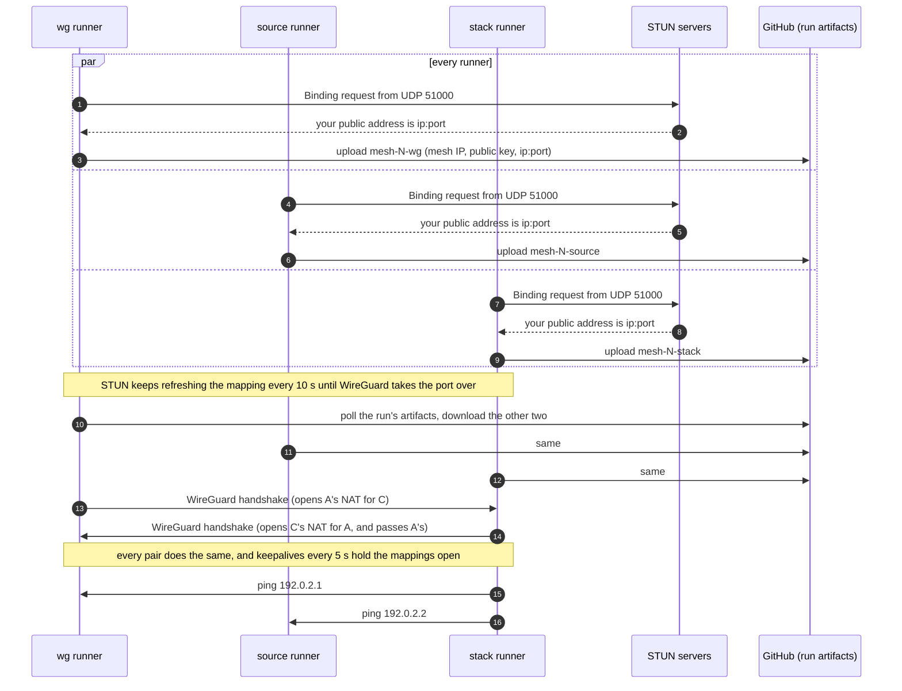
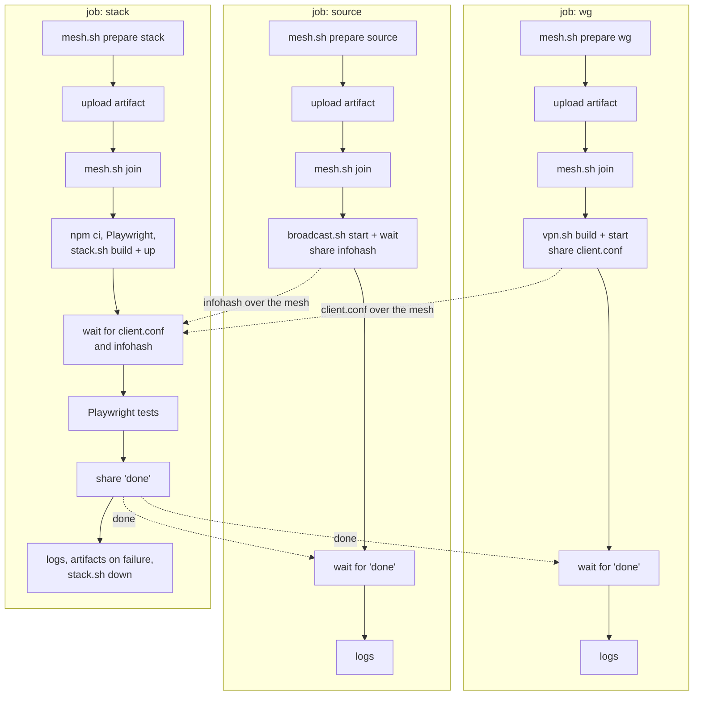
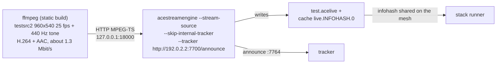
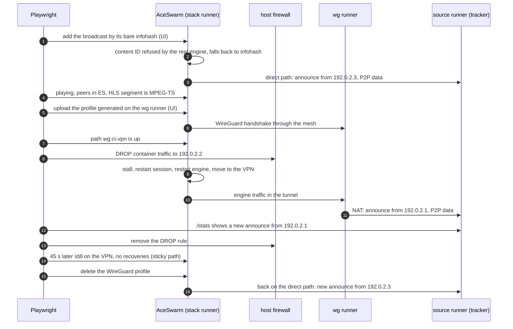

# End-to-end tests

There are two end-to-end suites. Both drive the real AceSwarm services (controller, transcoder, network gateway) through the UI and the REST API with Playwright.

| Suite             | Runs in                                             | Engines                | Machines                | Command      |
| ----------------- | --------------------------------------------------- | ---------------------- | ----------------------- | ------------ |
| Single machine    | CI job "End-to-end tests (mock engine)", or locally | mock engine            | 1                       | `e2e/run.sh` |
| Multiple machines | Workflow "E2E (multiple machines)"                  | real Acestream engines | 3 GitHub-hosted runners | CI only      |

The single-machine suite is fast and deterministic. It fakes the internet, the peers and the VPN on one Docker host, so it can test failure modes on purpose. The multi-machine suite checks the same paths with real engines, a real broadcast and a real WireGuard server, each on its own machine.

## Single-machine suite

### Single-machine architecture

Everything runs on one Docker host. The mock engine (`apps/mock-engine`) speaks the Acestream HTTP API, streams a generated test video, and pings fake peers over UDP through the stream's network path.



- **Fake peers** answer the mock engine's UDP pings on addresses Docker doesn't manage, because Docker 28+ drops packets routed to another network's container addresses.
- **The VPN-only peer** is only reachable through the throwaway WireGuard server (`e2e/wg-server`), so a stream that needs it has to move to the WireGuard path.
- **Fixed countries.** `GEOIP_STATIC` gives the fake peers countries.

### Mock behaviours

A mock stream's ID picks its behaviour by prefix. The last hex digit decides whether the mock treats it as a content ID (`0`–`7`) or an infohash (`8`–`f`).

| Prefix        | Behaviour                                     |
| ------------- | --------------------------------------------- |
| `0bad`        | plays, then stalls like a swarm that dries up |
| `beef`        | only plays while the VPN-only peer answers    |
| `ec0d`        | MPEG-2 video, which the transcoder re-encodes |
| `dead`        | never loads                                   |
| anything else | plays forever                                 |

### Run



```sh
e2e/run.sh            # build, start, test, stop
e2e/run.sh up         # only start the stack, then: npm run e2e
e2e/run.sh down
```

| Spec                 | Checks                                                                                                                                                    |
| -------------------- | --------------------------------------------------------------------------------------------------------------------------------------------------------- |
| `streams.spec.ts`    | adding streams from the UI, content ID or infohash detection, live stats, persistence across a controller restart, removal                                |
| `recovery.spec.ts`   | stall recovery, engine restarts that leave other streams alone, moving to the VPN path, fail closed after a gateway restart, profiles with hooks rejected |
| `isolation.spec.ts`  | engines can't reach the gateway, controller or transcoder APIs                                                                                            |
| `navigation.spec.ts` | arrow key navigation for TV remotes                                                                                                                       |

## Multi-machine suite

### Multi-machine architecture

Three runners each play one part. They reach each other over a private WireGuard network, the **mesh**, on TEST-NET-1 addresses (`192.0.2.0/24`). Nothing on the runners uses that range, and the gateway counts it as internet peers (its peer statistics skip private ranges).



- **The broadcast is real.** A real Acestream engine broadcasts a test pattern with a tone. Players on the stack runner find it by its infohash, through Acestream's own infohash lookup service, which returns the transport file with our tracker in it.
- **The VPN is real.** The WireGuard server writes a client profile pointing at its mesh address, and the tests upload it through the UI like a user would.
- **The direct path can be cut.** The tests add a `DROP` rule to the stack runner's `DOCKER-USER` chain for traffic from containers to the broadcast runner. It only affects forwarded traffic, so the WireGuard path and the tests' own requests keep working.
- **The tracker tells the paths apart.** An engine's announces come from `192.0.2.3` on the direct path and from `192.0.2.1` (the WireGuard server's runner, after NAT) on the VPN path. `GET /stats` on the tracker lists them.

| Address                          | Port         | What                                       |
| -------------------------------- | ------------ | ------------------------------------------ |
| every runner                     | UDP 51000    | mesh WireGuard (`wg-mesh`)                 |
| every runner                     | TCP 18999    | files shared on the mesh (`mesh.sh share`) |
| `192.0.2.1`                      | UDP 51820    | WireGuard server under test                |
| `192.0.2.2`                      | TCP+UDP 7764 | broadcast source (P2P)                     |
| `192.0.2.2`                      | TCP 7700     | tracker (`/announce`, `/stats`)            |
| `127.0.0.1` on the source runner | TCP 18000    | ffmpeg's HTTP MPEG-TS input                |
| `127.0.0.1` on the stack runner  | TCP 18080    | AceSwarm UI and API                        |

### Why a mesh, and how it forms

GitHub-hosted runners can't accept connections from the internet. Each one sits behind Azure's NAT, which only lets a packet in from an address and port the runner has already sent to. The runners have no IPv6 either. The NAT keeps one public port per local port, whatever the destination (endpoint-independent mapping). So if two runners know each other's public address and port, and both send at the same time, each one's first packets open its own NAT for the other. This is UDP hole punching.

The only missing piece is the public port, which the NAT picks at random. A runner can't see it locally. It learns it by sending a packet from that exact port to a STUN server, which answers with the address and port the packet came from. `e2e/multi/stun.ts` asks two public servers (Google and Cloudflare, no account needed). They always agreed in testing, which confirms the endpoint-independent mapping.



Artifact names include the run attempt (`mesh-N-…` above), so a re-run never picks up the addresses of runners from an earlier attempt.

The runners can't ping the internet either: Azure drops ICMP to and from outside addresses. The gateway's path probes ping `1.1.1.1` and `9.9.9.9` by default, so on a runner every path would stay down and, with the gateway failing closed, engines would reach nothing. `compose.multi.yaml` points `PROBE_TARGETS` at the WireGuard server's runner (`192.0.2.1`) instead, which answers both directly over the mesh and through the tunnel.

### Workflow

The three jobs start together and have no `needs`, so they run side by side. Once the mesh is up, the WireGuard server and the broadcast start in parallel on their own runners while the stack runner builds the images.



- **Sharing files.** Each runner serves `$RUNNER_TEMP/mesh/share` on its mesh address, port 18999. `mesh.sh share` publishes a file, and `mesh.sh wait-file` polls a peer for one.
- **Finishing.** The stack job shares `done` even when it fails, and the other two jobs stop waiting. If the stack runner disappears (cancelled or crashed), they stop after it hasn't answered pings for about two minutes.
- **Re-runs.** Use "Re-run all jobs". Re-running a single job can't work, because it would wait for runners that are gone.

### The broadcast



`e2e/multi/broadcast.sh` runs the parts. Two quirks of the 3.2.11 Linux engine shape it:

- **Its built-in tracker refuses every announce** ("Requested download is not authorized for use with this tracker"). The source skips it and announces to `e2e/multi/tracker.ts`, a minimal BitTorrent HTTP tracker, and players use that one too.
- **Its RSA key generation crashes with pycryptodome 4**, which the image ships: it relies on negative intermediate values. `PYCRYPTODOME_INTEGER=native` switches pycryptodome to its pure Python integers, which allow them.

The engine only reads HTTP sources (`--source -` for stdin isn't supported). ffmpeg's HTTP server serves one client and exits, so Docker restarts it for each reconnect.

### Tests

`e2e/multi/tests/real-engine.spec.ts` runs these in order, on one stream:



| Test                                  | Checks                                                                                                     |
| ------------------------------------- | ---------------------------------------------------------------------------------------------------------- |
| plays a broadcast from another runner | infohash detection with a real engine, playback, peer countries, tracker announce, HLS output              |
| connects to the WireGuard server      | a profile generated on another machine comes up through the mesh                                           |
| moves the stream to the VPN           | the recovery ladder with real engines, make-before-break path moves, traffic really leaves through the VPN |
| stays on the VPN                      | sticky path selection: no move back once the stream works                                                  |
| goes back to the direct path          | removing a profile moves its streams away right away                                                       |

The block in the third test only drops traffic to the broadcast runner, so the direct path keeps answering the gateway's pings and keeps its better probe score. That is what a connection that blocks Acestream peers looks like, and the stream still has to leave it.

### Debugging a failed run

- **Each job's last step prints its logs:** the mesh (`wg show`), the WireGuard server, or the broadcast (tracker, ffmpeg and engine logs).
- **The stack job also uploads** `e2e-multi-machine-results-<attempt>` on failure: the Playwright report, traces, videos and `e2e-stack.log` (every service and engine).
- **"no connectivity to …" in `mesh.sh join`** means hole punching failed. Check that `endpointIndependent` was `true` in each runner's "public UDP address" line. If GitHub ever changes its NAT, this suite needs a relay instead.
- **Tests time out waiting for playback** while the mesh is fine: check the tracker log in the source job. Each engine should announce and get the source as a peer.

### Files

| File                                       | Role                                                               |
| ------------------------------------------ | ------------------------------------------------------------------ |
| `.github/workflows/e2e-multi-machine.yml`  | the three jobs                                                     |
| `e2e/multi/mesh.sh`                        | STUN, artifacts, the WireGuard mesh, file sharing                  |
| `e2e/multi/stun.ts`                        | minimal STUN client with keepalive                                 |
| `e2e/multi/vpn.sh`                         | the WireGuard server under test                                    |
| `e2e/multi/broadcast.sh`                   | ffmpeg, the broadcast source and the tracker                       |
| `e2e/multi/tracker.ts`                     | minimal BitTorrent HTTP tracker with `/stats`                      |
| `e2e/multi/stack.sh`, `compose.multi.yaml` | AceSwarm with real engines                                         |
| `e2e/multi/playwright.config.ts`, `tests/` | the tests and their mesh helpers                                   |
| `e2e/multi/test/`                          | unit tests for the STUN client and the tracker (run by `npm test`) |
